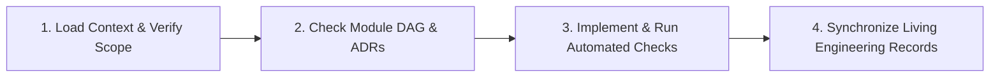

# MeterFlow Agent Engineering Handbook (`AGENT.md`)

## 1. Purpose

This handbook defines the mandatory engineering rules, architectural boundaries, and task workflow for every AI coding agent and human contributor working in **MeterFlow**. Following this document guarantees continuity across contributors and machines without context drift, duplicated business logic, or violated constraints.

---

## 2. Mandatory Context Loading Order

At the start of **every** task, read these files in exact order before inspecting or modifying source files:

1. [`AGENT.md`](./AGENT.md) — Mandatory workflow, guardrails, and verification gates.
2. [`MEMORY.md`](./MEMORY.md) — Confirmed project facts, locked technology decisions, and verified repository state.
3. [`PLAN.md`](./PLAN.md) — Current deliverable statuses (`Not Started` | `In Progress` | `Blocked` | `Completed`) and next actionable deliverable.
4. Task-relevant specifications:
   - [`docs/REQUIREMENTS_TRACEABILITY.md`](./docs/REQUIREMENTS_TRACEABILITY.md) — Individual mappings and measurable acceptance criteria for `FR1`–`FR10`, `QA1`–`QA5`, and `C1`–`C12`.
   - [`docs/architecture/MODULE_BOUNDARIES.md`](./docs/architecture/MODULE_BOUNDARIES.md) — Ten-module Spring Modulith DAG, `@NamedInterface("api")` contracts, and shared `RatingEngine` rules.
   - [`docs/architecture/DATA_MODEL.md`](./docs/architecture/DATA_MODEL.md) — PostgreSQL schema ownership, `NUMERIC(19,8)`/`NUMERIC(19,4)` rules, immutability triggers, and Flyway conventions.
   - [`docs/architecture/IMPLEMENTATION_CHECKLIST.md`](./docs/architecture/IMPLEMENTATION_CHECKLIST.md) — Granular deliverable verification items.
   - Governing records in [`docs/architecture/ADRs/`](./docs/architecture/ADRs/README.md) (`ADR-001` through `ADR-015`).

---

## 3. Non-Negotiable Technology & Repository Guardrails

### 3.1 Confirmed Technology Stack

| Capability | Mandatory Technology | Governing ADR |
| :--- | :--- | :--- |
| Runtime & Build | Java 25 (primary) / Java 21 LTS (`-Pjava21` fallback), Apache Maven | [ADR-001](./docs/architecture/ADRs/ADR-001-modular-monolith-spring-modulith.md) |
| Framework & Modularity | Spring Boot 4.x (`jakarta.*`), Spring Modulith 2.x (`10` acyclic modules) | [ADR-001](./docs/architecture/ADRs/ADR-001-modular-monolith-spring-modulith.md) |
| Databases | Shared **Supabase PostgreSQL** (`supabase`) + **Local PostgreSQL via Docker Compose** (`local`) | [ADR-002](./docs/architecture/ADRs/ADR-002-dual-postgresql-strategy-supabase-and-docker-compose.md) |
| Persistence & DDL | Spring Data JPA (`ddl-auto=validate`) + Flyway forward-only SQL migrations | [ADR-002](./docs/architecture/ADRs/ADR-002-dual-postgresql-strategy-supabase-and-docker-compose.md) |
| Caching | Bounded **Caffeine** caches (`planVersions`, `metricDefinitions`, `activeSubscriptionLookup`, `liveEstimates`, `dashboardSummaries`) | [ADR-003](./docs/architecture/ADRs/ADR-003-in-memory-caching-with-caffeine.md) |
| Internal Messaging | PostgreSQL-backed transactional outbox (`event_publication`, `completion-mode=UPDATE`, `republish-outstanding-events-on-restart=true`, `externalization.enabled=false`, `moments.enabled=false`; `OutboxRetryScheduler` + `SchedulingConfiguration`) | [ADR-004](./docs/architecture/ADRs/ADR-004-postgresql-transactional-outbox-messaging.md) |
| Batch Invoicing & Billing | `com.meterflow.billing` (`V6`): two-step `DRAFT` -> immutable `FINALIZED` invoices (DB immutability triggers), sequential `INV-*`/`CN-*` numbering, full line provenance via `RatingEngineFacade` + `UsageQueryFacade` (never Caffeine `liveEstimates`), deterministic `TaxCalculationStrategy` SPI + `tax_policies`, FIFO `SELECT ... FOR UPDATE` prepaid credits, immutable `credit_notes` with wallet refunds, cumulative-delta `billing_adjustments` via `LateUsageQueryFacade`, Spring Modulith outbox events (`InvoiceFinalizedEvent`, `CreditNoteIssuedEvent`), & Spring Batch 6 chunk jobs (`generateDraftInvoicesJob`, `finalizeInvoicesJob`, `chunk = 100`) | [ADR-005](./docs/architecture/ADRs/ADR-005-batch-billing-and-aggregation-with-spring-batch.md), [ADR-014](./docs/architecture/ADRs/ADR-014-billing-invoicing-tax-credits-and-batch-execution.md) |
| Web UI & Security | Spring MVC + Thymeleaf + Dual Spring Security 7 `SecurityFilterChain`s (DB-backed `DatabaseUserDetailsService`, `BCrypt(12)`, `CustomerAccessGuard`, one-time `METERFLOW_BOOTSTRAP_ADMIN_*` bootstrap) + SpringDoc OpenAPI `3.0.0` | [ADR-006](./docs/architecture/ADRs/ADR-006-server-rendered-ui-spring-mvc-thymeleaf-and-security.md) |
| Financial Kernel | Canonical immutable `Money` + `SupportedCurrency` (`BDT`, `USD`), zero implicit intermediate rounding, explicit `scale=8`/`4`/`2` (`HALF_UP` paisa/cent) | [ADR-010](./docs/architecture/ADRs/ADR-010-financial-precision-currency-and-rounding-policy.md) |
| Pricing & Catalogue | `com.meterflow.catalog` (`V3`): `5` aggregations, `5` filter ops, `6` mandatory OCP strategies (`FLAT_FEE`, `PER_UNIT`, `GRADUATED_TIERS`, `VOLUME_TIERS`, `PACKAGE`, `PER_SEAT`), immutable `PUBLISHED` versions (DB triggers), single-pass allowances, commitments, `RatingEngineFacade` (incl. `rateRecurringCharges`) & read-only simulation | [ADR-011](./docs/architecture/ADRs/ADR-011-pricing-tiers-packages-allowances-and-commitments.md) |
| Subscriptions & Proration | `com.meterflow.subscriptions` (`V4`): single-open-subscription policy, state transitions (`TRIALING`, `ACTIVE`, `PAUSED`, `PAST_DUE`, `CANCELLED`, `EXPIRED`), trials (`EXPIRE_ON_END` / `AUTO_CONVERT_TO_PAID`), calendar-clamped `BillingPeriod`, exact-seconds UTC proration (`EXACT_SECONDS_V1`, recurring vs. usage separation), scheduled period-end changes, pause/resume shift, & restart-safe `SubscriptionMaintenanceFacade` | [ADR-012](./docs/architecture/ADRs/ADR-012-subscription-workflow-billing-periods-and-proration.md) |
| Metering Engine | `com.meterflow.metering` (`V5`): single-round-trip `UNNEST` batch ingestion (up to `1,000` events, partial acceptance), DB-enforced `(customer_id, idempotency_key)` + `SHA-256` `payload_hash` (`200` duplicate / `409` conflict), `72h` late-event tracking (`usage_late_event_records` + `LateUsageEventRecordedEvent`), `5` aggregations & `5` filters via `MetricEvaluationSupport`, transactional hourly `usage_rollups` + reconciliation/recovery, `15s` after-commit Caffeine `liveEstimates`, & deduplicated `50/80/100%` threshold events | [ADR-013](./docs/architecture/ADRs/ADR-013-metering-ingestion-idempotency-rollups-and-freshness.md) |
| Payments & Dunning | `com.meterflow.payments` (`V7`): deterministic internal `MockPaymentGateway` (`SIMULATE_SUCCESS`/`SOFT_DECLINE`/`HARD_DECLINE`/`TIMEOUT`), DB-enforced single capture per invoice (`uq_captured_payment_per_invoice`), append-only payment/dunning audit triggers, exact Day 1/3/7 (`[24, 72, 168]`) retries & separate `suspension_at` timer (`0` 4th retry), PostgreSQL `FOR UPDATE SKIP LOCKED` worker, ACID billing/subscription settlement hooks (`SUSPENDED` + `CANCELLED`/`EXPIRED` protection), & Modulith outbox events | [ADR-007](./docs/architecture/ADRs/ADR-007-simulated-payment-processing-model.md), [ADR-015](./docs/architecture/ADRs/ADR-015-payments-mock-processor-dunning-retries-and-suspension.md) |
| Verification & CI | JUnit 5, Mockito, injectable `Clock`, Testcontainers PostgreSQL, `k6`, GitHub Actions | [ADR-008](./docs/architecture/ADRs/ADR-008-verification-strategy-testcontainers-modulith-k6-ci.md) |
| Outbound Webhooks | PostgreSQL `SKIP LOCKED` queue (`invoice.finalised`, `payment.failed`, `usage.threshold_reached`), dual-key `HMAC-SHA256`, backoff & replay | [ADR-009](./docs/architecture/ADRs/ADR-009-outbound-hmac-webhooks-backoff-and-replay.md) |

### 3.2 Strict Prohibitions

Never introduce any of the following without explicit stakeholder approval and a superseding ADR:

- **No Redis** (or external distributed caches).
- **No Kafka** (or RabbitMQ / external message brokers).
- **No paid cloud services or paid API keys**.
- **No real payment gateway integrations** (no Stripe, PayPal, Braintree, etc.).
- **No React or Next.js frontend** (or separate SPA build).
- **No unnecessary microservices or Kubernetes manifests**.
- **No duplicate business logic** — `catalog.api.RatingEngineFacade` must remain the sole implementation of charge/allowance/minimum-commitment math across batch invoices (`FR5`), late adjustments (`FR6`), live estimates (`FR7`), and simulations (`FR10`).
- **No redundant documentation or machine-specific links** — Use **portable relative Markdown links** (`./...`, `../...`) exclusively inside repository files; never commit local-filesystem URI links or workstation-specific directory paths.
- **No sequential development-tracking numbers or release-gate labels** — Organize all documentation, filenames, code comments, and commit messages strictly around **feature names, functional requirements (`FR1`–`FR10`), quality attributes (`QA1`–`QA5`), common requirements (`C1`–`C12`), architecture responsibilities, and deliverables**.
- **No secrets in Git** — Never store or log PATs, database passwords, or webhook signing secrets in repository files or `.git/config`.

---

## 4. Mandatory Task Execution Workflow

### 4.1 Pre-Task Checks
1. Inspect `git status` and `git diff` to preserve all existing workspace changes.
2. Identify the target deliverable in [`PLAN.md`](./PLAN.md) and exact requirement IDs in [`docs/REQUIREMENTS_TRACEABILITY.md`](./docs/REQUIREMENTS_TRACEABILITY.md).
3. Verify module ownership in [`docs/architecture/MODULE_BOUNDARIES.md`](./docs/architecture/MODULE_BOUNDARIES.md) (`shared`, `identity`, `catalog`, `subscriptions`, `metering`, `billing`, `payments`, `webhooks`, `notifications`, `portal`).

### 4.2 Implementation Invariants (Future Coding Tasks)
1. **Financial Exactness (`QA2`, `ADR-010`)**: Use `com.meterflow.shared.Money` and `SupportedCurrency` (`BDT`, `USD`) backed exclusively by `BigDecimal` (no implicit intermediate rounding; explicit `roundToIntermediate()` `scale=8`, `roundToPersisted()` `scale=4`, `roundToPayable()` `scale=2` paisa/cent `HALF_UP`); prohibit `double`/`float`; preserve immutability of `PUBLISHED` `plan_versions` (`FR10`) and `FINALIZED` invoices (`FR5`).
2. **Customer Isolation & Secure Provisioning (`C6`, `QA4`, `ADR-006`)**: Enforce customer-scoped access via `com.meterflow.identity.api.CustomerAccessGuard` (never trusting request-supplied `customerId`); never hardcode credentials—for one-time local initial admin provisioning set `METERFLOW_BOOTSTRAP_ADMIN_ENABLED=true`, `METERFLOW_BOOTSTRAP_ADMIN_EMAIL`, and `METERFLOW_BOOTSTRAP_ADMIN_PASSWORD` (`>= 12` chars) via untracked environment variables, start once, then disable.
2. **Cache Freshness (`FR7`, `QA1`)**: Store only immutable `record` DTOs in Caffeine; trigger mutable-source cache evictions via after-commit callbacks; keep `liveEstimates` TTL at `15s` backed by synchronous hourly `usage_rollups` (`<= 15.65s` worst-case freshness `<< 60s`), and never read Caffeine `liveEstimates` for authoritative invoicing (`FR5`, `FR6`).
3. **Database & Load Safety (`C5`, `C10`)**: Express schema changes exclusively via forward-only Flyway migrations; connect Flyway to Supabase via Session Mode port `5432`; run destructive tests on Testcontainers and **all `k6` load tests strictly against Local Docker Compose PostgreSQL**.

### 4.3 Verification Gates
- `./mvnw test` passes (unit matrix + `ApplicationModules.verify()`).
- `./mvnw verify` passes (Testcontainers PostgreSQL migrations, Spring Batch, outbox, dunning, webhook HMAC/backoff, and security tests).
- `docker compose config -q` and `docker compose --profile full up --build -d` boot healthy `meterflow-postgres` and `meterflow-app` containers within `512m` memory caps (`SERVER_PORT` override supported if host `8080` is reserved).
- All internal Markdown links are relative and resolve cleanly across platforms.

### 4.4 Mandatory Post-Task Record Synchronization
Before concluding any task, update all affected records truthfully (never fabricating completed features or test results):
- [`PLAN.md`](./PLAN.md), [`MEMORY.md`](./MEMORY.md), [`CHANGELOG.md`](./CHANGELOG.md), [`docs/WORK_LOG.md`](./docs/WORK_LOG.md), [`docs/AI_USAGE_LOG.md`](./docs/AI_USAGE_LOG.md), [`docs/REQUIREMENTS_TRACEABILITY.md`](./docs/REQUIREMENTS_TRACEABILITY.md), [`docs/architecture/IMPLEMENTATION_CHECKLIST.md`](./docs/architecture/IMPLEMENTATION_CHECKLIST.md), and [`docs/architecture/ADRs/`](./docs/architecture/ADRs/README.md) if architectural decisions evolve.
