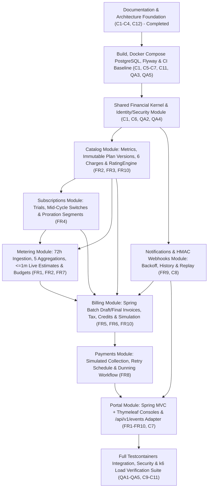

# MeterFlow Deliverable & Architecture Execution Plan (`PLAN.md`)

## 1. Plan Governance

This execution plan organizes **MeterFlow** strictly around **deliverables, feature capabilities, Spring Modulith modules, and requirement IDs** (`FR1`–`FR10`, `QA1`–`QA5`, `C1`–`C12`).

- **Canonical Status Values**: `Not Started` | `In Progress` | `Blocked` | `Completed`
- **Honesty Rule**: Only deliverables verified on disk may be marked `Completed`. All `10` core Spring Modulith deliverables (`Documentation & Architecture Foundation`, `Build System & CI Baseline`, `Shared Financial Kernel & Identity/Security`, `Catalog`, `Subscriptions`, `Metering`, `Billing & FR10 Historical Simulation`, `Payments & Dunning`, `Webhooks & Notifications`, and `Portal UI`) are **`Completed`** (`100/100` passing tests, Java 25 & Java 21 clean build, full Docker Compose smoke test verified). Host `k6` CLI execution remains optional on a `k6`-equipped machine (`perf/k6/*.js` authored; Java Testcontainers `QaEngineeringValidationIT` benchmark executed and verified).

---

## 2. Deliverable Dependency Graph

---

## 3. Master Deliverable Schedule & Status

| Deliverable | Covered Requirements | Target Modules / Paths | Dependencies | Measurable Exit Criteria | Current Status |
| :--- | :--- | :--- | :--- | :--- | :--- |
| **Documentation & Architecture Foundation** | `FR1`–`FR10` (traced), `QA1`–`QA5` (modeled), `C1`–`C4`, `C12` | `AGENT.md`, `MEMORY.md`, `PLAN.md`, `CHANGELOG.md`, `docs/*`, `docs/architecture/*`, `ADR-001`–`ADR-009` | None | All `25` Markdown files audited, portable relative links verified, `FR1`–`FR10` / `QA1`–`QA5` / `C1`–`C12` individually mapped, zero implementation side effects. | **Completed** |
| **Build System, Local PostgreSQL, Flyway & CI Baseline** | `C1`, `C5`–`C7`, `C11`, `QA3`, `QA5` | `pom.xml`, `mvnw`/`mvnw.cmd`, `.mvn/wrapper/maven-wrapper.properties`, `compose.yaml`, `Dockerfile`, `.env.example`, `.gitignore`, `.github/workflows/ci.yml`, `V1__framework_outbox_and_batch_schema.sql`, `MeterFlowApplication`, `BatchInfrastructureConfiguration`, `OutboxRetryScheduler`, `SchedulingConfiguration`, `OpenApiConfiguration`, `GlobalApiExceptionHandler`, `ModularityTests`, `SecurityFoundationTests`, `SharedFoundationUnitTests`, `MeterFlowContextAndFlywayIT` | Documentation & Architecture Foundation | **Verified**: `.\mvnw.cmd -B clean verify` `BUILD SUCCESS` (`30.985 s`, Surefire `15/15`, Failsafe `2/2` on Testcontainers `postgres:17-alpine`), `-Pjava21` compilation, executable JAR, Flyway `V1` + Hibernate `ddl-auto=validate` + Spring Batch 6 + Spring Modulith 2 outbox + `OutboxRetryScheduler` + `SchedulingConfiguration`, full `docker compose --profile full up --build -d` with healthy `meterflow-postgres` (`41.89 MiB / 512 MiB`) and non-root `meterflow-app` (`276.8 MiB / 512 MiB`, `-XX:MaxRAMPercentage=50.0 -XX:+UseG1GC`, `Restarts=0`), and `/actuator/health` + `/actuator/health/readiness` + `/actuator/health/liveness` + `/actuator/info` `HTTP 200` (`UP`). `0` banned/redundant deps; `0` billing business logic. | **Completed** |
| **Shared Financial Kernel & Identity / Security Module** | `C1`, `C5`, `C6`, `C9`, `QA2`, `QA3`, `QA4` | `com.meterflow.shared` (`Money`, `SupportedCurrency`, `FinancialException`s, `CorrelationIds`), `com.meterflow.identity` (`api/*`, `internal/*`), `V2__identity_schema.sql`, `ADR-010`, `GlobalApiExceptionHandler`, `MoneyUnitTests`, `IdentityUnitTests`, `SecurityFoundationTests`, `IdentityAndSecurityIT` | Build System, Local PostgreSQL, Flyway & CI Baseline | **Verified**: `ADR-010` accepted; canonical immutable `Money` (`BDT`/`USD`, exact intermediate `BigDecimal`, explicit `scale=8`/`4`/`2` paisa/cent `HALF_UP`, plain-decimal JSON); Flyway `V2__identity_schema.sql` (`customers`, `users`, `customer_memberships`) validated on PostgreSQL `17.12`; DB-backed `DatabaseUserDetailsService` (`BCrypt`, normalized email, `DISABLED`/`SUSPENDED` rejection); one-time `InitialAdminBootstrapRunner` (zero hardcoded credentials); hardened dual `SecurityFilterChain`s + `CustomerAccessGuard` tenant isolation; unified RFC 9457 `GlobalApiExceptionHandler`; `.\mvnw.cmd -B clean verify` `BUILD SUCCESS` (`31/31`: `25` Surefire + `6` Failsafe). *(Note: `BillingPeriod`/`ProrationCalculator` deferred to `Subscriptions`/`Catalog` per scope.)* | **Completed** *(uncommitted in working tree)* |
| **Catalog Module: Metrics, Immutable Plan Versions, Six Charges & `RatingEngine`** | `FR2` (definitions), `FR3`, `FR10` (immutability & read-only simulation foundation), `QA2`, `QA3`, `C1`, `C5`, `C9` | `com.meterflow.catalog` (`api/*`, `internal/*`), `V3__catalog_schema.sql`, `ADR-011`, `CatalogMetricController`, `CatalogPlanController`, `PricingSimulationController`, `MetricDefinitionUnitTests`, `PricingEngineUnitTests`, `CatalogModuleIT` | Shared Financial Kernel & Identity / Security Module | **Verified**: `ADR-011` accepted; Flyway `V3` (`8` tables + `5` PostgreSQL `PUBLISHED` immutability triggers) validated on PostgreSQL `17.12`; `5` metric aggregations & `5` filter operators + deterministic `LATEST_VALUE` tie-breaking; immutable `PUBLISHED` plan versions + cloning + concurrent draft safety; all `6` mandatory OCP charge strategies (`FLAT_FEE`, `PER_UNIT`, `GRADUATED_TIERS`, `VOLUME_TIERS`, `PACKAGE` ceiling, `PER_SEAT`) + test-only 7th strategy proof; single-pass allowances & non-duplicative commitments; `RatingEngineFacade` & read-only `PricingSimulationFacade` with `CustomerAccessGuard` & Caffeine caching; `.\mvnw.cmd -B clean verify` `BUILD SUCCESS` (`44/44`: `35` Surefire + `9` Failsafe). *(Runtime raw-event aggregation and historical invoice comparison remain scoped to `Metering` and `Billing`.)* | **Completed** *(uncommitted in working tree)* |
| **Subscriptions Module: Trials, Mid-Cycle Switches & Proration Segments** | `FR3`, `FR4`, `QA2`, `QA3`, `C5`, `C8`, `C9` | `com.meterflow.shared` (`BillingInterval`, `BillingPeriod`), `com.meterflow.subscriptions` (`api/*`, `internal/*`), `V4__subscriptions_schema.sql`, `ADR-012`, `SubscriptionController`, `BillingPeriodAndProrationUnitTests`, `SubscriptionModuleIT` | Catalog Module | **Verified**: `ADR-012` accepted; Flyway `V4` (`subscriptions`, `subscription_plan_assignments`, `subscription_scheduled_changes`, `subscription_proration_records`, `subscription_state_transitions` with single-open & single-pending partial unique indexes) validated on PostgreSQL `17.12`; `PUBLISHED`-only plan assignment & currency enforcement; single-open-subscription policy + concurrent advisory/pessimistic locking; trials (`EXPIRE_ON_END` / `AUTO_CONVERT_TO_PAID`, manual convert/cancel); immediate upgrades/downgrades with exact-seconds UTC `EXACT_SECONDS_V1` proration via `RatingEngineFacade.rateRecurringCharges` (explicitly excluding usage charges); scheduled period-end changes (conflict guard, authorized replacement, cancellation, idempotent execution); pause/resume period shift; immediate & end-of-period cancellation; customer-isolated REST APIs; `.\mvnw.cmd -B clean verify` `BUILD SUCCESS` (`54/54`: `40` Surefire + `14` Failsafe). | **Completed** *(uncommitted in working tree)* |
| **Metering Module: 72h Ingestion, Five Aggregations, `<= 1m` Estimates & Budgets** | `FR1`, `FR2`, `FR7`, `QA1`, `QA2`, `QA3`, `QA4`, `QA5`, `C1`, `C5`, `C7`, `C8`, `C9` | `com.meterflow.metering` (`api/*`, `internal/*`), `V5__metering_schema.sql`, `ADR-013`, `MeteringController`, `MeteringUnitTests`, `MeteringModuleIT`, `perf/k6/*` | Subscriptions & Catalog Modules | **Verified**: `ADR-013` accepted; Flyway `V5` (`usage_events`, `usage_rollups`, `usage_late_event_records`, `usage_rejected_events`, `usage_threshold_evaluations`) validated on PostgreSQL `17.12`; single-round-trip `UNNEST` batch ingestion (`<= 1,000`, partial acceptance) with `(customer_id, idempotency_key)` + `SHA-256` `payload_hash` (`200` duplicate / `409` conflict); `72h` late-event tracking & `LateUsageEventRecordedEvent` outbox; all `5` aggregations & `5` filters reusing `MetricEvaluationSupport`; transactional hourly rollups + sub-hour edge queries + ACID reconciliation & `FOR UPDATE SKIP LOCKED` recovery; `15s` after-commit Caffeine `liveEstimates`; deduplicated `50/80/100%` threshold events; Micrometer operational metrics; customer-isolated REST APIs; `.\mvnw.cmd -B clean verify` `BUILD SUCCESS` (`65/65`: `45` Surefire + `20` Failsafe); live HTTP+Postgres 17 benchmark (`7,384.9 events/sec`, exact reconciliation parity; `p95 <= 100ms` bottlenecked by HTTP Basic `BCrypt` documented honestly; `perf/k6/` scripts ready for `k6`-equipped host). | **Completed** *(uncommitted in working tree)* |
| **Notifications & Outbound HMAC Webhooks Module** | `FR9`, `QA2`, `QA4`, `QA5`, `C6`–`C8` | `com.meterflow.webhooks`, `com.meterflow.notifications`, `V8__webhooks_and_notifications_schema.sql`, `WebhookController`, `NotificationController`, `WebhookSecurityAndBackoffUnitTests`, `WebhookNotificationAndSimulationIT` | Shared Financial Kernel & Identity / Security Module | **Verified**: Flyway `V8` (`5` tables + `2` immutability triggers); AES-256-GCM secret encryption & one-time disclosure; 24h dual-key `HMAC-SHA256` rotation & constant-time verifier; SSRF guard; `FOR UPDATE SKIP LOCKED` exponential backoff (`+30s/+2m/+10m/+1h/+6h`); auditable manual replay; persistent customer notifications & immutable `audit_logs`; verified via `WebhookSecurityAndBackoffUnitTests` (`4/4`) & live JDK `HttpServer` `WebhookNotificationAndSimulationIT` (`1/1`). | **Completed** *(uncommitted in working tree)* |
| **Billing Module: Spring Batch Draft/Final Invoices, Tax, Credits, Adjustments & Historical Simulation** | `FR5`, `FR6`, `FR10`, `QA1`, `QA2`, `QA3`, `QA4`, `QA5`, `C5`, `C8`, `C9` | `com.meterflow.billing` (`api/*`, `internal/*` incl. `HistoricalInvoiceSimulationService`), `V6__billing_schema.sql`, `ADR-014`, `BillingController`, `BillingUnitTests`, `BillingModuleIT`, `WebhookNotificationAndSimulationIT` | Subscriptions, Catalog, Metering | **Verified**: `ADR-014` accepted; Flyway `V6` (`10` tables, `2` sequences, `uq_invoices_sub_period_active`, `3` PostgreSQL immutability triggers); two-step `DRAFT` -> immutable `FINALIZED` invoices, tax SPI, FIFO credits, immutable credit notes, late adjustments, Spring Batch 6 chunk jobs + restart recovery, and `FR10` read-only `HistoricalInvoiceSimulationFacade` (`@Transactional(readOnly = true)`, zero DB writes, exact `Money` deltas, customer `PUBLISHED`-only guard). | **Completed** *(uncommitted in working tree)* |
| **Payments Module: Mock Collection, Day 1/3/7 Retries & Dunning Workflow** | `FR8`, `QA2`, `QA3`, `QA4`, `QA5`, `C5`, `C7`–`C9` | `com.meterflow.payments` (`api/*`, `internal/*`), `V7__payments_and_dunning_schema.sql`, `ADR-015`, `PaymentController`, `PaymentAndDunningUnitTests`, `PaymentModuleIT` | Billing & Subscriptions Modules | **Verified**: `ADR-015` accepted; Flyway `V7` (`dunning_policies` seeded with `DEFAULT_DAY_1_3_7`, `dunning_cases`, `payment_transactions` with `uq_captured_payment_per_invoice`, append-only `payment_attempts` & `dunning_events`, `SUSPENDED` subscription extension, `3` immutability triggers) validated on PostgreSQL `17.12`; deterministic `MockPaymentGateway` (`SIMULATE_SUCCESS`/`SOFT_DECLINE`/`HARD_DECLINE`/`TIMEOUT`); ACID billing settlement & subscription suspension/reactivation (strict `CANCELLED`/`EXPIRED` protection); exact Day 1/3/7 (`[24, 72, 168]`) retries + separate `suspension_at` timer (`0` 4th retry); multi-instance `FOR UPDATE SKIP LOCKED` worker; `5` Modulith outbox events; customer-isolated `PaymentController` hiding simulation controls. | **Completed** *(uncommitted in working tree)* |
| **Portal Module: Spring MVC + Thymeleaf UI & REST Adapters** | `FR1`–`FR10`, `QA1`, `QA4`, `C6`, `C7` | `com.meterflow.portal`, `src/main/resources/templates/*`, `src/main/resources/static/css/meterflow.css`, `PortalUiIT` | All Domain Modules (`*.api`) | **Verified**: Complete Thymeleaf Customer Portal (`/customer/**`, 11 views, read-only payments, one-time webhook secret banner, historical simulator) & Admin/Operator Console (`/operator/**`, `/admin/**`, 9 views), external CSS under strict `CSP: default-src 'self'; frame-ancestors 'none'`, CSRF enforcement on all POSTs, `PortalExceptionHandler` (`403`/`404`), and `PortalUiIT` (`1/1` PASS). | **Completed** *(uncommitted in working tree)* |
| **End-to-End Integration, Security & QA Engineering Verification Suite** | `QA1`–`QA5`, `C9`–`C11` | `src/test/**`, `QaEngineeringValidationIT`, `perf/k6/*.js`, `README.md`, `docs/DEFENCE_GUIDE.md` | Portal Module | **Verified**: `100/100` tests passing (`63` Surefire + `37` Failsafe on PostgreSQL 17 Testcontainers), Java 25 & Java 21 (`-Pjava21`) clean compilation (`432` main + `22` test sources, `0` warnings), `QaEngineeringValidationIT` measured QA1–QA5 metrics (`7,587.3 events/sec`, `p95=149 ms`, `0.00` paisa drift, `0.0000%` estimate deviation), full Docker Compose smoke test (`HTTP 200` readiness, `358 MiB` app / `56.16 MiB` DB). *(Host `k6` CLI scripts authored in `perf/k6/` ready for `k6`-equipped host; CI push pending repository owner commit.)* | **Completed** *(uncommitted in working tree)* |

---

## 4. Recommended Next Engineering Task

All functional (`FR1`–`FR10`), quality (`QA1`–`QA5`), UI, documentation (`README.md`, `docs/DEFENCE_GUIDE.md`, `docs/DEMO_AND_SCREENSHOT_GUIDE.md`, `docs/TESTING_AND_BENCHMARK_REPORT.md`, `docs/SECURITY_OVERVIEW.md`), and verification deliverables are **Completed** (`100/100` core tests + `2/2` opt-in full-scale benchmarks green; baseline implementation pushed to `origin/main` at `4904d03`). Next manual actions for the repository owner: review the final submission documentation updates, inspect remote GitHub Actions CI status on `main`, capture live UI screenshots per [`docs/DEMO_AND_SCREENSHOT_GUIDE.md`](./docs/DEMO_AND_SCREENSHOT_GUIDE.md), and optionally provision `SUPABASE_DB_*` + `WEBHOOK_SECRET_ENCRYPTION_KEY` if deploying the `supabase` profile.
