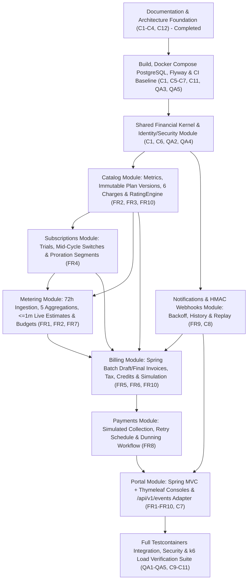

# MeterFlow Deliverable & Architecture Execution Plan (`PLAN.md`)

## 1. Plan Governance

This execution plan organizes **MeterFlow** strictly around **deliverables, feature capabilities, Spring Modulith modules, and requirement IDs** (`FR1`–`FR10`, `QA1`–`QA5`, `C1`–`C12`).

- **Canonical Status Values**: `Not Started` | `In Progress` | `Blocked` | `Completed`
- **Honesty Rule**: Only deliverables verified on disk may be marked `Completed`. Currently, **`Documentation & Architecture Foundation`** and **`Build System, Local PostgreSQL, Flyway & CI Baseline`** are `Completed`; all `FR1`–`FR10` domain business-logic deliverables remain `Not Started`.

---

## 2. Deliverable Dependency Graph

---

## 3. Master Deliverable Schedule & Status

| Deliverable | Covered Requirements | Target Modules / Paths | Dependencies | Measurable Exit Criteria | Current Status |
| :--- | :--- | :--- | :--- | :--- | :--- |
| **Documentation & Architecture Foundation** | `FR1`–`FR10` (traced), `QA1`–`QA5` (modeled), `C1`–`C4`, `C12` | `AGENT.md`, `MEMORY.md`, `PLAN.md`, `CHANGELOG.md`, `docs/*`, `docs/architecture/*`, `ADR-001`–`ADR-009` | None | All `25` Markdown files audited, portable relative links verified, `FR1`–`FR10` / `QA1`–`QA5` / `C1`–`C12` individually mapped, zero implementation side effects. | **Completed** |
| **Build System, Local PostgreSQL, Flyway & CI Baseline** | `C1`, `C5`–`C7`, `C11`, `QA3`, `QA5` | `pom.xml`, `mvnw`/`mvnw.cmd`, `.mvn/wrapper/maven-wrapper.properties`, `compose.yaml`, `Dockerfile`, `.env.example`, `.gitignore`, `.github/workflows/ci.yml`, `V1__framework_outbox_and_batch_schema.sql`, `MeterFlowApplication`, `BatchInfrastructureConfiguration`, `OutboxRetryScheduler`, `SchedulingConfiguration`, `OpenApiConfiguration`, `GlobalApiExceptionHandler`, `ModularityTests`, `SecurityFoundationTests`, `SharedFoundationUnitTests`, `MeterFlowContextAndFlywayIT` | Documentation & Architecture Foundation | **Verified**: `.\mvnw.cmd -B clean verify` `BUILD SUCCESS` (`30.985 s`, Surefire `15/15`, Failsafe `2/2` on Testcontainers `postgres:17-alpine`), `-Pjava21` compilation, executable JAR, Flyway `V1` + Hibernate `ddl-auto=validate` + Spring Batch 6 + Spring Modulith 2 outbox + `OutboxRetryScheduler` + `SchedulingConfiguration`, full `docker compose --profile full up --build -d` with healthy `meterflow-postgres` (`41.89 MiB / 512 MiB`) and non-root `meterflow-app` (`276.8 MiB / 512 MiB`, `-XX:MaxRAMPercentage=50.0 -XX:+UseG1GC`, `Restarts=0`), and `/actuator/health` + `/actuator/health/readiness` + `/actuator/health/liveness` + `/actuator/info` `HTTP 200` (`UP`). `0` banned/redundant deps; `0` billing business logic. | **Completed** |
| **Shared Financial Kernel & Identity / Security Module** | `C1`, `C6`, `QA2`, `QA4` | `com.meterflow.shared`, `com.meterflow.identity`, `V2__identity_schema.sql` | Build System, Local PostgreSQL, Flyway & CI Baseline | `Money` (`NUMERIC(19,8)` intermediate / `NUMERIC(19,4)` `HALF_UP` line math), `ProrationCalculator`, injectable `Clock`, `BCrypt`, and dual Spring Security 7 chains (`RBAC`, `CSRF`, stateless API) pass unit & MockMvc tests. | **Not Started** |
| **Catalog Module: Metrics, Immutable Plan Versions, Six Charges & `RatingEngine`** | `FR2`, `FR3`, `FR10`, `QA1`–`QA3`, `C1`, `C7` | `com.meterflow.catalog`, `V3__catalog_metrics_and_plans_schema.sql` | Shared Financial Kernel & Identity / Security Module | Metric definitions + configurable filters (`FR2`), immutable `PUBLISHED` `plan_versions` (`FR10`) cached in Caffeine `planVersions`, and the Strategy/Composite `RatingEngine` supporting all `6` mandatory charge types (`FLAT_FEE`, `PER_UNIT`, `GRADUATED_TIERS`, `VOLUME_TIERS`, `PACKAGE`, `PER_SEAT`), free allowances, minimum commitments, and OCP extensibility (`FR3`) pass unit & DB immutability tests. | **Not Started** |
| **Subscriptions Module: Trials, Mid-Cycle Switches & Proration Segments** | `FR3`, `FR4`, `QA2`, `QA3`, `C5`, `C8` | `com.meterflow.subscriptions`, `V4__customers_and_subscriptions_schema.sql` | Catalog Module | Trial periods, state transitions (`PENDING`..`EXPIRED`), `seat_quantity` (`PER_SEAT`), and mid-cycle plan/seat switches generating exact `NUMERIC(19,8)` prorated `subscription_segments` pass `Clock`-stepped Testcontainers tests. | **Not Started** |
| **Metering Module: 72h Ingestion, Five Aggregations, `<= 1m` Estimates & Budgets** | `FR1`, `FR2`, `FR7`, `QA1`, `QA2`, `C7`, `C8` | `com.meterflow.metering`, `V5__metering_rollups_and_budgets_schema.sql` | Subscriptions & Catalog Modules | `(customer_id, idempotency_key)` + `payload_hash` (`200` duplicate / `409` conflict), `1,000`-event batch, `72h` late-event routing (`FR1`), all `5` aggregations with `JSONB` filters (`FR2`), synchronous `bucket_hour` `usage_rollups` + `15s` Caffeine `liveEstimates` (`<= 15.65s` worst-case freshness), and single-fire `usage.threshold_reached` alerts (`FR7`) pass concurrency and `Clock` tests. | **Not Started** |
| **Notifications & Outbound HMAC Webhooks Module** | `FR9`, `QA2`, `QA4`, `QA5`, `C6`–`C8` | `com.meterflow.webhooks`, `com.meterflow.notifications`, `V8__webhooks_notifications_and_audit_schema.sql` | Shared Financial Kernel & Identity / Security Module | Mandatory `invoice.finalised`, `payment.failed`, and `usage.threshold_reached` deliveries via PostgreSQL `SKIP LOCKED`, dual-key `HMAC-SHA256` signing & secret rotation, SSRF guard, exponential backoff (`30s`..`6h`), persistent attempt logs, RBAC-scoped replay (`FR9`), and in-app/audit logs pass local HTTP receiver tests. | **Not Started** |
| **Billing Module: Spring Batch Draft/Final Invoices, Tax, Credits & Simulation** | `FR5`, `FR6`, `FR10`, `QA1`, `QA2`, `C5`, `C8`, `C9` | `com.meterflow.billing`, `V6__billing_credits_and_adjustments_schema.sql` | Subscriptions, Catalog, Metering, Notifications/Webhooks | Two-step Spring Batch jobs (`generateDraftInvoicesJob`, `finalizeInvoicesJob`), `FINALIZED` immutability, tax, line-level provenance (`FR5`), FIFO credit grants, credit notes, cumulative-delta `72h` late adjustments (`FR6`), and `@Transactional(readOnly = true)` invoice simulation (`FR10`) pass `SpringBatchTest` and reconciliation suites. | **Not Started** |
| **Payments Module: Simulated Collection, Retry Schedule & Dunning Workflow** | `FR8`, `QA2`, `QA5`, `C7`–`C9` | `com.meterflow.payments`, `V7__payments_ledger_and_dunning_schema.sql` | Billing Module | Deterministic `SimulatedPaymentService`, double-capture immunity, balanced `ledger_entries`, exact **Day 1 / Day 3 / Day 7 (`[24, 72, 168]`)** retries, separate `suspension_at` transition timer (`0` 4th retry), customer notifications at every transition, and recovery pass `Clock`-stepped Testcontainers tests. | **Not Started** |
| **Portal Module: Spring MVC + Thymeleaf UI & Ingestion REST Adapter** | `FR1`–`FR10`, `QA1`, `QA4`, `C6`, `C7` | `com.meterflow.portal`, `src/main/resources/templates/*` | All Domain Modules (`*.api`) | `/api/v1/events` & `/api/v1/events/batch` JSON endpoints plus Thymeleaf Admin, Operator, and Customer views (metrics, plan versions, simulation studio, live estimates, budgets, printable invoices/credit notes, simulated payments, dunning & webhook replay) pass MockMvc RBAC/CSRF/IDOR tests. | **Not Started** |
| **End-to-End Integration, Security & `k6` Load Suite** | `QA1`–`QA5`, `C9`–`C11` | `src/test/**`, `perf/k6/*.js` | Portal Module | Full end-to-end Testcontainers journey, `k6` load benchmarks (`p95 <= 200 ms` ingestion, `<= 1m` freshness, `50`-VU idempotency) against Local Docker Compose PostgreSQL, and green GitHub Actions CI. | **Not Started** |

---

## 4. Recommended Next Engineering Task

**Next Implementation Deliverable**: **`Shared Financial Kernel & Identity / Security Module`** (`C1`, `C6`, `QA2`, `QA4`) — add `V2__identity_schema.sql` (`users`, `user_roles`), replace the local-only bootstrap `InMemoryUserDetailsManager` with JPA-backed `UserDetailsService` and `IdentityQueryFacade`, and implement `BillingPeriod` and `ProrationCalculator` (`NUMERIC(19,8)` intermediate / `NUMERIC(19,4)` `HALF_UP` line rounding) in `com.meterflow.shared`.
