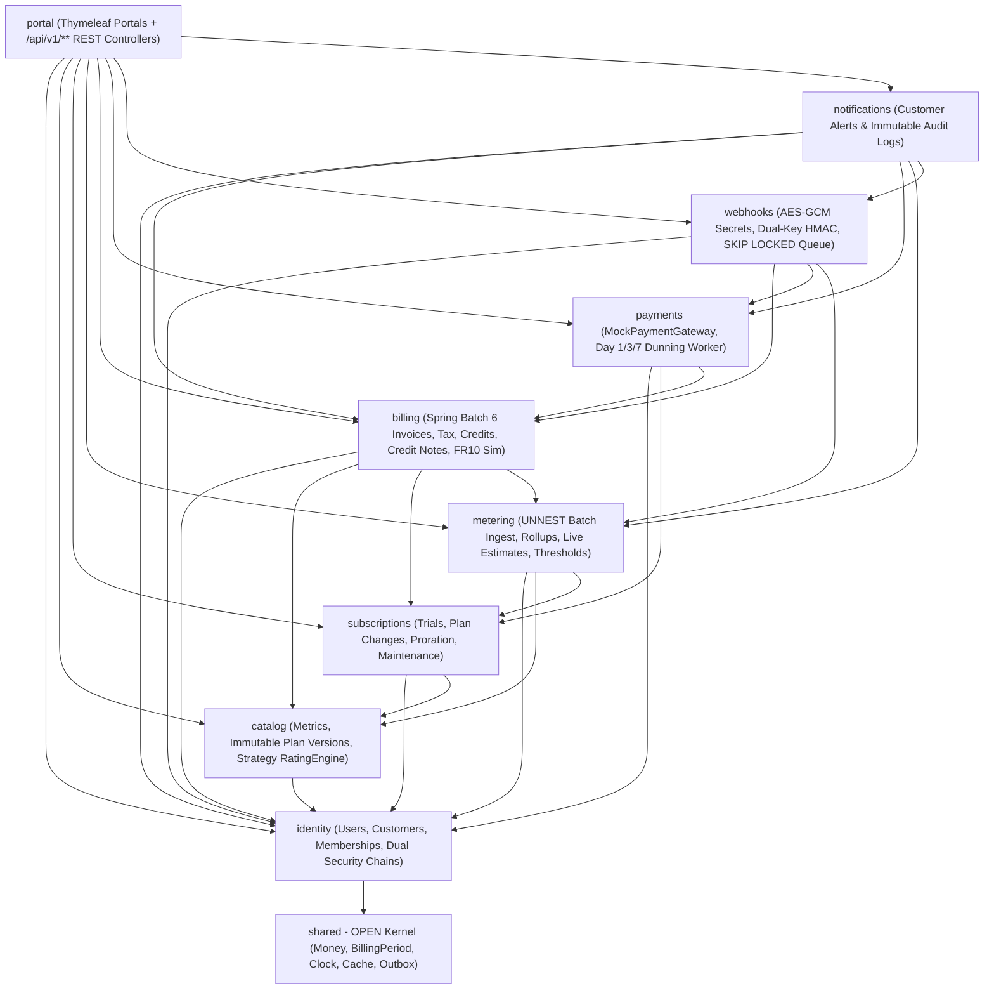
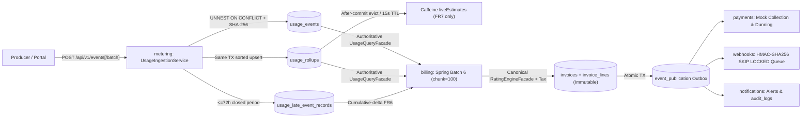

# MeterFlow

**Usage-Based Metering, Subscription Rating, Invoicing, Dunning & Webhook Platform**

MeterFlow is a self-contained, financially rigorous usage-based billing platform engineered as a **Spring Modulith** modular monolith on **Java 25** (with **Java 21 LTS** compatibility via `-Pjava21`), **Spring Boot 4.0.5**, **PostgreSQL 17**, **Flyway**, **Spring Batch 6**, **Spring Security 7**, **Caffeine**, and **Thymeleaf**.

---

## Table of Contents

1. [Project Overview](#project-overview)
2. [Key Capabilities](#key-capabilities)
3. [Architecture](#architecture)
4. [Technology Stack](#technology-stack)
5. [Prerequisites](#prerequisites)
6. [Installation & Setup](#installation--setup)
7. [Environment Configuration](#environment-configuration)
8. [Running the Application](#running-the-application)
9. [Database & Migrations](#database--migrations)
10. [Application Usage](#application-usage)
11. [API Documentation](#api-documentation)
12. [Security](#security)
13. [Testing](#testing)
14. [Performance & Quality Results](#performance--quality-results)
15. [Limitations](#limitations)
16. [Future Improvements](#future-improvements)
17. [Repository Structure](#repository-structure)
18. [CI/CD](#cicd)
19. [License](#license)
20. [Academic Context & Documentation Index](#academic-context--documentation-index)

---

## Project Overview

Modern SaaS, API, and cloud-infrastructure products bill customers through a combination of recurring subscriptions, seat counts, tiered usage consumption, free allowances, minimum spend commitments, prepaid credits, tax rules, payment retries, and outbound webhook notifications. Naive implementations commonly suffer from duplicate event counting, floating-point rounding drift, accidental mutation of published plans or finalized invoices, mid-cycle proration errors, and unnecessary distributed-infrastructure complexity.

**MeterFlow** solves these problems in a single deployable modular monolith backed exclusively by **PostgreSQL** and bounded in-process **Caffeine** caches—with zero Redis, Kafka, paid cloud APIs, external payment gateways, Kubernetes, or separate SPA builds.

### Intended Users & Use Cases
- **Platform Administrators (`ROLE_ADMIN`)**: Define billable metrics, publish immutable pricing plan versions, configure tax and dunning policies, run and monitor batch invoicing jobs, and inspect operational health and audit logs.
- **Billing & Revenue Operators (`ROLE_OPERATOR`)**: Manage customers and subscriptions, generate and finalize invoices, grant prepaid credits, issue credit notes, trigger deterministic mock payment scenarios, process dunning queues, replay webhook deliveries, and run staff-level historical invoice simulations (including against `DRAFT` plan versions).
- **Customer Account Holders (`ROLE_CUSTOMER`)**: View active subscriptions, current-period live usage and spend estimates, itemized invoices, prepaid credit balances, read-only payment/dunning status, notifications, outbound webhook endpoints/deliveries, and read-only historical comparisons against `PUBLISHED` plan versions.
- **Usage Ingestion Producers & Webhook Receivers**: Submit idempotent single or batch usage events over `/api/v1/events/**` and verify `HMAC-SHA256`-signed outbound webhooks.

---

## Key Capabilities

All monetary math executes through the immutable `com.meterflow.shared.Money` kernel backed strictly by `BigDecimal` (`RoundingMode.HALF_UP`, zero `double`/`float`), supporting **BDT** (paisa) and **USD** (cents) with single-currency isolation ([ADR-010](./docs/architecture/ADRs/ADR-010-financial-precision-currency-and-rounding-policy.md)).

- **Usage Ingestion, Idempotency & Late-Event Handling (`FR1`)**: Single and batch ingestion (up to `1,000` events/request with partial batch acceptance) via single-round-trip PostgreSQL `UNNEST ... ON CONFLICT DO NOTHING`; `(customer_id, idempotency_key)` uniqueness plus canonical `SHA-256` `payload_hash` (`200` duplicate / `409` payload conflict); `72-hour` late-event acceptance routed into post-finalization billing adjustments; rejection of future (`> +5m`) and expired (`> 72h`) events into `usage_rejected_events`.
- **Billable Metrics & Deterministic Aggregation (`FR2`)**: Supports all five aggregation types (`SUM`, `COUNT`, `MAXIMUM`, `UNIQUE_COUNT`, `LATEST_VALUE` with deterministic tie-breaking) and five property filter operators (`EQUALS`, `NOT_EQUALS`, `IN`, `NOT_IN`, `EXISTS`), backed by synchronous transactional hourly `usage_rollups` and raw-event reconciliation/recovery.
- **Immutable Plan Versions & Extensible Pricing Engine (`FR3`, `FR10`)**: `DRAFT -> PUBLISHED` version publishing enforced by service guards and five PostgreSQL immutability triggers, version cloning, six built-in `ChargeCalculationStrategy` implementations (`FLAT_FEE`, `PER_UNIT`, `GRADUATED_TIERS`, `VOLUME_TIERS`, `PACKAGE` ceiling rule, `PER_SEAT`), single-pass free allowances, non-duplicative minimum commitments, and Open/Closed runtime extensibility (verified with a custom 7th strategy).
- **Subscription Management, Trials & Proration (`FR4`)**: Single-open-subscription enforcement per customer (`TRIALING`, `ACTIVE`, `PAUSED`, `PAST_DUE`, `SUSPENDED`, `CANCELLED`, `EXPIRED`), configurable trial policies (`EXPIRE_ON_END`, `AUTO_CONVERT_TO_PAID`), immediate mid-cycle plan/seat changes with exact-seconds UTC `EXACT_SECONDS_V1` proration (`NUMERIC(19,8)` factor -> `NUMERIC(19,4)` amounts, separating recurring from usage charges), scheduled period-end changes, pause/resume period shifting, and full state-transition audit trails.
- **Two-Step Invoicing & Spring Batch 6 Billing (`FR5`)**: `DRAFT -> FINALIZED -> PAID / VOID` workflow, sequential `INV-<YYYY>-<seq>` numbering, three PostgreSQL immutability triggers protecting finalized invoices and lines, pluggable `TaxCalculationStrategy` + `tax_policies`, full JSONB calculation provenance on every invoice line, and chunked Spring Batch 6 jobs (`generateDraftInvoicesJob`, `finalizeInvoicesJob`, `chunk = 100`, keyset pagination) with restart/resume support.
- **Prepaid Credits, Credit Notes & Late Adjustments (`FR6`)**: FIFO prepaid credit wallet drawdown under `SELECT ... FOR UPDATE` row locks (`remaining_amount >= 0`), immutable `CN-<YYYY>-<seq>` credit notes with proportional tax reversal and wallet refunds on paid invoices, and cumulative-delta `LATE_USAGE` plus `MANUAL_CREDIT`/`MANUAL_DEBIT` billing adjustments applied on the next invoice.
- **Live Usage/Spend Estimates & Threshold Alerts (`FR7`)**: Caffeine-cached `liveEstimates` (`15s` TTL with after-commit eviction over synchronous hourly `usage_rollups`, strictly isolated from authoritative invoicing) and deduplicated `50%`/`80%`/`100%` usage threshold evaluation publishing `UsageThresholdReachedEvent` to persistent notifications and webhooks.
- **Simulated Payments & Dunning Engine (`FR8`)**: Deterministic internal `MockPaymentGateway` (`SIMULATE_SUCCESS`, `SIMULATE_SOFT_DECLINE`, `SIMULATE_HARD_DECLINE`, `SIMULATE_TIMEOUT`), database-enforced single capture per invoice, exact Day 1 (`+24h`) / Day 3 (`+72h`) / Day 7 (`+168h`) retry schedule -> `FINAL_WARNING` -> separate `suspension_at` timer (`+336h`, zero 4th payment attempt) -> `SUSPENDED` processed via PostgreSQL `FOR UPDATE SKIP LOCKED`, and automatic recovery reactivation protecting `CANCELLED`, `EXPIRED`, and `PAUSED` subscriptions.
- **Signed Outbound Webhooks, Notifications & Auditability (`FR9`)**: Publishes `invoice.finalised`, `payment.failed`, `usage.threshold_reached`, `payment.succeeded`, `credit_note.issued`, `subscription.suspended`, and `subscription.reactivated`; AES-256-GCM encrypted signing secrets with one-time disclosure; 24-hour dual-key `HMAC-SHA256` secret rotation; SSRF URL validation; `FOR UPDATE SKIP LOCKED` exponential backoff (`+30s`, `+2m`, `+10m`, `+1h`, `+6h`); immutable `webhook_delivery_attempts` and `audit_logs` tables; auditable manual replay; and customer-scoped notifications.
- **Read-Only Historical Invoice & Plan Simulation (`FR10`)**: `@Transactional(readOnly = true)` `HistoricalInvoiceSimulationFacade` re-rates any historical finalized invoice against an alternative plan version using the exact authoritative usage, rating, and tax engines without mutating any financial record (`CUSTOMER` restricted to own invoices and `PUBLISHED` versions; `ADMIN`/`OPERATOR` may simulate `DRAFT` or `PUBLISHED`).
- **Server-Rendered Portals**: Full Thymeleaf **Customer Portal** (`/customer/**`, 11 views) and **Admin/Operator Console** (`/operator/**`, `/admin/**`, 9 views) with external CSS under strict `Content-Security-Policy` and CSRF protection.

---

## Architecture

MeterFlow enforces **10 strictly encapsulated Spring Modulith modules** verified automatically on every build by [`ModularityTests.java`](./src/test/java/com/meterflow/ModularityTests.java) (`0` cycles, `0` illegal cross-module internal imports). Cross-module synchronous calls pass strictly through `@NamedInterface("api")` contracts; asynchronous domain propagation uses the PostgreSQL-backed Spring Modulith transactional outbox (`event_publication`).

### Module Dependency Topology



### Usage Ingestion to Billing & Webhook Data Flow



### Module Responsibilities

| Module | Primary Responsibility |
| :--- | :--- |
| `com.meterflow.shared` | Open kernel: `Money`, `SupportedCurrency` (`BDT`/`USD`), `BillingInterval`, `BillingPeriod`, injectable `Clock`, Caffeine cache names/config, `OutboxRetryScheduler`, `CorrelationIds`. |
| `com.meterflow.identity` | `customers`, `users`, `customer_memberships`, `DatabaseUserDetailsService`, `BCrypt(12)`, `CustomerAccessGuard`, `InitialAdminBootstrapRunner`, dual `SecurityFilterChain`s. |
| `com.meterflow.catalog` | Billable metrics (`5` aggregations, `5` filter ops), immutable `PUBLISHED` plan versions, `ChargeCalculationStrategy` SPI (`6` strategies), `RatingEngineFacade`, read-only pricing simulation. |
| `com.meterflow.subscriptions` | Subscription state transitions, single-open policy, trials, immediate exact-seconds proration, scheduled changes, pause/resume shift, maintenance worker. |
| `com.meterflow.metering` | Single/batch `UNNEST` ingestion (`<= 1,000`), idempotency + payload hash conflicts, `72h` late tracking, hourly rollups & reconciliation, `15s` live estimates, `50/80/100%` threshold evaluator. |
| `com.meterflow.billing` | Two-step invoicing (`DRAFT` -> `FINALIZED`), Spring Batch 6 chunk jobs, `TaxCalculationStrategy`, FIFO prepaid credits, immutable credit notes, late-usage/manual adjustments, `FR10` historical simulation. |
| `com.meterflow.payments` | `MockPaymentGateway`, single-capture enforcement, exact Day 1/3/7 dunning retries + separate suspension timer (`FOR UPDATE SKIP LOCKED`), billing/subscription recovery hooks. |
| `com.meterflow.webhooks` | Endpoint CRUD, AES-256-GCM secret encryption, 24h dual-key HMAC-SHA256 signing & verification, SSRF guard, `SKIP LOCKED` exponential backoff dispatcher, auditable manual replay. |
| `com.meterflow.notifications` | Idempotent customer notifications across domain events and immutable `audit_logs` persistence. |
| `com.meterflow.portal` | Presentation adapter: `/api/v1/**` REST controllers, `GlobalApiExceptionHandler` (RFC 9457 `ProblemDetail`), clamped `PageResponse`, SpringDoc OpenAPI config, and Thymeleaf Customer/Operator portals. |

Architecture decisions are formally documented in **15 accepted ADRs** ([`docs/architecture/ADRs/README.md`](./docs/architecture/ADRs/README.md)), [`SYSTEM_DESIGN.md`](./docs/architecture/SYSTEM_DESIGN.md), [`MODULE_BOUNDARIES.md`](./docs/architecture/MODULE_BOUNDARIES.md), and [`DATA_MODEL.md`](./docs/architecture/DATA_MODEL.md).

---

## Technology Stack

Verified directly against [`pom.xml`](./pom.xml), [`.mvn/wrapper/maven-wrapper.properties`](./.mvn/wrapper/maven-wrapper.properties), [`compose.yaml`](./compose.yaml), and resolved Maven artifacts:

| Layer | Technology | Verified Version |
| :--- | :--- | :--- |
| Language & Runtime | Java (Eclipse Temurin) | **Java 25** (primary, `25.0.5.1+2-LTS`) / **Java 21 LTS** (`-Pjava21` verified) |
| Core Framework | Spring Boot / Spring Framework | **4.0.5** / **7.0.6** |
| Modularity & Outbox | Spring Modulith | **2.0.4** (`spring-modulith-starter-core`, `spring-modulith-starter-jpa`) |
| Batch Processing | Spring Batch | **6.0.3** (`spring-boot-starter-batch-jdbc`) |
| Security | Spring Security | **7.0.4** (`BCrypt(12)`, dual `SecurityFilterChain`s) |
| Persistence & Migrations | Spring Data JPA / Hibernate ORM / Flyway | **4.0.4** / **7.2.7.Final** / **11.14.1** |
| Database & Driver | PostgreSQL (`postgres:17-alpine`) / PostgreSQL JDBC | **17.12** / **42.7.10** |
| In-Memory Cache | Caffeine | **3.2.3** |
| Server-Rendered UI | Spring Web MVC + Thymeleaf | Managed by Spring Boot **4.0.5** |
| API Documentation | SpringDoc OpenAPI Starter WebMVC UI | **3.0.0** |
| JSON Serialization | Jackson (`tools.jackson.*`) | **3.1.0** |
| Build Tool | Apache Maven (Wrapper `mvnw` / `mvnw.cmd`) | **3.9.9** (wrapper `3.3.4`) |
| Containerization | Docker / Docker Compose | Two-step builder/runtime `eclipse-temurin:25-jre-alpine` non-root image |
| Testing | JUnit Jupiter / Mockito / Testcontainers | **6.0.3** / **5.20.0** / **2.0.4** (`testcontainers-postgresql`) |

---

## Prerequisites

- **JDK 21 or JDK 25** (no global Maven installation required—use the included `./mvnw` / `.\mvnw.cmd` wrapper)
- **Docker** and **Docker Compose** (required for running PostgreSQL 17 locally and executing Testcontainers integration tests)
- **Optional**: `k6` CLI if you wish to run the external load scripts under [`perf/k6/`](./perf/k6/README.md)

---

## Installation & Setup

```bash
git clone https://github.com/arman07k/MeterFlow.git
cd MeterFlow
cp .env.example .env
```

On Windows PowerShell:

```powershell
git clone https://github.com/arman07k/MeterFlow.git
cd MeterFlow
Copy-Item .env.example .env
```

> Never commit `.env` or real credentials. `.gitignore` excludes `.env` and `.env.*` (except `.env.example`).

---

## Environment Configuration

Source of truth: [`.env.example`](./.env.example), [`compose.yaml`](./compose.yaml), and [`application.yml`](./src/main/resources/application.yml).

| Variable | Purpose | Required / Optional | Safe Example Value |
| :--- | :--- | :--- | :--- |
| `SPRING_PROFILES_ACTIVE` | Active Spring profile: `local` (Docker PostgreSQL) or `supabase` | Optional (default `local` in Compose) | `local` |
| `SERVER_PORT` | HTTP port exposed by MeterFlow | Optional (default `8080`) | `8080` *(or `18080` on Windows if `8080` is excluded)* |
| `LOCAL_PG_PORT` | Host port mapped to container PostgreSQL `5432` in `compose.yaml` | Optional (default `5432`) | `5432` |
| `POSTGRES_DB` | Local PostgreSQL database name | Optional (default `meterflow`) | `meterflow` |
| `POSTGRES_USER` | Local PostgreSQL username | Optional (default `meterflow`) | `meterflow` |
| `POSTGRES_PASSWORD` | Local PostgreSQL password (dev-only default) | Optional in local dev | `meterflow_local_dev_only` |
| `LOCAL_DB_URL` | JDBC URL used by `local` profile | Optional (default `jdbc:postgresql://localhost:5432/meterflow`) | `jdbc:postgresql://localhost:5432/meterflow` |
| `SUPABASE_DB_URL` | Supabase PostgreSQL Session Mode URL (port `5432`, required for Flyway locks) | Required only for `supabase` profile | `jdbc:postgresql://aws-0-region.pooler.supabase.com:5432/postgres?sslmode=require` |
| `SUPABASE_DB_USERNAME` | Supabase PostgreSQL username | Required only for `supabase` profile | `postgres.your-project-ref` |
| `SUPABASE_DB_PASSWORD` | Supabase PostgreSQL password | Required only for `supabase` profile | `replace-with-supabase-password` |
| `WEBHOOK_SECRET_ENCRYPTION_KEY` | Base64-encoded 32-byte (256-bit) AES-GCM master key for webhook secrets | **Required in `supabase`/production**; optional in `local` (logs warning & uses non-prod fallback) | `replace-with-base64-encoded-32-byte-key` |
| `METERFLOW_WEBHOOKS_ALLOW_LOCAL_TARGETS` | Permits `http://` and loopback/private webhook URLs for local demos | Optional (`false` by default; `true` in `application-local.yml`) | `false` |
| `METERFLOW_BOOTSTRAP_ADMIN_ENABLED` | Enables one-time creation of an initial `ROLE_ADMIN` account on boot | Optional (default `false`) | `false` |
| `METERFLOW_BOOTSTRAP_ADMIN_EMAIL` | Email for initial bootstrapped `ADMIN` | Required if bootstrap enabled | `admin@example.com` |
| `METERFLOW_BOOTSTRAP_ADMIN_NAME` | Full name for initial bootstrapped `ADMIN` | Optional (default `Platform Administrator`) | `Platform Administrator` |
| `METERFLOW_BOOTSTRAP_ADMIN_PASSWORD` | Initial `ADMIN` password (minimum `12` characters) | Required if bootstrap enabled | `replace-with-strong-min-12-char-password` |

---

## Running the Application

### Option 1: Full Docker Compose Stack (PostgreSQL 17 + MeterFlow)

```bash
docker compose --profile full up --build -d
```

Verify readiness:

```bash
curl http://localhost:8080/actuator/health/readiness
# Expected: {"status":"UP"}
```

*(Windows note: if Windows Hyper-V/WinNAT dynamically excludes port `8080`, set `SERVER_PORT=18080` in `.env` and access `http://localhost:18080`.)*

### Option 2: Local PostgreSQL Container + Maven Run

```bash
docker compose up -d postgres
./mvnw spring-boot:run -Dspring-boot.run.profiles=local
```

On Windows PowerShell:

```powershell
docker compose up -d postgres
.\mvnw.cmd spring-boot:run "-Dspring-boot.run.profiles=local"
```

### One-Time Initial Administrator Bootstrap

MeterFlow ships with zero hardcoded passwords. To provision an initial `ROLE_ADMIN` account on first boot, set these environment variables once, start the app, and then disable `METERFLOW_BOOTSTRAP_ADMIN_ENABLED`:

```dotenv
METERFLOW_BOOTSTRAP_ADMIN_ENABLED=true
METERFLOW_BOOTSTRAP_ADMIN_EMAIL=admin@example.com
METERFLOW_BOOTSTRAP_ADMIN_NAME="Platform Administrator"
METERFLOW_BOOTSTRAP_ADMIN_PASSWORD="StrongPassword#2026"
```

---

## Database & Migrations

- **Schema Governance**: Hibernate runs with `spring.jpa.hibernate.ddl-auto: validate`, `spring.flyway.baseline-on-migrate: false`, and `spring.batch.jdbc.initialize-schema: never`. Flyway automatically executes forward-only SQL migrations from `src/main/resources/db/migration/` on startup before Hibernate validates entities.
- **Initialization Expectations**: Start against an empty PostgreSQL 17 database (`meterflow` in Compose, or a clean schema in Supabase using Session Mode port `5432` so Flyway advisory locks succeed). `V7` seeds one default dunning policy (`DEFAULT_DAY_1_3_7`: Day 1 / Day 3 / Day 7 retries + 336h suspension offset); all other domain data is created via APIs, portals, or bootstrap env vars.

### Exact Flyway Migrations (`V1`–`V8` — `48` Tables, `6` Sequences, `13` Immutability Triggers)

| Migration File | Schema Scope |
| :--- | :--- |
| [`V1__framework_outbox_and_batch_schema.sql`](./src/main/resources/db/migration/V1__framework_outbox_and_batch_schema.sql) | Spring Modulith `event_publication` outbox + Spring Batch 6 `BATCH_*` metadata tables and sequences |
| [`V2__identity_schema.sql`](./src/main/resources/db/migration/V2__identity_schema.sql) | `customers`, `users`, `customer_memberships` |
| [`V3__catalog_schema.sql`](./src/main/resources/db/migration/V3__catalog_schema.sql) | `billable_metrics`, `metric_filters`, `pricing_plans`, `plan_versions`, `plan_charges`, `charge_tiers`, `free_allowances`, `minimum_commitments` + `5` published-plan immutability triggers |
| [`V4__subscriptions_schema.sql`](./src/main/resources/db/migration/V4__subscriptions_schema.sql) | `subscriptions`, `subscription_plan_assignments`, `subscription_scheduled_changes`, `subscription_proration_records`, `subscription_state_transitions` |
| [`V5__metering_schema.sql`](./src/main/resources/db/migration/V5__metering_schema.sql) | `usage_events`, `usage_rollups`, `usage_late_event_records`, `usage_rejected_events`, `usage_threshold_evaluations` |
| [`V6__billing_schema.sql`](./src/main/resources/db/migration/V6__billing_schema.sql) | `billing_runs`, `tax_policies`, `invoices`, `invoice_lines`, `invoice_tax_lines`, `prepaid_credit_grants`, `credit_transactions`, `credit_notes`, `credit_note_lines`, `billing_adjustments`, `2` sequences + `3` invoice immutability triggers |
| [`V7__payments_and_dunning_schema.sql`](./src/main/resources/db/migration/V7__payments_and_dunning_schema.sql) | `SUSPENDED` subscription extension, `dunning_policies` (seeded `DEFAULT_DAY_1_3_7`), `dunning_cases`, `payment_transactions`, `payment_attempts`, `dunning_events`, `1` sequence + `3` payment/dunning immutability triggers |
| [`V8__webhooks_and_notifications_schema.sql`](./src/main/resources/db/migration/V8__webhooks_and_notifications_schema.sql) | `webhook_endpoints`, `webhook_deliveries`, `webhook_delivery_attempts` (immutable), `notifications`, `audit_logs` (immutable) + `2` immutability triggers |

---

## Application Usage

### Browser Portals (Form Login at `/login`)
- **Admin / Operator Console (`ROLE_ADMIN`, `ROLE_OPERATOR`)**:
  - `/operator/overview` (also `/admin`, `/admin/overview`) — Platform KPIs, recent billing runs, invoices, active dunning cases
  - `/operator/customers` & `/operator/customers/{customerId}` — Create customers and inspect 360° customer history
  - `/operator/catalog` — Inspect plans/versions, publish immutable versions, clone drafts
  - `/operator/subscriptions` — Monitor subscriptions, pause/resume
  - `/operator/billing` — Trigger Spring Batch draft/finalization runs, resume runs, configure tax policies, grant prepaid credits, process late-usage adjustments
  - `/operator/payments` — Initiate deterministic mock payments (`SIMULATE_SUCCESS`, `SIMULATE_SOFT_DECLINE`, `SIMULATE_HARD_DECLINE`, `SIMULATE_TIMEOUT`) and run dunning processing
  - `/operator/webhooks` — Dispatch pending webhook deliveries, replay deliveries, inspect immutable `audit_logs`
  - `/operator/simulation` — Run staff historical invoice simulations against `DRAFT` or `PUBLISHED` plan versions
- **Customer Portal (`ROLE_CUSTOMER`, strict tenant isolation)**:
  - `/customer/dashboard` — Active subscription, live spend estimate, credit balance, recent invoices, payments, notifications
  - `/customer/usage` — Live spend estimate and metered usage history
  - `/customer/subscription` — Subscription details, pause/resume, cancel-at-period-end, cancel scheduled change
  - `/customer/invoices` & `/customer/invoices/{invoiceId}` — Paginated invoices and itemized provenance detail
  - `/customer/payments` — Read-only payment and dunning status (no mock simulation controls)
  - `/customer/credits` — Prepaid credit balance, grants, transactions, and credit notes
  - `/customer/notifications` — Unread/read customer alerts
  - `/customer/webhooks` & `/customer/webhooks/deliveries/{deliveryId}` — Register endpoints, view one-time secrets, rotate secrets (`24h` grace), inspect attempts, replay deliveries
  - `/customer/simulation` — Compare own finalized invoices against alternative `PUBLISHED` plan versions

For a complete step-by-step live walkthrough and recovery playbook, see [`docs/DEMO_AND_SCREENSHOT_GUIDE.md`](./docs/DEMO_AND_SCREENSHOT_GUIDE.md).

---

## API Documentation

### Conventions
- **Base path**: `/api/v1/**`
- **Authentication**: Stateless HTTP Basic (`Authorization: Basic ...`) verified against PostgreSQL `users` (`DatabaseUserDetailsService`).
- **Interactive OpenAPI 3 / Swagger UI**: `/v3/api-docs` and `/swagger-ui.html` (authenticated `ROLE_ADMIN` or `ROLE_OPERATOR`).
- **Error Format**: RFC 9457 `application/problem+json` (`ProblemDetail`) with `type`, `title`, `status`, `detail`, `instance`, and `correlationId` via [`GlobalApiExceptionHandler.java`](./src/main/java/com/meterflow/portal/internal/GlobalApiExceptionHandler.java).
- **Pagination**: List endpoints accept `page` (default `0`) and `size` (default `20`, clamped to `1..100`) and return `PageResponse<T>` (`items`, `page`, `size`, `totalElements`, `totalPages`).

### Verified Endpoint Groups

| Domain | Staff Endpoints (`ADMIN` / `OPERATOR`) | Customer-Scoped Endpoints (`ADMIN` / `OPERATOR` / owning `CUSTOMER`) |
| :--- | :--- | :--- |
| **Catalogue (`FR2`, `FR3`, `FR10`)** | `POST/GET/PUT /api/v1/catalog/metrics[/{id}]`, `POST/GET /api/v1/catalog/plans[/{id}[/versions]]`, `GET/PUT /api/v1/catalog/plan-versions/{id}`, `POST .../publish`, `POST .../clone`, `POST /api/v1/catalog/simulations` | `GET /api/v1/customer/{cid}/catalog/metrics`, `GET /api/v1/customer/{cid}/catalog/plan-versions/{id}`, `POST /api/v1/customer/{cid}/catalog/simulations` |
| **Subscriptions (`FR4`)** | `POST /api/v1/subscriptions`, `GET /api/v1/subscriptions/{id}[/history]`, `GET /api/v1/subscriptions/customer/{cid}`, `POST .../{id}/trial/{convert,cancel}`, `POST/DELETE .../{id}/plan-changes/{immediate,scheduled}`, `POST .../{id}/{pause,resume,cancel,cancel-at-period-end}`, `POST /api/v1/subscriptions/maintenance/run` | `GET /api/v1/customer/{cid}/subscriptions[/{id}[/history]]`, `POST/DELETE /api/v1/customer/{cid}/subscriptions/{id}/plan-changes/scheduled`, `POST /api/v1/customer/{cid}/subscriptions/{id}/cancel-at-period-end` |
| **Metering (`FR1`, `FR2`, `FR7`)** | `POST /api/v1/events`, `POST /api/v1/events/batch`, `GET /api/v1/metering/events/{id}`, `GET /api/v1/metering/customers/{cid}/events`, `POST /api/v1/metering/usage/{query,live-estimate}`, `GET /api/v1/metering/late-events`, `POST /api/v1/metering/rollups/{reconcile,recover}`, `POST /api/v1/metering/thresholds/evaluate` | `POST /api/v1/customer/{cid}/metering/events[/batch]`, `GET /api/v1/customer/{cid}/metering/events[/{id}]`, `POST /api/v1/customer/{cid}/metering/usage/{query,live-estimate}` |
| **Billing & Simulation (`FR5`, `FR6`, `FR10`)** | `POST/GET /api/v1/billing/tax-policies`, `POST /api/v1/billing/invoices/draft`, `POST /api/v1/billing/invoices/{id}/{finalize,void}`, `GET /api/v1/billing/invoices[/{id}]`, `POST /api/v1/billing/runs/{draft,finalize,{id}/resume}`, `GET /api/v1/billing/runs[/{id}]`, `POST /api/v1/billing/credits/grants`, `GET /api/v1/billing/customers/{cid}/credits/{balance,grants,transactions}`, `POST/GET /api/v1/billing/credit-notes[/{id}]`, `GET /api/v1/billing/invoices/{id}/credit-notes`, `POST /api/v1/billing/adjustments/{late-usage/process,manual}`, `GET /api/v1/billing/customers/{cid}/adjustments`, `POST /api/v1/billing/simulations/historical` | `GET /api/v1/customer/{cid}/billing/invoices[/{id}]`, `GET /api/v1/customer/{cid}/billing/credits/{balance,grants,transactions}`, `GET /api/v1/customer/{cid}/billing/credit-notes[/{id}]`, `GET /api/v1/customer/{cid}/billing/adjustments`, `POST /api/v1/customer/{cid}/billing/simulations/historical` |
| **Payments & Dunning (`FR8`)** | `POST/GET /api/v1/payments[/{id}[/attempts]]`, `GET /api/v1/payments/{invoices/{id},customers/{cid}}`, `POST/GET /api/v1/dunning/policies[/active]`, `GET /api/v1/dunning/cases[/{id}]`, `GET /api/v1/dunning/invoices/{id}`, `POST /api/v1/dunning/process` | `GET /api/v1/customer/{cid}/payments[/{id}[/attempts]]`, `GET /api/v1/customer/{cid}/payments/invoices/{id}`, `GET /api/v1/customer/{cid}/dunning/cases[/{id}]` |
| **Webhooks & Notifications (`FR9`)** | `GET /api/v1/webhooks/endpoints`, `GET /api/v1/webhooks/deliveries[/{id}]`, `POST /api/v1/webhooks/deliveries/{dispatch,{id}/replay}`, `GET /api/v1/audit-logs` | `POST/GET/PATCH/DELETE /api/v1/customer/{cid}/webhooks/endpoints[/{id}]`, `POST .../rotate-secret`, `GET /api/v1/customer/{cid}/webhooks/deliveries[/{id}]`, `POST .../replay`, `GET /api/v1/customer/{cid}/notifications[/unread-count]`, `POST /api/v1/customer/{cid}/notifications/{id/read,read-all}` |

### Outbound Webhook Signing & Verification

Every outbound webhook POST carries:
- `X-MeterFlow-Signature: t=<unix_epoch_seconds>,v1=<hex_hmac>[,v1=<previous_hex_hmac>]`
- `X-MeterFlow-Delivery-Id`, `X-MeterFlow-Event-Type`, `X-MeterFlow-Event-Version`, `X-MeterFlow-Idempotency-Key`

Signatures are computed as `HMAC-SHA256(secret, "<epoch_seconds>.<raw_utf8_body>")`. During a 24-hour secret rotation grace window, both active and previous `v1=` signatures are sent. Receivers should verify in constant time and reject timestamps older/newer than `300` seconds (reference implementation: [`WebhookSignatureVerifier.java`](./src/main/java/com/meterflow/webhooks/api/WebhookSignatureVerifier.java)).

---

## Security

Implemented controls (full technical breakdown in [`docs/SECURITY_OVERVIEW.md`](./docs/SECURITY_OVERVIEW.md)):
- **Dual Spring Security 7 Filter Chains**: Stateless `/api/v1/**` (HTTP Basic + RFC 9457 errors) separated from stateful Thymeleaf portals (form login, `migrateSession`, `HttpOnly`/`SameSite=Lax`, full logout invalidation).
- **RBAC & Multi-Tenant Isolation**: `ADMIN` / `OPERATOR` / `CUSTOMER` roles with live `customer_memberships` ownership checks via `CustomerAccessGuard` (`403` on cross-tenant IDOR attempts).
- **Password Hashing**: `BCryptPasswordEncoder` (`strength = 12`), zero hardcoded credentials, opt-in one-time admin bootstrap (`>= 12`-char minimum).
- **Web Hardening**: CSRF tokens on every stateful POST form; strict `Content-Security-Policy: default-src 'self'; frame-ancestors 'none'` (zero inline CSS/JS), `X-Frame-Options: DENY`, `X-Content-Type-Options: nosniff`, `Referrer-Policy: strict-origin-when-cross-origin`.
- **Webhook & Audit Integrity**: AES-256-GCM encrypted signing secrets (fresh 12-byte IV), one-time disclosure, 24h dual-key HMAC-SHA256 rotation, SSRF IP/hostname validator, and `13` PostgreSQL immutability triggers across `V3`, `V6`, `V7`, and `V8`.

**Honest Security Caveats**:
- `application-local.yml` sets `meterflow.webhooks.allow-local-targets: true` for local demos (`false` by default in `application.yml` and `supabase`).
- Outside the `supabase` profile, omitting `WEBHOOK_SECRET_ENCRYPTION_KEY` triggers a logged warning and a non-production deterministic local fallback key (`supabase` fails fast on startup).
- Production deployments require external TLS termination, rate limiting, and replacing stateless HTTP Basic `BCrypt(12)` if sub-100 ms HTTP `p95` is required at scale.

---

## Testing

```bash
# 1. Full build, Spring Modulith boundary check, unit tests & PostgreSQL 17 Testcontainers ITs
./mvnw -B clean verify

# 2. Java 21 LTS compatibility check
./mvnw -B -Pjava21 clean test-compile

# 3. Opt-in full-scale PostgreSQL 17 benchmarks (1,000,000 events & 10,000 customers)
./mvnw -B test-compile failsafe:integration-test failsafe:verify \
  -Dit.test=QaScaleBenchmarkIT -Dmeterflow.scale.benchmark=true
```

### Verified Test Suite Results
- **Surefire Unit, Architecture & Security (`12` classes, `63 / 63` PASS — re-verified in final audit)**: `ModularityTests` (`10` modules), `MoneyUnitTests`, `SharedFoundationUnitTests`, `IdentityUnitTests`, `SecurityFoundationTests`, `MetricDefinitionUnitTests`, `PricingEngineUnitTests`, `BillingPeriodAndProrationUnitTests`, `MeteringUnitTests`, `BillingUnitTests`, `PaymentAndDunningUnitTests`, `WebhookSecurityAndBackoffUnitTests`.
- **Failsafe Core PostgreSQL 17 Testcontainers (`10` classes, `37 / 37` PASS — verified on unchanged codebase `4904d03`)**: `MeterFlowContextAndFlywayIT` (`V1`–`V8`), `IdentityAndSecurityIT`, `CatalogModuleIT`, `SubscriptionModuleIT`, `MeteringModuleIT`, `BillingModuleIT`, `PaymentModuleIT`, `WebhookNotificationAndSimulationIT` (live JDK `HttpServer`), `PortalUiIT`, `QaEngineeringValidationIT`.
- **Opt-In Scale Benchmarks (`QaScaleBenchmarkIT`, `2 / 2` PASS — verified on unchanged codebase `4904d03`)** — skipped by default unless `-Dmeterflow.scale.benchmark=true` is passed.

Full test inventory and benchmark report: [`docs/TESTING_AND_BENCHMARK_REPORT.md`](./docs/TESTING_AND_BENCHMARK_REPORT.md).

---

## Performance & Quality Results

Measured directly on a local workstation running **Temurin JDK 25** and **Docker PostgreSQL 17.12 (`postgres:17-alpine`)** via `QaScaleBenchmarkIT` and `QaEngineeringValidationIT` (zero mocks):

| Canonical Quality Attribute | Benchmark / Verification Scenario | Verified Measured Result |
| :--- | :--- | :--- |
| **QA1 (Performance, Throughput & Freshness)** | 1M-event ingestion (4 threads, 10 customers) | **`16,586.5 events/sec`** (`60.29 s`, `0` errors, `143 MiB` heap) |
| **QA1 (Ingestion Latency)** | Service + PostgreSQL batch-250 vs. batch-1,000 | Batch-250: **`p50 = 35 ms`, `p95 = 46 ms`, `p99 = 49 ms`**; Batch-1,000 (4 threads): **`p50 = 204 ms`, `p95 = 295 ms`, `p99 = 371 ms`** |
| **QA1 (HTTP Basic Auth Overhead)** | Full HTTP + `BCrypt(12)` + PostgreSQL (20k events, 200/batch) | **`4,092.5 events/sec`**, `httpP50 = 175.58 ms`, `httpP95 = 267.30 ms` *(~109 ms per-request `BCrypt(12)` cost)* |
| **QA1 (10k-Customer Batch Billing)** | Spring Batch 6 (`chunk = 100`, keyset pagination) | **`5m 42.2s` (`342.2 s`)** — `181.6 s` draft + `160.6 s` finalization (`163 MiB` heap, `< 10m` SLA) |
| **QA2 (Financial Accuracy & Idempotency)** | `1,000,000` unique + `30,000` dup (3%) + `20,000` late (2%) + 10k re-run | **`0.00` paisa** reconciliation drift (`6,050.00 BDT` exact/customer); **`0.0000%`** live-estimate vs. finalized deviation; **`0` duplicates** on `197 ms` 10k re-run |
| **QA3 (Modularity & OCP)** | `ModularityTests` + 7th custom `ChargeCalculationStrategy` | **`0`** module cycles/leaks across `10` modules; 7th strategy verified with `0` edits to existing strategies |
| **QA4 (Security & Webhooks)** | RBAC, CSRF, CSP, tenant isolation, AES-256-GCM, dual-key HMAC, SSRF | **100% pass** across unit, integration, and MockMvc portal tests |
| **QA5 (Reproducibility & Observability)** | Offline Testcontainers build, `Clock` injection, Actuator, provenance | `100/100` core + `2/2` scale PASS; `/actuator/health/readiness` `HTTP 200 UP`; JSONB provenance on every invoice line |

> **Methodology & Scope Disclaimer**: These figures represent local single-host Docker/Testcontainers benchmark measurements and are **not** production SLA guarantees. Real-world throughput and latency depend on network RTT, disk IOPS, database contention, TLS termination, and API authentication strategy.

---

## Limitations

1. **Simulated External Integrations**: Payment collection uses an internal deterministic `MockPaymentGateway` (no real payment gateways), and notifications persist in PostgreSQL without external email/SMS delivery.
2. **Spend-Budget CRUD Scope (`FR7`)**: Live spend estimates (`15s` Caffeine TTL) and deduplicated `50%`/`80%`/`100%` usage threshold alerts (`usage_threshold_evaluations` + `POST /api/v1/metering/thresholds/evaluate`) are implemented and verified, but a standalone customer-editable spend-budget CRUD UI/entity is not implemented.
3. **Stateless HTTP Basic Latency**: Per-request `BCrypt(12)` hashing adds `~100 ms` per HTTP API request; high-frequency HTTP producers would benefit from cached API tokens or JWTs.
4. **Single-Node Caching Model**: In-process Caffeine caches assume a single JVM deployment (`ADR-003`); authoritative billing always bypasses Caffeine and reads PostgreSQL directly.
5. **Unverified External Environments in Local Audit**: `perf/k6/*.js` scripts are authored but were not run locally (`k6` CLI not installed); `application-supabase.yml` is configured and verified statically but was not live-connected to an external Supabase project; UI screenshots are not bundled in the repository (see checklist in [`docs/DEMO_AND_SCREENSHOT_GUIDE.md`](./docs/DEMO_AND_SCREENSHOT_GUIDE.md)).
6. **Customer User Provisioning UI**: Creating `customers` is exposed in `/operator/customers`, while creating `ROLE_CUSTOMER` user logins and `customer_memberships` is exposed via `IdentityManagementFacade` rather than a dedicated self-registration UI form.

---

## Future Improvements

The following enhancements are **not currently implemented** and represent natural next steps:

- Scoped, revocable customer API keys (hashed/cached) or OAuth2/JWT authentication for sub-100 ms HTTP ingestion `p95`
- Customer-managed spend-budget CRUD UI integrated directly with automatic threshold evaluation
- Pluggable real payment gateway and SMTP/SMS notification adapters behind the existing domain facades
- Server-side PDF invoice and credit-note export
- Self-service operator UI for provisioning customer users and memberships
- Distributed cache invalidation and multi-node horizontal scaling if deployed beyond a single JVM

---

## Repository Structure

```text
MeterFlow/
├── .github/workflows/ci.yml              # GitHub Actions CI (Java 25, compose validation, mvn verify)
├── .env.example                          # Placeholder-only environment configuration template
├── compose.yaml                          # Local PostgreSQL 17 + optional full-stack app container
├── Dockerfile                            # Two-step builder/runtime non-root Eclipse Temurin 25 JRE image
├── pom.xml                               # Maven build (Java 25 primary + -Pjava21 fallback)
├── docs/
│   ├── PROJECT_CHARTER.md                # Scope, stakeholders, assumptions
│   ├── REQUIREMENTS_TRACEABILITY.md      # Bidirectional FR1-FR10, QA1-QA5, C1-C12 matrix
│   ├── TESTING_AND_BENCHMARK_REPORT.md   # Test inventory, verified results & benchmark methodology
│   ├── SECURITY_OVERVIEW.md              # Security controls, triggers & honest caveats
│   ├── DEMO_AND_SCREENSHOT_GUIDE.md      # Live demo runbook, recovery guide & screenshot checklist
│   ├── DEFENCE_GUIDE.md                  # 15-minute presentation walkthrough & Q&A guide
│   ├── WORK_LOG.md / AI_USAGE_LOG.md     # Chronological engineering & AI transparency logs
│   └── architecture/                     # SYSTEM_DESIGN, DATA_MODEL, MODULE_BOUNDARIES, UTILITY_TREE, QUALITY_ATTRIBUTE_PLAN, PATTERN_JUSTIFICATION, ADRs/ (ADR-001..ADR-015)
├── perf/k6/                              # Reproducible k6 load scripts (qa1, qa2, qa3)
└── src/
    ├── main/
    │   ├── java/com/meterflow/           # 10 Spring Modulith modules (shared, identity, catalog, subscriptions, metering, billing, payments, webhooks, notifications, portal)
    │   └── resources/
    │       ├── application*.yml          # Base, local, and supabase Spring profiles
    │       ├── db/migration/             # Forward-only Flyway migrations V1..V8
    │       ├── static/css/meterflow.css  # External stylesheet (strict CSP)
    │       └── templates/                # 23 Thymeleaf templates (customer/, operator/, fragments/)
    └── test/                             # 23 unit, Modulith, security, UI & PostgreSQL 17 Testcontainers ITs
```

---

## CI/CD

[`.github/workflows/ci.yml`](./.github/workflows/ci.yml) runs automatically on pushes and pull requests to `main` on `ubuntu-latest`:
1. Sets up Eclipse Temurin JDK `25` with Maven dependency caching.
2. Validates `compose.yaml` syntax (`docker compose config -q`).
3. Executes `./mvnw -B verify` (compilation, `ModularityTests`, Surefire unit/security tests, and PostgreSQL 17 Testcontainers Failsafe ITs).
4. Uploads `target/surefire-reports/` and `target/failsafe-reports/` artifacts for inspection.

*(Note: All workflow commands have been verified locally; remote GitHub Actions execution status for `main` should be confirmed directly in the repository's GitHub Actions tab.)*

---

## License

No explicit license file (`LICENSE`) currently exists in this repository. All rights remain with the repository author(s) unless a license is explicitly added.

---

## Academic Context & Documentation Index

MeterFlow was developed and documented as a software engineering project demonstrating domain-partitioned modular monolith architecture, formal architectural decision records (`ADR-001`–`ADR-015`), ATAM quality-attribute engineering, financial precision, and reproducible automated verification. *(No course roster, institution name, or instructor handout is stored in this repository.)*

- [Requirements Traceability Matrix (`FR1`–`FR10`, `QA1`–`QA5`, `C1`–`C12`)](./docs/REQUIREMENTS_TRACEABILITY.md)
- [Testing, QA & Benchmark Report](./docs/TESTING_AND_BENCHMARK_REPORT.md)
- [Security Architecture & Controls Overview](./docs/SECURITY_OVERVIEW.md)
- [Live Demonstration Runbook & Screenshot Capture Checklist](./docs/DEMO_AND_SCREENSHOT_GUIDE.md)
- [15-Minute Defence Presentation Guide](./docs/DEFENCE_GUIDE.md)
- [System Design & C4 Diagrams](./docs/architecture/SYSTEM_DESIGN.md)
- [Database Schema & ERD (`V1`–`V8`)](./docs/architecture/DATA_MODEL.md)
- [Module Boundaries & Spring Modulith DAG](./docs/architecture/MODULE_BOUNDARIES.md)
- [Architecture Decision Records (`ADR-001`–`ADR-015`)](./docs/architecture/ADRs/README.md)
- [Changelog](./CHANGELOG.md)
