# MeterFlow Data Model (`docs/architecture/DATA_MODEL.md`)

## 1. Relational Persistence & Financial Schema Standards

MeterFlow persists all domain state, Spring Batch metadata, internal outbox records, and webhook/dunning queues in **PostgreSQL**—managed exclusively via **Flyway** (`spring.jpa.hibernate.ddl-auto=validate`) across **Local Docker Compose PostgreSQL**, **Testcontainers**, and **Shared Supabase PostgreSQL** (`C5`, `QA2`, [ADR-002](./ADRs/ADR-002-dual-postgresql-strategy-supabase-and-docker-compose.md)).

| Standard | PostgreSQL / JPA Rule | Requirement Addressed |
| :--- | :--- | :--- |
| **Primary Keys** | `UUID` (`DEFAULT gen_random_uuid()`) | Conflict-free batch inserts and idempotent event serialization. |
| **Persisted Monetary & Usage Amounts** | `NUMERIC(19,4) NOT NULL` (`BigDecimal`, `RoundingMode.HALF_UP`, `BDT`/`USD` only) | Exact `4`-decimal line/ledger storage (`FR3`–`FR8`, `QA2`, [ADR-010](./ADRs/ADR-010-financial-precision-currency-and-rounding-policy.md)). |
| **Proration & Unit Rate Precision** | `NUMERIC(19,8) NOT NULL` | Prevents intermediate truncation on mid-cycle second-level proration and unit/seat rates (`FR3`, `FR4`, `QA2`, [ADR-010](./ADRs/ADR-010-financial-precision-currency-and-rounding-policy.md)). |
| **Final Payable Settlement Precision** | `2` minor-unit decimals (`BDT` paisa, `USD` cents, `HALF_UP`) | Exact customer payable settlement via `Money.roundToPayable()` ([ADR-010](./ADRs/ADR-010-financial-precision-currency-and-rounding-policy.md)). |
| **Timestamps** | `TIMESTAMPTZ NOT NULL` stored in UTC | Deterministic `72h` late cutoffs, segment splits, hourly rollups, Day 1/3/7 retries, and secret-rotation expiry (`FR1`, `FR4`, `FR7`–`FR9`). |
| **Immutability Triggers** | DB `BEFORE UPDATE/DELETE` triggers protecting `PUBLISHED` `plan_versions` (+ `plan_charges`/`charge_tiers`) and `FINALIZED` `invoices` (+ `invoice_lines`/`credit_notes`/`ledger_entries`) | Enforces audit-grade financial immutability (`FR5`, `FR6`, `FR10`, `QA2`). |

---

## 2. Core Entity-Relationship Diagram (Verified Against `V1`–`V8`)

```mermaid
erDiagram
    customers ||--o{ customer_memberships : "grants_access"
    users ||--o{ customer_memberships : "belongs_to"
    customers ||--o{ subscriptions : "holds"
    customers ||--o{ prepaid_credit_grants : "funded_with"
    customers ||--o{ webhook_endpoints : "registers"
    customers ||--o{ notifications : "receives"
    pricing_plans ||--|{ plan_versions : "versions"
    plan_versions ||--o{ plan_charges : "defines"
    plan_charges ||--o{ charge_tiers : "brackets"
    plan_versions ||--o{ free_allowances : "grants"
    plan_versions ||--o{ minimum_commitments : "enforces"
    billable_metrics ||--o{ metric_filters : "filters"
    billable_metrics ||--o{ plan_charges : "measured_by"
    subscriptions ||--|{ subscription_plan_assignments : "assigned_over"
    plan_versions ||--o{ subscription_plan_assignments : "governs"
    subscriptions ||--o{ subscription_proration_records : "prorates"
    customers ||--o{ usage_events : "emits"
    customers ||--o{ usage_rollups : "hourly_aggregates"
    customers ||--o{ usage_threshold_evaluations : "triggers_alerts"
    customers ||--o{ invoices : "billed_via"
    invoices ||--|{ invoice_lines : "traces"
    invoices ||--o{ invoice_tax_lines : "taxes"
    invoices ||--o{ credit_notes : "adjusted_by"
    credit_notes ||--|{ credit_note_lines : "reverses"
    customers ||--o{ billing_adjustments : "accrues_adjustments"
    invoices ||--o{ payment_transactions : "collected_by"
    payment_transactions ||--|{ payment_attempts : "logs_attempts"
    invoices ||--o| dunning_cases : "enters_dunning"
    dunning_cases ||--o{ dunning_events : "logs_transitions"
    webhook_endpoints ||--o{ webhook_deliveries : "queues"
    webhook_deliveries ||--o{ webhook_delivery_attempts : "logs"
```

---

## 3. Complete Module-Owned Table Specification

### 3.1 `identity` Module (`V2__identity_schema.sql` — Verified on PostgreSQL 17)
- **`customers`**: `id UUID PK DEFAULT gen_random_uuid()`, `external_key VARCHAR(100) UNIQUE NOT NULL` (`CHECK nonblank`), `name VARCHAR(200) NOT NULL`, `currency_code VARCHAR(3) NOT NULL` (`CHECK IN ('BDT', 'USD')`), `status VARCHAR(20) NOT NULL DEFAULT 'ACTIVE'` (`CHECK IN ('ACTIVE', 'SUSPENDED', 'CLOSED')`), `version BIGINT NOT NULL DEFAULT 0`, `created_at TIMESTAMPTZ NOT NULL`, `updated_at TIMESTAMPTZ NOT NULL`; index `idx_customers_status`.
- **`users`**: `id UUID PK DEFAULT gen_random_uuid()`, `email VARCHAR(255) UNIQUE NOT NULL` (`CHECK email = lower(btrim(email)) AND btrim(email) <> ''`), `full_name VARCHAR(200) NOT NULL`, `password_hash VARCHAR(100) NOT NULL` (`CHECK length >= 60`), `platform_role VARCHAR(20) NOT NULL` (`CHECK IN ('ADMIN', 'OPERATOR', 'CUSTOMER')`), `status VARCHAR(20) NOT NULL DEFAULT 'ACTIVE'` (`CHECK IN ('ACTIVE', 'DISABLED', 'SUSPENDED')`), `version BIGINT NOT NULL DEFAULT 0`, `created_at TIMESTAMPTZ NOT NULL`, `updated_at TIMESTAMPTZ NOT NULL`; index `idx_users_role_status`.
- **`customer_memberships`**: `id UUID PK DEFAULT gen_random_uuid()`, `user_id UUID NOT NULL FK -> users(id) ON DELETE RESTRICT`, `customer_id UUID NOT NULL FK -> customers(id) ON DELETE RESTRICT`, `membership_role VARCHAR(20) NOT NULL DEFAULT 'MEMBER'` (`CHECK IN ('OWNER', 'BILLING_ADMIN', 'MEMBER')`), `status VARCHAR(20) NOT NULL DEFAULT 'ACTIVE'` (`CHECK IN ('ACTIVE', 'REVOKED')`), `version BIGINT NOT NULL DEFAULT 0`, `created_at TIMESTAMPTZ NOT NULL`, `updated_at TIMESTAMPTZ NOT NULL`, `UNIQUE (user_id, customer_id)`; partial indexes `idx_customer_memberships_user_active` and `idx_customer_memberships_customer_active` (`WHERE status = 'ACTIVE'`).

### 3.2 `catalog` Module (`V3__catalog_schema.sql` — Verified on PostgreSQL 17, `FR2`, `FR3`, `FR10`, [ADR-011](./ADRs/ADR-011-pricing-tiers-packages-allowances-and-commitments.md))
- **`billable_metrics`**: `id UUID PK`, `metric_key VARCHAR(80) NOT NULL`, `name VARCHAR(160) NOT NULL`, `description TEXT NULL`, `aggregation_type VARCHAR(20)` (`CHECK IN ('SUM', 'COUNT', 'MAXIMUM', 'UNIQUE_COUNT', 'LATEST_VALUE')`), `target_property VARCHAR(120) NULL` (`CHECK aggregation_type = 'COUNT' OR target_property nonblank`), `customer_id UUID NULL FK -> customers(id)`, `active BOOLEAN`, `version BIGINT`, `created_at`/`updated_at TIMESTAMPTZ`; partial unique indexes `uq_billable_metrics_global_key` (`WHERE customer_id IS NULL`) and `uq_billable_metrics_customer_key` (`(customer_id, metric_key) WHERE customer_id IS NOT NULL`).
- **`metric_filters`**: `id UUID PK`, `metric_id UUID FK -> billable_metrics(id) ON DELETE CASCADE`, `filter_order INTEGER`, `property_key VARCHAR(120)`, `operator VARCHAR(20)` (`CHECK IN ('EQUALS', 'NOT_EQUALS', 'IN', 'NOT_IN', 'EXISTS')`), `filter_values JSONB NOT NULL DEFAULT '[]'`, `created_at TIMESTAMPTZ`, `UNIQUE (metric_id, filter_order)`.
- **`pricing_plans`**: `id UUID PK`, `plan_code VARCHAR(80) UNIQUE NOT NULL`, `name VARCHAR(160) NOT NULL`, `description TEXT NULL`, `currency_code VARCHAR(3)` (`CHECK IN ('BDT', 'USD')`), `active BOOLEAN`, `version BIGINT`, `created_at`/`updated_at TIMESTAMPTZ`.
- **`plan_versions`** *(protected by PostgreSQL `BEFORE UPDATE/DELETE` trigger `trg_guard_published_plan_version` once `PUBLISHED`/`ARCHIVED`, `FR10`)*: `id UUID PK`, `plan_id UUID FK -> pricing_plans(id)`, `version_number INTEGER NOT NULL`, `status VARCHAR(20)` (`DRAFT`, `PUBLISHED`, `ARCHIVED`), `effective_from TIMESTAMPTZ NULL`, `published_at TIMESTAMPTZ NULL`, `cloned_from_version_id UUID NULL FK -> plan_versions(id)`, `version BIGINT`, `created_at`/`updated_at TIMESTAMPTZ`, `UNIQUE (plan_id, version_number)`.
- **`plan_charges`** *(protected by trigger `trg_guard_plan_charges_immutable`, `FR3`)*: `id UUID PK`, `plan_version_id UUID FK`, `display_order INTEGER`, `charge_code VARCHAR(80)`, `description VARCHAR(255) NULL`, `charge_type VARCHAR(40) NOT NULL` (`FLAT_FEE`, `PER_UNIT`, `GRADUATED_TIERS`, `VOLUME_TIERS`, `PACKAGE`, `PER_SEAT`, plus open OCP strategy keys), `metric_id UUID NULL FK -> billable_metrics(id)`, `flat_amount NUMERIC(19,4) NULL`, `unit_price NUMERIC(19,8) NULL`, `package_size NUMERIC(19,4) NULL`, `package_price NUMERIC(19,4) NULL`, `charge_config JSONB NOT NULL DEFAULT '{}'`, `created_at TIMESTAMPTZ`, `UNIQUE (plan_version_id, charge_code)`, `UNIQUE (plan_version_id, display_order)`.
- **`charge_tiers`** *(protected by trigger `trg_guard_charge_tiers_immutable`)*: `id UUID PK`, `plan_charge_id UUID FK`, `tier_order INTEGER`, `lower_bound NUMERIC(19,4)`, `upper_bound NUMERIC(19,4) NULL` (`NULL` = unbounded final tier), `unit_price NUMERIC(19,8)`, `flat_fee NUMERIC(19,4) DEFAULT 0`, `description VARCHAR(255) NULL`, `UNIQUE (plan_charge_id, tier_order)`.
- **`free_allowances`** *(protected by trigger `trg_guard_free_allowances_immutable`)*: `id UUID PK`, `plan_version_id UUID FK`, `metric_id UUID NULL FK -> billable_metrics(id)`, `target_charge_id UUID NULL FK -> plan_charges(id)`, `free_quantity NUMERIC(19,4) CHECK (> 0)`, `reset_period VARCHAR(20)` (`BILLING_PERIOD`, `MONTHLY`, `ANNUAL`), `created_at TIMESTAMPTZ`.
- **`minimum_commitments`** *(protected by trigger `trg_guard_minimum_commitments_immutable`)*: `id UUID PK`, `plan_version_id UUID FK`, `plan_charge_id UUID NULL FK -> plan_charges(id)` (`NULL` = plan-level commitment), `minimum_amount NUMERIC(19,4) CHECK (>= 0)`, `currency_code VARCHAR(3)` (`BDT`/`USD`), `created_at TIMESTAMPTZ`; partial unique indexes `uq_minimum_commitments_plan_level` and `uq_minimum_commitments_charge_level`.

### 3.3 `subscriptions` Module (`V4__subscriptions_schema.sql` — Verified on PostgreSQL 17, `FR3`, `FR4`, [ADR-012](./ADRs/ADR-012-subscription-workflow-billing-periods-and-proration.md))
- **`subscriptions`**: `id UUID PK`, `customer_id UUID NOT NULL FK -> customers(id)`, `current_plan_version_id UUID NOT NULL FK -> plan_versions(id)`, `currency_code VARCHAR(3)` (`CHECK IN ('BDT', 'USD')`), `billing_interval VARCHAR(20)` (`MONTHLY`, `ANNUAL`), `billing_timezone VARCHAR(64) DEFAULT 'UTC'`, `seat_quantity INTEGER NOT NULL DEFAULT 1 CHECK (>= 0)`, `status VARCHAR(20)` (`TRIALING`, `ACTIVE`, `PAUSED`, `PAST_DUE`, `CANCELLED`, `EXPIRED`), `trial_start_at`/`trial_end_at TIMESTAMPTZ NULL`, `trial_conversion_policy VARCHAR(32)` (`EXPIRE_ON_END`, `AUTO_CONVERT_TO_PAID`), `current_period_start`/`current_period_end TIMESTAMPTZ NULL`, `paused_at TIMESTAMPTZ NULL`, `paused_remaining_seconds BIGINT NULL`, `cancel_at_period_end BOOLEAN DEFAULT FALSE`, `cancelled_at TIMESTAMPTZ NULL`, `creation_idempotency_key VARCHAR(150) NULL`, `version BIGINT`, `created_at`/`updated_at TIMESTAMPTZ`; partial unique indexes `uq_subscriptions_one_open_per_customer` (`WHERE status IN ('TRIALING', 'ACTIVE', 'PAUSED', 'PAST_DUE')`) and `uq_subscriptions_creation_idempotency`; due-scan indexes `idx_subscriptions_due_trial_end` and `idx_subscriptions_due_eop_cancel`.
- **`subscription_plan_assignments`**: `id UUID PK`, `subscription_id UUID FK -> subscriptions(id)`, `plan_version_id UUID FK -> plan_versions(id)`, `seat_quantity INTEGER CHECK (>= 0)`, `effective_from TIMESTAMPTZ NOT NULL`, `effective_to TIMESTAMPTZ NULL` (`CHECK effective_to IS NULL OR effective_to >= effective_from`), `assignment_reason VARCHAR(40)`, `created_at TIMESTAMPTZ`; index `idx_sub_plan_assignments_sub_from`.
- **`subscription_scheduled_changes`**: `id UUID PK`, `subscription_id UUID FK`, `current_plan_version_id UUID FK`, `target_plan_version_id UUID FK`, `target_seat_quantity INTEGER CHECK (>= 0)`, `change_direction VARCHAR(24)` (`UPGRADE`, `DOWNGRADE`, `PLAN_CHANGE`), `effective_at TIMESTAMPTZ NOT NULL`, `status VARCHAR(20)` (`PENDING`, `APPLIED`, `CANCELLED`, `SUPERSEDED`), `idempotency_key VARCHAR(150) NULL`, `applied_at`/`cancelled_at TIMESTAMPTZ NULL`, `version BIGINT`, `created_at`/`updated_at TIMESTAMPTZ`; partial unique indexes `uq_sub_scheduled_one_pending` (`WHERE status = 'PENDING'`) and `uq_sub_scheduled_idempotency`; due-scan index `idx_sub_scheduled_due`.
- **`subscription_proration_records`**: `id UUID PK`, `subscription_id UUID FK`, `previous_plan_version_id`/`new_plan_version_id UUID FK`, `previous_seat_quantity`/`new_seat_quantity INTEGER`, `period_start`/`period_end`/`effective_at TIMESTAMPTZ`, `total_period_seconds`/`remaining_seconds BIGINT`, `proration_factor NUMERIC(19,8)`, `previous_plan_recurring_amount`/`new_plan_recurring_amount`/`credit_amount`/`debit_amount`/`net_proration_amount NUMERIC(19,4)`, `currency_code VARCHAR(3)`, `non_proratable_usage_charges JSONB`, `calculation_policy VARCHAR(40)` (`EXACT_SECONDS_V1`), `idempotency_key VARCHAR(150) NULL`, `created_at TIMESTAMPTZ`; partial unique index `uq_sub_proration_idempotency`.
- **`subscription_state_transitions`**: `id UUID PK`, `subscription_id UUID FK`, `from_status VARCHAR(20) NULL`, `to_status VARCHAR(20) NOT NULL`, `reason VARCHAR(80) NOT NULL`, `effective_at TIMESTAMPTZ NOT NULL`, `idempotency_key VARCHAR(150) NULL`, `metadata JSONB NOT NULL DEFAULT '{}'`, `created_at TIMESTAMPTZ`; partial unique index `uq_sub_transition_idempotency`.

### 3.4 `metering` Module (`V5__metering_schema.sql` — Verified on PostgreSQL 17, `FR1`, `FR2`, `FR7`, [ADR-013](./ADRs/ADR-013-metering-ingestion-idempotency-rollups-and-freshness.md))
- **`usage_events`** *(authoritative immutable event store, distinct quantity precision `NUMERIC(19,6)`)*: `id UUID PK`, `customer_id UUID NOT NULL FK -> customers(id)`, `subscription_id UUID NULL FK -> subscriptions(id)`, `metric_id UUID NOT NULL FK -> billable_metrics(id)`, `idempotency_key VARCHAR(150) NOT NULL`, `payload_hash VARCHAR(64) NOT NULL` (canonical `SHA-256`), `quantity NUMERIC(19,6) NOT NULL CHECK (>= 0)`, `measured_value NUMERIC(19,6) NULL`, `distinct_key VARCHAR(255) NULL`, `event_timestamp TIMESTAMPTZ NOT NULL`, `ingested_at TIMESTAMPTZ NOT NULL`, `properties JSONB NOT NULL DEFAULT '{}'`, `filter_matched BOOLEAN`, `late_event BOOLEAN`, `late_classification VARCHAR(32)` (`ON_TIME`, `LATE_WITHIN_72H`), `billing_period_start`/`billing_period_end TIMESTAMPTZ NULL`, `processing_status VARCHAR(24)` (`PENDING_ROLLUP`, `ROLLED_UP`, `RECONCILED`), `UNIQUE (customer_id, idempotency_key)`; indexes `idx_usage_events_cust_metric_ts`, `idx_usage_events_late_only`, `idx_usage_events_pending_rollup`, `idx_usage_events_props_gin`.
- **`usage_rollups`** *(atomically upserted inside the ingestion transaction in sorted lock order, reconciled directly from `usage_events`)*: `id UUID PK`, `customer_id UUID FK`, `metric_id UUID FK`, `bucket_start`/`bucket_end TIMESTAMPTZ`, `event_count BIGINT`, `sum_value NUMERIC(24,6)`, `max_value NUMERIC(19,6) NULL`, `latest_value NUMERIC(19,6) NULL`, `latest_event_timestamp TIMESTAMPTZ NULL`, `latest_ingested_at TIMESTAMPTZ NULL`, `latest_event_id UUID NULL`, `late_event_count BIGINT`, `last_reconciled_at TIMESTAMPTZ NULL`, `updated_at TIMESTAMPTZ`, `UNIQUE (customer_id, metric_id, bucket_start)`; index `idx_usage_rollups_cust_metric_bucket`.
- **`usage_late_event_records`** *(downstream Billing `FR1`/`FR6` late-adjustment contract)*: `id UUID PK`, `usage_event_id UUID UNIQUE FK -> usage_events(id)`, `customer_id UUID FK`, `subscription_id UUID NULL FK`, `metric_id UUID FK`, `event_timestamp`/`ingested_at`/`closed_period_start`/`closed_period_end TIMESTAMPTZ`, `hours_late NUMERIC(10,4) CHECK (0..72)`, `adjustment_status VARCHAR(24)` (`PENDING_BILLING`, `CONSUMED_BY_BILLING`), `created_at`/`consumed_at TIMESTAMPTZ`; index `idx_usage_late_records_pending`.
- **`usage_rejected_events`** *(conflict & validation audit trail without raw sensitive payloads)*: `id UUID PK`, `customer_id UUID NULL`, `metric_id UUID NULL`, `idempotency_key VARCHAR(150) NULL`, `rejection_code VARCHAR(48)`, `rejection_reason VARCHAR(500)`, `event_timestamp TIMESTAMPTZ NULL`, `payload_hash VARCHAR(64) NULL`, `rejected_at TIMESTAMPTZ`; index `idx_usage_rejected_customer_at`.
- **`usage_threshold_evaluations`** *(deduplicated `FR7` `50%`/`80%`/`100%` threshold foundation)*: `id UUID PK`, `customer_id UUID FK`, `subscription_id UUID NULL FK`, `metric_id UUID NULL FK`, `scope_key VARCHAR(120)`, `window_start`/`window_end TIMESTAMPTZ`, `threshold_percent INTEGER CHECK IN (50, 80, 100)`, `limit_value NUMERIC(19,6)`, `current_value NUMERIC(24,6)`, `utilization_percent NUMERIC(10,4)`, `triggered_at TIMESTAMPTZ`, `UNIQUE (customer_id, scope_key, window_start, window_end, threshold_percent)`.

### 3.5 `billing` Module (`V6__billing_schema.sql` — Verified on PostgreSQL 17, `FR5`, `FR6`, [ADR-014](./ADRs/ADR-014-billing-invoicing-tax-credits-and-batch-execution.md))
- **Sequences**: `invoice_number_seq` (`START WITH 100001`), `credit_note_number_seq` (`START WITH 100001`).
- **`billing_runs`**: Batch run coordination (`DRAFT_GENERATION`, `FINALIZATION`, `cutoff_timestamp`, `batch_job_execution_id`, `status` IN `RUNNING`/`COMPLETED`/`FAILED`, `processed_count`/`created_count`/`skipped_count`/`failed_count`).
- **`tax_policies`**: Deterministic percentage tax rules (`policy_code`, `name`, optional `customer_id`, `jurisdiction`, `tax_name`, `rate_percent NUMERIC(7,4)`, `tax_exempt`, `active`).
- **`invoices`** *(protected by `trg_guard_finalized_invoice_immutable` once non-`DRAFT`)*: `id UUID PK`, `invoice_number VARCHAR(50) UNIQUE NULL`, `customer_id`, `subscription_id`, `billing_run_id`, `period_start`/`period_end`/`grace_expires_at`, `currency_code`, `subtotal_amount`, `taxable_amount`, `tax_amount`, `total_amount`, `credits_applied_amount`, `credit_notes_applied_amount`, `amount_due` (`NUMERIC(19,4)`), `payable_amount_due` (`NUMERIC(19,2)`), `status` (`DRAFT`, `FINALIZED`, `PAID`, `PAST_DUE`, `WRITTEN_OFF`, `VOID`), partial unique index `uq_invoices_sub_period_active`.
- **`invoice_lines`** *(protected by `trg_guard_invoice_lines_immutable`)* & **`invoice_tax_lines`** *(protected by `trg_guard_invoice_tax_lines_immutable`)*: Full line-level provenance (`subscription_id`, `plan_version_id`, `charge_id`, `charge_code`, `charge_type`, `metric_id`, `window_start`/`window_end`, `seat_quantity`, `raw_quantity`, `free_allowance_quantity`, `billable_quantity`, `unit_price`, `line_amount`, `source_reference_id`, `calculation_breakdown JSONB`).
- **`prepaid_credit_grants`** & **`credit_transactions`**: FIFO wallet drawdown (`remaining_amount >= 0`, `SELECT ... FOR UPDATE`) with append-only `ISSUED`/`CONSUMED`/`REVERSED` transaction history.
- **`credit_notes`** & **`credit_note_lines`**: Immutable post-finalization credit notes (`CN-<YYYY>-<seq>`) referencing `original_invoice_id` with proportional tax reversal and wallet refunds.
- **`billing_adjustments`**: Cumulative-delta `LATE_USAGE` (unique per `late_usage_record_id`, referencing `original_invoice_id`) plus `MANUAL_CREDIT` and `MANUAL_DEBIT` adjustments (`PENDING` -> `APPLIED_TO_DRAFT` -> `BILLED` / `VOID`).

### 3.6 `payments` Module (`V7__payments_and_dunning_schema.sql` — Verified on PostgreSQL 17, `FR8`, [ADR-015](./ADRs/ADR-015-payments-mock-processor-dunning-retries-and-suspension.md))
- **Sequence & Extension**: `payment_reference_seq` (`START WITH 100001`), plus forward extension of `subscriptions` constraints to support `SUSPENDED`.
- **`dunning_policies`**: Seeded with `DEFAULT_DAY_1_3_7` (`retry_offsets_hours = '[24, 72, 168]'`, `suspension_offset_hours = 336`) strictly separating the 3 payment retries from the post-warning suspension transition timer.
- **`dunning_cases`**: One case per invoice (`invoice_id UNIQUE`), tracking `retries_completed` (`0..3`), `next_retry_at`, separate `suspension_at`, and `status` (`RETRY_SCHEDULED`, `FINAL_WARNING`, `SUSPENDED`, `RECOVERED`, `CANCELLED`).
- **`payment_transactions`** *(protected by `trg_guard_completed_payment_immutable`)*: `payment_reference UNIQUE`, `idempotency_key` (`uq_payment_tx_idempotency` scoped by `(customer_id, idempotency_key)`), `attempt_source` (`MANUAL`, `AUTO_INITIAL`, `DUNNING_RETRY`), `attempt_number` (`0..3`), `simulation_outcome` (`SIMULATE_SUCCESS`, `SIMULATE_SOFT_DECLINE`, `SIMULATE_HARD_DECLINE`, `SIMULATE_TIMEOUT`), `status` (`PENDING`, `CAPTURED`, `FAILED`), partial unique index `uq_captured_payment_per_invoice` preventing double capture.
- **`payment_attempts`** *(append-only trigger `trg_guard_payment_attempts_append_only`)* & **`dunning_events`** *(append-only trigger `trg_guard_dunning_events_append_only`)*: Immutable audit trail of every payment attempt and dunning state transition.

### 3.7 `webhooks` & `notifications` Modules (`V8__webhooks_and_notifications_schema.sql` — Verified on PostgreSQL 17, `FR9`, `QA4`, `QA5`, [ADR-009](./ADRs/ADR-009-outbound-hmac-webhooks-backoff-and-replay.md))
- **`webhook_endpoints`**: Customer-scoped webhook targets (`target_url VARCHAR(1000)`) with AES-256-GCM encrypted `active_signing_secret_enc`, `previous_signing_secret_enc`, `previous_secret_expires_at` (24h dual-key rotation window), `subscribed_events JSONB`, `active` toggle, and soft-delete `deleted_at`.
- **`webhook_deliveries`**: Durable `FOR UPDATE SKIP LOCKED` delivery queue (`payload_json TEXT`, `status` IN `PENDING`/`RETRYING`/`DELIVERED`/`EXHAUSTED`, `attempt_count`, `max_attempts` default `6`, `next_attempt_at`, `UNIQUE (webhook_endpoint_id, source_event_id)`).
- **`webhook_delivery_attempts`** *(protected by `trg_webhook_delivery_attempts_immutable`)*: Append-only attempt log recording `attempt_number`, `is_manual_replay`, `replayed_by_user_id`, `signature_timestamp`, `http_status`, `duration_ms`, and error/response excerpt.
- **`notifications`** & **`audit_logs`** *(protected by `trg_audit_logs_immutable`)*: Idempotent customer notifications with read/unread state (`notifications`) and immutable operational/replay audit trail (`audit_logs`).

### 3.8 Framework Tables (`V1__framework_outbox_and_batch_schema.sql` — Verified on PostgreSQL 17, `C5`, `C8`)
- **`event_publication`** (Spring Modulith 2.0.4 JPA outbox) and **`BATCH_*`** (`BATCH_JOB_INSTANCE`, `BATCH_JOB_EXECUTION`, `BATCH_JOB_EXECUTION_PARAMS`, `BATCH_STEP_EXECUTION`, `BATCH_STEP_EXECUTION_CONTEXT`, `BATCH_JOB_EXECUTION_CONTEXT`, plus 3 Spring Batch 6 sequences; `spring.batch.jdbc.initialize-schema=never`).

---

## 4. High-Selectivity Indexes (`QA1`, `QA2`)

1. `uq_usage_events_customer_idempotency` on `usage_events (customer_id, idempotency_key)` — Atomic `FR1` deduplication and `409` conflict check.
2. `idx_usage_events_cust_metric_ts` on `usage_events (customer_id, metric_id, event_timestamp ASC)` — Powers window aggregations and exact `UNIQUE_COUNT`.
3. `idx_usage_events_props_gin` on `usage_events USING GIN (properties)` — Accelerates configurable `FR2` dimensional filter predicates.
4. `idx_usage_rollups_cust_metric_bucket` on `usage_rollups (customer_id, metric_id, bucket_start)` — Powers fast `FR7` live estimates and authoritative rollup reads.
5. Partial unique `uq_invoices_sub_period_active` on `invoices` & `uq_captured_payment_per_invoice` on `payment_transactions` — Prevents double billing and double payment capture under concurrency.
6. Due-work polling indexes on `dunning_cases` (`next_retry_at` and `suspension_at`), `webhook_deliveries` (`next_attempt_at`), and `event_publication` (`completion_date IS NULL`) — Constant-cost `FOR UPDATE SKIP LOCKED` / outbox worker polling.
