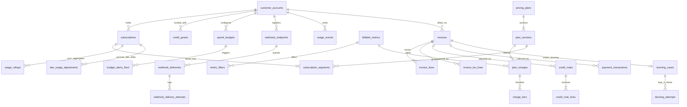

# MeterFlow Data Model (`docs/architecture/DATA_MODEL.md`)

## 1. Relational Persistence & Financial Schema Standards

MeterFlow persists all domain state, Spring Batch metadata, internal outbox records, and webhook/dunning queues in **PostgreSQL**—managed exclusively via **Flyway** (`spring.jpa.hibernate.ddl-auto=validate`) across **Local Docker Compose PostgreSQL**, **Testcontainers**, and **Shared Supabase PostgreSQL** (`C5`, `QA2`, [ADR-002](./ADRs/ADR-002-dual-postgresql-strategy-supabase-and-docker-compose.md)).

| Standard | PostgreSQL / JPA Rule | Requirement Addressed |
| :--- | :--- | :--- |
| **Primary Keys** | `UUID` (`DEFAULT gen_random_uuid()`) | Conflict-free batch inserts and idempotent event serialization. |
| **Persisted Monetary & Usage Amounts** | `NUMERIC(19,4) NOT NULL` (`BigDecimal`, `RoundingMode.HALF_UP`, `BDT`/`USD` only) | Exact `4`-decimal line/ledger storage (`FR3`–`FR8`, `QA2`, [ADR-010](./ADRs/ADR-010-financial-precision-currency-and-rounding-policy.md)). |
| **Proration & Unit Rate Precision** | `NUMERIC(19,8) NOT NULL` | Prevents intermediate truncation on mid-cycle second-level proration and unit/seat rates (`FR3`, `FR4`, `QA2`, [ADR-010](./ADRs/ADR-010-financial-precision-currency-and-rounding-policy.md)). |
| **Final Payable Settlement Precision** | `2` minor-unit decimals (`BDT` paisa, `USD` cents, `HALF_UP`) | Exact customer payable settlement via `Money.roundToPayable()` ([ADR-010](./ADRs/ADR-010-financial-precision-currency-and-rounding-policy.md)). |
| **Timestamps** | `TIMESTAMPTZ NOT NULL` stored in UTC | Deterministic `72h` late cutoffs, segment splits, hourly rollups, Day 1/3/7 retries, and secret-rotation expiry (`FR1`, `FR4`, `FR7`–`FR9`). |
| **Immutability Triggers** | DB `BEFORE UPDATE/DELETE` triggers protecting `PUBLISHED` `plan_versions` (+ `plan_charges`/`charge_tiers`) and `FINALIZED` `invoices` (+ `invoice_lines`/`credit_notes`/`ledger_entries`) | Enforces audit-grade financial immutability (`FR5`, `FR6`, `FR10`, `QA2`). |

---

## 2. Core Entity-Relationship Diagram

---

## 3. Complete Module-Owned Table Specification

### 3.1 `identity` Module (`V2__identity_schema.sql` — Verified on PostgreSQL 17)
- **`customers`**: `id UUID PK DEFAULT gen_random_uuid()`, `external_key VARCHAR(100) UNIQUE NOT NULL` (`CHECK nonblank`), `name VARCHAR(200) NOT NULL`, `currency_code VARCHAR(3) NOT NULL` (`CHECK IN ('BDT', 'USD')`), `status VARCHAR(20) NOT NULL DEFAULT 'ACTIVE'` (`CHECK IN ('ACTIVE', 'SUSPENDED', 'CLOSED')`), `version BIGINT NOT NULL DEFAULT 0`, `created_at TIMESTAMPTZ NOT NULL`, `updated_at TIMESTAMPTZ NOT NULL`; index `idx_customers_status`.
- **`users`**: `id UUID PK DEFAULT gen_random_uuid()`, `email VARCHAR(255) UNIQUE NOT NULL` (`CHECK email = lower(btrim(email)) AND btrim(email) <> ''`), `full_name VARCHAR(200) NOT NULL`, `password_hash VARCHAR(100) NOT NULL` (`CHECK length >= 60`), `platform_role VARCHAR(20) NOT NULL` (`CHECK IN ('ADMIN', 'OPERATOR', 'CUSTOMER')`), `status VARCHAR(20) NOT NULL DEFAULT 'ACTIVE'` (`CHECK IN ('ACTIVE', 'DISABLED', 'SUSPENDED')`), `version BIGINT NOT NULL DEFAULT 0`, `created_at TIMESTAMPTZ NOT NULL`, `updated_at TIMESTAMPTZ NOT NULL`; index `idx_users_role_status`.
- **`customer_memberships`**: `id UUID PK DEFAULT gen_random_uuid()`, `user_id UUID NOT NULL FK -> users(id) ON DELETE RESTRICT`, `customer_id UUID NOT NULL FK -> customers(id) ON DELETE RESTRICT`, `membership_role VARCHAR(20) NOT NULL DEFAULT 'MEMBER'` (`CHECK IN ('OWNER', 'BILLING_ADMIN', 'MEMBER')`), `status VARCHAR(20) NOT NULL DEFAULT 'ACTIVE'` (`CHECK IN ('ACTIVE', 'REVOKED')`), `version BIGINT NOT NULL DEFAULT 0`, `created_at TIMESTAMPTZ NOT NULL`, `updated_at TIMESTAMPTZ NOT NULL`, `UNIQUE (user_id, customer_id)`; partial indexes `idx_customer_memberships_user_active` and `idx_customer_memberships_customer_active` (`WHERE status = 'ACTIVE'`).

### 3.2 `catalog` Module (`V3__catalog_schema.sql` — Verified on PostgreSQL 17, `FR2`, `FR3`, `FR10`, [ADR-011](./ADRs/ADR-011-pricing-tiers-packages-allowances-and-commitments.md))
- **`billable_metrics`**: `id UUID PK`, `metric_key VARCHAR(80) NOT NULL`, `name VARCHAR(160) NOT NULL`, `description TEXT NULL`, `aggregation_type VARCHAR(20)` (`CHECK IN ('SUM', 'COUNT', 'MAXIMUM', 'UNIQUE_COUNT', 'LATEST_VALUE')`), `target_property VARCHAR(120) NULL` (`CHECK aggregation_type = 'COUNT' OR target_property nonblank`), `customer_id UUID NULL FK -> customers(id)`, `active BOOLEAN`, `version BIGINT`, `created_at`/`updated_at TIMESTAMPTZ`; partial unique indexes `uq_billable_metrics_global_key` (`WHERE customer_id IS NULL`) and `uq_billable_metrics_customer_key` (`(customer_id, metric_key) WHERE customer_id IS NOT NULL`).
- **`metric_filters`**: `id UUID PK`, `metric_id UUID FK -> billable_metrics(id) ON DELETE CASCADE`, `filter_order INTEGER`, `property_key VARCHAR(120)`, `operator VARCHAR(20)` (`CHECK IN ('EQUALS', 'NOT_EQUALS', 'IN', 'NOT_IN', 'EXISTS')`), `filter_values JSONB NOT NULL DEFAULT '[]'`, `created_at TIMESTAMPTZ`, `UNIQUE (metric_id, filter_order)`.
- **`pricing_plans`**: `id UUID PK`, `plan_code VARCHAR(80) UNIQUE NOT NULL`, `name VARCHAR(160) NOT NULL`, `description TEXT NULL`, `currency_code VARCHAR(3)` (`CHECK IN ('BDT', 'USD')`), `active BOOLEAN`, `version BIGINT`, `created_at`/`updated_at TIMESTAMPTZ`.
- **`plan_versions`** *(protected by PostgreSQL `BEFORE UPDATE/DELETE` trigger `trg_guard_published_plan_version` once `PUBLISHED`/`ARCHIVED`, `FR10`)*: `id UUID PK`, `plan_id UUID FK -> pricing_plans(id)`, `version_number INTEGER NOT NULL`, `status VARCHAR(20)` (`DRAFT`, `PUBLISHED`, `ARCHIVED`), `effective_from TIMESTAMPTZ NULL`, `published_at TIMESTAMPTZ NULL`, `cloned_from_version_id UUID NULL FK -> plan_versions(id)`, `version BIGINT`, `created_at`/`updated_at TIMESTAMPTZ`, `UNIQUE (plan_id, version_number)`.
- **`plan_charges`** *(protected by trigger `trg_guard_plan_charges_immutable`, `FR3`)*: `id UUID PK`, `plan_version_id UUID FK`, `display_order INTEGER`, `charge_code VARCHAR(80)`, `description VARCHAR(255) NULL`, `charge_type VARCHAR(40) NOT NULL` (`FLAT_FEE`, `PER_UNIT`, `GRADUATED_TIERS`, `VOLUME_TIERS`, `PACKAGE`, `PER_SEAT`, plus open OCP strategy keys), `metric_id UUID NULL FK -> billable_metrics(id)`, `flat_amount NUMERIC(19,4) NULL`, `unit_price NUMERIC(19,8) NULL`, `package_size NUMERIC(19,4) NULL`, `package_price NUMERIC(19,4) NULL`, `charge_config JSONB NOT NULL DEFAULT '{}'`, `created_at TIMESTAMPTZ`, `UNIQUE (plan_version_id, charge_code)`, `UNIQUE (plan_version_id, display_order)`.
- **`charge_tiers`** *(protected by trigger `trg_guard_charge_tiers_immutable`)*: `id UUID PK`, `plan_charge_id UUID FK`, `tier_order INTEGER`, `lower_bound NUMERIC(19,4)`, `upper_bound NUMERIC(19,4) NULL` (`NULL` = unbounded final tier), `unit_price NUMERIC(19,8)`, `flat_fee NUMERIC(19,4) DEFAULT 0`, `description VARCHAR(255) NULL`, `UNIQUE (plan_charge_id, tier_order)`.
- **`free_allowances`** *(protected by trigger `trg_guard_free_allowances_immutable`)*: `id UUID PK`, `plan_version_id UUID FK`, `metric_id UUID NULL FK -> billable_metrics(id)`, `target_charge_id UUID NULL FK -> plan_charges(id)`, `free_quantity NUMERIC(19,4) CHECK (> 0)`, `reset_period VARCHAR(20)` (`BILLING_PERIOD`, `MONTHLY`, `ANNUAL`), `created_at TIMESTAMPTZ`.
- **`minimum_commitments`** *(protected by trigger `trg_guard_minimum_commitments_immutable`)*: `id UUID PK`, `plan_version_id UUID FK`, `plan_charge_id UUID NULL FK -> plan_charges(id)` (`NULL` = plan-level commitment), `minimum_amount NUMERIC(19,4) CHECK (>= 0)`, `currency_code VARCHAR(3)` (`BDT`/`USD`), `created_at TIMESTAMPTZ`; partial unique indexes `uq_minimum_commitments_plan_level` and `uq_minimum_commitments_charge_level`.

### 3.3 `subscriptions` Module (`V4__subscriptions_schema.sql` — Verified on PostgreSQL 17, `FR3`, `FR4`, [ADR-012](./ADRs/ADR-012-subscription-workflow-billing-periods-and-proration.md))
- **`subscriptions`**: `id UUID PK`, `customer_id UUID NOT NULL FK -> customers(id)`, `current_plan_version_id UUID NOT NULL FK -> plan_versions(id)`, `currency_code VARCHAR(3)` (`CHECK IN ('BDT', 'USD')`), `billing_interval VARCHAR(20)` (`MONTHLY`, `ANNUAL`), `billing_timezone VARCHAR(64) DEFAULT 'UTC'`, `seat_quantity INTEGER NOT NULL DEFAULT 1 CHECK (>= 0)`, `status VARCHAR(20)` (`TRIALING`, `ACTIVE`, `PAUSED`, `PAST_DUE`, `CANCELLED`, `EXPIRED`), `trial_start_at`/`trial_end_at TIMESTAMPTZ NULL`, `trial_conversion_policy VARCHAR(32)` (`EXPIRE_ON_END`, `AUTO_CONVERT_TO_PAID`), `current_period_start`/`current_period_end TIMESTAMPTZ NULL`, `paused_at TIMESTAMPTZ NULL`, `paused_remaining_seconds BIGINT NULL`, `cancel_at_period_end BOOLEAN DEFAULT FALSE`, `cancelled_at TIMESTAMPTZ NULL`, `creation_idempotency_key VARCHAR(150) NULL`, `version BIGINT`, `created_at`/`updated_at TIMESTAMPTZ`; partial unique indexes `uq_subscriptions_one_open_per_customer` (`WHERE status IN ('TRIALING', 'ACTIVE', 'PAUSED', 'PAST_DUE')`) and `uq_subscriptions_creation_idempotency`; due-scan indexes `idx_subscriptions_due_trial_end` and `idx_subscriptions_due_eop_cancel`.
- **`subscription_plan_assignments`**: `id UUID PK`, `subscription_id UUID FK -> subscriptions(id)`, `plan_version_id UUID FK -> plan_versions(id)`, `seat_quantity INTEGER CHECK (>= 0)`, `effective_from TIMESTAMPTZ NOT NULL`, `effective_to TIMESTAMPTZ NULL` (`CHECK effective_to IS NULL OR effective_to >= effective_from`), `assignment_reason VARCHAR(40)`, `created_at TIMESTAMPTZ`; index `idx_sub_plan_assignments_sub_from`.
- **`subscription_scheduled_changes`**: `id UUID PK`, `subscription_id UUID FK`, `current_plan_version_id UUID FK`, `target_plan_version_id UUID FK`, `target_seat_quantity INTEGER CHECK (>= 0)`, `change_direction VARCHAR(24)` (`UPGRADE`, `DOWNGRADE`, `PLAN_CHANGE`), `effective_at TIMESTAMPTZ NOT NULL`, `status VARCHAR(20)` (`PENDING`, `APPLIED`, `CANCELLED`, `SUPERSEDED`), `idempotency_key VARCHAR(150) NULL`, `applied_at`/`cancelled_at TIMESTAMPTZ NULL`, `version BIGINT`, `created_at`/`updated_at TIMESTAMPTZ`; partial unique indexes `uq_sub_scheduled_one_pending` (`WHERE status = 'PENDING'`) and `uq_sub_scheduled_idempotency`; due-scan index `idx_sub_scheduled_due`.
- **`subscription_proration_records`**: `id UUID PK`, `subscription_id UUID FK`, `previous_plan_version_id`/`new_plan_version_id UUID FK`, `previous_seat_quantity`/`new_seat_quantity INTEGER`, `period_start`/`period_end`/`effective_at TIMESTAMPTZ`, `total_period_seconds`/`remaining_seconds BIGINT`, `proration_factor NUMERIC(19,8)`, `previous_plan_recurring_amount`/`new_plan_recurring_amount`/`credit_amount`/`debit_amount`/`net_proration_amount NUMERIC(19,4)`, `currency_code VARCHAR(3)`, `non_proratable_usage_charges JSONB`, `calculation_policy VARCHAR(40)` (`EXACT_SECONDS_V1`), `idempotency_key VARCHAR(150) NULL`, `created_at TIMESTAMPTZ`; partial unique index `uq_sub_proration_idempotency`.
- **`subscription_state_transitions`**: `id UUID PK`, `subscription_id UUID FK`, `from_status VARCHAR(20) NULL`, `to_status VARCHAR(20) NOT NULL`, `reason VARCHAR(80) NOT NULL`, `effective_at TIMESTAMPTZ NOT NULL`, `idempotency_key VARCHAR(150) NULL`, `metadata JSONB NOT NULL DEFAULT '{}'`, `created_at TIMESTAMPTZ`; partial unique index `uq_sub_transition_idempotency`.

### 3.4 `metering` Module (`V5__metering_schema.sql` — Verified on PostgreSQL 17, `FR1`, `FR2`, `FR7`, [ADR-013](./ADRs/ADR-013-metering-ingestion-idempotency-rollups-and-freshness.md))
- **`usage_events`** *(authoritative immutable event store, distinct quantity precision `NUMERIC(19,6)`)*: `id UUID PK`, `customer_id UUID NOT NULL FK -> customers(id)`, `subscription_id UUID NULL FK -> subscriptions(id)`, `metric_id UUID NOT NULL FK -> billable_metrics(id)`, `idempotency_key VARCHAR(150) NOT NULL`, `payload_hash VARCHAR(64) NOT NULL` (canonical `SHA-256`), `quantity NUMERIC(19,6) NOT NULL CHECK (>= 0)`, `measured_value NUMERIC(19,6) NULL`, `distinct_key VARCHAR(255) NULL`, `event_timestamp TIMESTAMPTZ NOT NULL`, `ingested_at TIMESTAMPTZ NOT NULL`, `properties JSONB NOT NULL DEFAULT '{}'`, `filter_matched BOOLEAN`, `late_event BOOLEAN`, `late_classification VARCHAR(32)` (`ON_TIME`, `LATE_WITHIN_72H`), `billing_period_start`/`billing_period_end TIMESTAMPTZ NULL`, `processing_status VARCHAR(24)` (`PENDING_ROLLUP`, `ROLLED_UP`, `RECONCILED`), `UNIQUE (customer_id, idempotency_key)`; indexes `idx_usage_events_cust_metric_ts`, `idx_usage_events_late_only`, `idx_usage_events_pending_rollup`, `idx_usage_events_props_gin`.
- **`usage_rollups`** *(atomically upserted inside the ingestion transaction in sorted lock order, reconciled directly from `usage_events`)*: `id UUID PK`, `customer_id UUID FK`, `metric_id UUID FK`, `bucket_start`/`bucket_end TIMESTAMPTZ`, `event_count BIGINT`, `sum_value NUMERIC(24,6)`, `max_value NUMERIC(19,6) NULL`, `latest_value NUMERIC(19,6) NULL`, `latest_event_timestamp TIMESTAMPTZ NULL`, `latest_ingested_at TIMESTAMPTZ NULL`, `latest_event_id UUID NULL`, `late_event_count BIGINT`, `last_reconciled_at TIMESTAMPTZ NULL`, `updated_at TIMESTAMPTZ`, `UNIQUE (customer_id, metric_id, bucket_start)`; index `idx_usage_rollups_cust_metric_bucket`.
- **`usage_late_event_records`** *(downstream Billing `FR1`/`FR6` late-adjustment contract)*: `id UUID PK`, `usage_event_id UUID UNIQUE FK -> usage_events(id)`, `customer_id UUID FK`, `subscription_id UUID NULL FK`, `metric_id UUID FK`, `event_timestamp`/`ingested_at`/`closed_period_start`/`closed_period_end TIMESTAMPTZ`, `hours_late NUMERIC(10,4) CHECK (0..72)`, `adjustment_status VARCHAR(24)` (`PENDING_BILLING`, `CONSUMED_BY_BILLING`), `created_at`/`consumed_at TIMESTAMPTZ`; index `idx_usage_late_records_pending`.
- **`usage_rejected_events`** *(conflict & validation audit trail without raw sensitive payloads)*: `id UUID PK`, `customer_id UUID NULL`, `metric_id UUID NULL`, `idempotency_key VARCHAR(150) NULL`, `rejection_code VARCHAR(48)`, `rejection_reason VARCHAR(500)`, `event_timestamp TIMESTAMPTZ NULL`, `payload_hash VARCHAR(64) NULL`, `rejected_at TIMESTAMPTZ`; index `idx_usage_rejected_customer_at`.
- **`usage_threshold_evaluations`** *(deduplicated `FR7` `50%`/`80%`/`100%` threshold foundation)*: `id UUID PK`, `customer_id UUID FK`, `subscription_id UUID NULL FK`, `metric_id UUID NULL FK`, `scope_key VARCHAR(120)`, `window_start`/`window_end TIMESTAMPTZ`, `threshold_percent INTEGER CHECK IN (50, 80, 100)`, `limit_value NUMERIC(19,6)`, `current_value NUMERIC(24,6)`, `utilization_percent NUMERIC(10,4)`, `triggered_at TIMESTAMPTZ`, `UNIQUE (customer_id, scope_key, window_start, window_end, threshold_percent)`.

### 3.5 `billing` Module (`FR5`, `FR6`)
- **`billing_runs`**: `id UUID PK`, `batch_job_execution_id BIGINT`, `run_type VARCHAR(24)` (`DRAFT_GENERATION`, `FINALIZATION`), `cutoff_timestamp TIMESTAMPTZ`, `status VARCHAR(24)`, `invoices_processed INTEGER`, `started_at TIMESTAMPTZ`, `completed_at TIMESTAMPTZ`.
- **`invoices`** *(monetary/line fields immutable once `FINALIZED`)*: `id UUID PK`, `invoice_number VARCHAR(50) UNIQUE NULL`, `customer_id UUID NOT NULL`, `subscription_id UUID NOT NULL`, `billing_run_id UUID NULL`, `period_start TIMESTAMPTZ`, `period_end TIMESTAMPTZ`, `grace_expires_at TIMESTAMPTZ`, `currency_code CHAR(3)`, `subtotal_amount NUMERIC(19,4)`, `tax_amount NUMERIC(19,4)`, `total_amount NUMERIC(19,4)`, `credits_applied_amount NUMERIC(19,4)`, `credit_notes_applied_amount NUMERIC(19,4)`, `amount_due NUMERIC(19,4)`, `status VARCHAR(24)` (`DRAFT`, `FINALIZED`, `PAID`, `PAST_DUE`, `WRITTEN_OFF`, `VOID`), `finalized_at TIMESTAMPTZ NULL`, `due_at TIMESTAMPTZ NULL`, `version BIGINT`, `UNIQUE (subscription_id, period_start, period_end) WHERE status <> 'VOID'`.
- **`invoice_lines`** *(full line-level traceability, `FR5`)*: `id UUID PK`, `invoice_id UUID FK`, `line_order SMALLINT`, `line_type VARCHAR(32)` (`BASE_FEE`, `USAGE_CHARGE`, `SEAT_CHARGE`, `MINIMUM_COMMITMENT_TRUE_UP`, `PRORATION_CREDIT`, `LATE_USAGE_ADJUSTMENT`), `subscription_id UUID NOT NULL`, `subscription_segment_id UUID NULL`, `plan_version_id UUID NOT NULL`, `plan_charge_id UUID NULL`, `billable_metric_id UUID NULL`, `charge_type VARCHAR(24) NULL`, `aggregation_type VARCHAR(20) NULL`, `window_start TIMESTAMPTZ NOT NULL`, `window_end TIMESTAMPTZ NOT NULL`, `seat_quantity INTEGER NULL`, `raw_quantity NUMERIC(19,4)`, `free_units_applied NUMERIC(19,4)`, `billable_quantity NUMERIC(19,4)`, `proration_factor NUMERIC(19,8)`, `effective_unit_price NUMERIC(19,8) NULL`, `line_amount NUMERIC(19,4) NOT NULL`, `calculation_breakdown JSONB NOT NULL`.
- **`invoice_tax_lines`**, **`credit_grants`**, **`credit_ledger_entries`**, **`credit_notes`**, **`credit_note_lines`**, **`late_usage_adjustments`**: Retain exact `NUMERIC(19,4)` amounts, `remaining_amount >= 0`, `trigger_usage_event_id UNIQUE`, and immutable links to `original_invoice_id` / `original_invoice_line_id`.

### 3.6 `payments` Module (`FR8`)
- **`payment_transactions`**: `id UUID PK`, `invoice_id UUID NOT NULL`, `customer_id UUID NOT NULL`, `idempotency_key VARCHAR(150) UNIQUE NOT NULL`, `amount NUMERIC(19,4) CHECK (amount > 0)`, `simulation_mode VARCHAR(32)` (`SIMULATE_SUCCESS`, `SIMULATE_SOFT_DECLINE`, `SIMULATE_HARD_DECLINE`, `SIMULATE_TIMEOUT`), `status VARCHAR(24)` (`CAPTURED`, `SOFT_DECLINED`, `HARD_DECLINED`, `FAILED_TIMEOUT`), `failure_code VARCHAR(64) NULL`, `processed_at TIMESTAMPTZ`; partial unique index `uq_captured_payment_per_invoice ON payment_transactions(invoice_id) WHERE status = 'CAPTURED'`.
- **`ledger_entries`**: `id UUID PK`, `customer_id UUID`, `invoice_id UUID NULL`, `credit_note_id UUID NULL`, `payment_transaction_id UUID NULL`, `entry_type VARCHAR(16)` (`DEBIT`, `CREDIT`), `account_bucket VARCHAR(32)` (`ACCOUNTS_RECEIVABLE`, `REVENUE`, `TAX_PAYABLE`, `CREDIT_LIABILITY`, `SIMULATED_CASH`), `amount NUMERIC(19,4) NOT NULL`, `recorded_at TIMESTAMPTZ`.
- **`dunning_policies`** *(strict separation of payment retry timers vs. state-transition timer)*: `id UUID PK`, `name VARCHAR(100) UNIQUE`, **`retry_offsets_hours JSONB NOT NULL DEFAULT '[24, 72, 168]'`** (exactly **3** payment retries: Day 1, Day 3, Day 7; `CHECK (jsonb_array_length(retry_offsets_hours) = 3)`), **`suspension_offset_hours INTEGER NOT NULL DEFAULT 336`** (`CHECK (suspension_offset_hours >= 168)` — separate state-transition timer for `FINAL_WARNING -> SUSPENDED`; **never** executes a 4th payment attempt), `default_policy BOOLEAN`.
- **`dunning_cases`** & **`dunning_attempts`**: `dunning_cases` tracks `id UUID PK`, `invoice_id UUID UNIQUE`, `subscription_id UUID`, `dunning_policy_id UUID`, `retries_completed SMALLINT NOT NULL DEFAULT 0 CHECK (retries_completed BETWEEN 0 AND 3)`, `next_retry_at TIMESTAMPTZ NULL`, **`suspension_at TIMESTAMPTZ NULL`**, `status VARCHAR(24)` (`RETRY_SCHEDULED`, `FINAL_WARNING`, `SUSPENDED`, `RECOVERED`, `WRITTEN_OFF`), `opened_at TIMESTAMPTZ`, `closed_at TIMESTAMPTZ NULL`; `dunning_attempts` records each of the `1`–`3` payment retry attempts linked to `payment_transaction_id`.

### 3.7 `webhooks` & `notifications` Modules (`FR9`, `QA4`, `QA5`)
- **`webhook_endpoints`** *(safe dual-key secret rotation)*: `id UUID PK`, `customer_id UUID NULL`, `target_url VARCHAR(500) NOT NULL`, **`active_signing_secret_enc TEXT NOT NULL`**, **`previous_signing_secret_enc TEXT NULL`**, **`previous_secret_expires_at TIMESTAMPTZ NULL`**, `subscribed_events JSONB NOT NULL` (validates membership in `invoice.finalised`, `payment.failed`, `usage.threshold_reached`, and optional catalog events), `active BOOLEAN NOT NULL DEFAULT true`, `created_at TIMESTAMPTZ`.
- **`webhook_deliveries`**: `id UUID PK`, `endpoint_id UUID FK`, `source_event_id UUID NOT NULL`, `event_type VARCHAR(80) NOT NULL`, `payload JSONB NOT NULL`, `status VARCHAR(24)` (`PENDING`, `RETRYING`, `DELIVERED`, `EXHAUSTED`), `attempt_count SMALLINT DEFAULT 0`, `next_attempt_at TIMESTAMPTZ NOT NULL`, `last_http_status SMALLINT NULL`, `created_at TIMESTAMPTZ`, `UNIQUE (endpoint_id, source_event_id)`.
- **`webhook_delivery_attempts`**: `id UUID PK`, `delivery_id UUID FK`, `attempt_number SMALLINT`, `is_manual_replay BOOLEAN DEFAULT false`, **`replayed_by_user_id UUID NULL`**, `signature_timestamp BIGINT NOT NULL`, `http_status SMALLINT NULL`, `duration_ms INTEGER`, `response_excerpt VARCHAR(500) NULL`, `error_reason VARCHAR(255) NULL`, `attempted_at TIMESTAMPTZ`.
- **`notification_logs`** & **`audit_logs`**: `notification_logs` (`uq_notification_event` on `(recipient_scope, source_event_id)`); `audit_logs` (`actor`, `action`, `entity_type`, `entity_id`, `details JSONB`, `occurred_at TIMESTAMPTZ`).

### 3.8 Framework Tables (Flyway-Governed, `C5`, `C8`)
- **`event_publication`** (Spring Modulith JPA outbox) and **`BATCH_*`** (Spring Batch 6 JDBC repository, `spring.batch.jdbc.initialize-schema=never`).

---

## 4. High-Selectivity Indexes (`QA1`, `QA2`)

1. `uq_usage_events_customer_idempotency UNIQUE ON usage_events (customer_id, idempotency_key)` — Atomic `FR1` deduplication and `409` conflict check.
2. `idx_usage_events_sub_metric_ts ON usage_events (subscription_id, metric_code, event_timestamp ASC)` — Powers exact segment window aggregations and `UNIQUE_COUNT`.
3. `idx_usage_events_props_gin ON usage_events USING GIN (properties jsonb_path_ops)` — Accelerates configurable `FR2` dimensional filter predicates.
4. `idx_usage_rollups_sub_bucket ON usage_rollups (subscription_id, bucket_hour DESC)` — Powers `< 50 ms` `FR7` live estimates (`<= 744` hourly rows/month).
5. `idx_credit_grants_drawdown ON credit_grants (customer_id, expires_at ASC NULLS LAST, priority ASC, created_at ASC) WHERE remaining_amount > 0` — Deterministic `FR6` credit drawdown.
6. `idx_dunning_cases_due_retry ON dunning_cases (next_retry_at ASC) WHERE status = 'RETRY_SCHEDULED' AND next_retry_at IS NOT NULL` and `idx_dunning_cases_due_suspend ON dunning_cases (suspension_at ASC) WHERE status = 'FINAL_WARNING' AND suspension_at IS NOT NULL` — Separate constant-cost polling indexes for payment retries vs. suspension transition (`FR8`).
7. `idx_webhook_deliveries_due ON webhook_deliveries (next_attempt_at ASC) WHERE status IN ('PENDING', 'RETRYING')` — Constant-cost `FOR UPDATE SKIP LOCKED` polling (`FR9`).
8. `idx_event_publication_incomplete ON event_publication (publication_date ASC) WHERE completion_date IS NULL` — Constant-cost internal outbox retry scans (`C8`).
