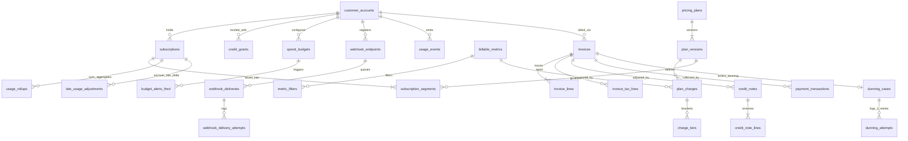

# MeterFlow Data Model (`docs/architecture/DATA_MODEL.md`)

## 1. Relational Persistence & Financial Schema Standards

MeterFlow persists all domain state, Spring Batch metadata, internal outbox records, and webhook/dunning queues in **PostgreSQL**—managed exclusively via **Flyway** (`spring.jpa.hibernate.ddl-auto=validate`) across **Local Docker Compose PostgreSQL**, **Testcontainers**, and **Shared Supabase PostgreSQL** (`C5`, `QA2`, [ADR-002](./ADRs/ADR-002-dual-postgresql-strategy-supabase-and-docker-compose.md)).

| Standard | PostgreSQL / JPA Rule | Requirement Addressed |
| :--- | :--- | :--- |
| **Primary Keys** | `UUID` (`DEFAULT gen_random_uuid()`) | Conflict-free batch inserts and idempotent event serialization. |
| **Persisted Monetary & Usage Amounts** | `NUMERIC(19,4) NOT NULL` (`BigDecimal`, `RoundingMode.HALF_UP`) | Exact `4`-decimal financial/quantity storage (`FR3`–`FR8`, `QA2`). |
| **Proration & Unit Rate Precision** | `NUMERIC(19,8) NOT NULL` | Prevents intermediate truncation on mid-cycle second-level proration and unit/seat rates (`FR3`, `FR4`, `QA2`). |
| **Timestamps** | `TIMESTAMPTZ NOT NULL` stored in UTC | Deterministic `72h` late cutoffs, segment splits, hourly rollups, Day 1/3/7 retries, and secret-rotation expiry (`FR1`, `FR4`, `FR7`–`FR9`). |
| **Immutability Triggers** | DB `BEFORE UPDATE/DELETE` triggers protecting `PUBLISHED` `plan_versions` (+ `plan_charges`/`charge_tiers`) and `FINALIZED` `invoices` (+ `invoice_lines`/`credit_notes`/`ledger_entries`) | Enforces audit-grade financial immutability (`FR5`, `FR6`, `FR10`, `QA2`). |

---

## 2. Core Entity-Relationship Diagram

---

## 3. Complete Module-Owned Table Specification

### 3.1 `identity` Module
- **`users`**: `id UUID PK`, `email VARCHAR(255) UNIQUE`, `password_hash VARCHAR(100) NOT NULL`, `customer_id UUID NULL`, `enabled BOOLEAN`, `created_at TIMESTAMPTZ`.
- **`user_roles`**: `(user_id UUID FK, role_name VARCHAR(40))` PK (`ROLE_ADMIN`, `ROLE_OPERATOR`, `ROLE_CUSTOMER`).

### 3.2 `catalog` Module (`FR2`, `FR3`, `FR10`)
- **`billable_metrics`**: `id UUID PK`, `code VARCHAR(80) UNIQUE`, `name VARCHAR(160)`, `aggregation_type VARCHAR(20)` (`CHECK IN ('COUNT', 'SUM', 'MAX', 'UNIQUE_COUNT', 'LATEST')`), `field_name VARCHAR(120) NULL`, `active BOOLEAN`, `version BIGINT`.
- **`metric_filters`**: `id UUID PK`, `metric_id UUID FK`, `property_key VARCHAR(120)`, `operator VARCHAR(20)` (`EQUALS`, `NOT_EQUALS`, `IN`, `NOT_IN`, `EXISTS`), `filter_values JSONB NOT NULL`.
- **`pricing_plans`**: `id UUID PK`, `plan_code VARCHAR(80) UNIQUE`, `name VARCHAR(160)`, `description TEXT`, `created_at TIMESTAMPTZ`.
- **`plan_versions`** *(immutable once `status = 'PUBLISHED'`, `FR10`)*: `id UUID PK`, `plan_id UUID FK`, `version_number INTEGER NOT NULL`, `currency_code CHAR(3)`, `billing_interval VARCHAR(20)` (`MONTHLY`, `ANNUAL`), `base_flat_fee NUMERIC(19,4)`, `plan_minimum_spend NUMERIC(19,4)`, `trial_days INTEGER DEFAULT 0`, `grace_period_hours SMALLINT DEFAULT 72`, `status VARCHAR(20)` (`DRAFT`, `PUBLISHED`, `ARCHIVED`), `published_at TIMESTAMPTZ`, `UNIQUE (plan_id, version_number)`.
- **`plan_charges`** *(immutable with parent `plan_version`, `FR3`)*: `id UUID PK`, `plan_version_id UUID FK`, `metric_id UUID FK NULL` (`NULL` permitted for `FLAT_FEE` and contracted `PER_SEAT`), `charge_type VARCHAR(24) NOT NULL` (`CHECK IN ('FLAT_FEE', 'PER_UNIT', 'GRADUATED_TIERS', 'VOLUME_TIERS', 'PACKAGE', 'PER_SEAT')` — extensible via `charge_config JSONB` if an additional OCP strategy such as `PERCENTAGE` is added later), `free_units NUMERIC(19,4) DEFAULT 0`, `charge_minimum_spend NUMERIC(19,4) DEFAULT 0`, `unit_price NUMERIC(19,8) NULL` (used by `PER_UNIT` and `PER_SEAT`), `package_size NUMERIC(19,4) NULL`, `package_price NUMERIC(19,4) NULL`, `seat_source VARCHAR(24) NULL` (`CONTRACTED_QUANTITY`, `METERED_METRIC`), `proratable BOOLEAN DEFAULT true`, `charge_config JSONB NOT NULL DEFAULT '{}'`.
- **`charge_tiers`** *(for `GRADUATED_TIERS` & `VOLUME_TIERS`, `FR3`)*: `id UUID PK`, `plan_charge_id UUID FK`, `tier_order SMALLINT`, `first_unit NUMERIC(19,4)`, `last_unit NUMERIC(19,4) NULL` (`NULL` = unbounded top bracket), `unit_price NUMERIC(19,8)`, `tier_flat_fee NUMERIC(19,4) DEFAULT 0`, `UNIQUE (plan_charge_id, tier_order)`.

### 3.3 `subscriptions` Module (`FR3`, `FR4`)
- **`customer_accounts`**: `id UUID PK`, `external_key VARCHAR(100) UNIQUE`, `name VARCHAR(200)`, `billing_email VARCHAR(255)`, `currency_code CHAR(3)`, `tax_rate_pct NUMERIC(7,4) DEFAULT 0`, `tax_exempt BOOLEAN DEFAULT false`, `dunning_policy_id UUID NULL`, `status VARCHAR(20)` (`ACTIVE`, `SUSPENDED`, `CLOSED`), `version BIGINT`.
- **`subscriptions`**: `id UUID PK`, `customer_id UUID FK`, `current_plan_version_id UUID`, `pending_next_plan_version_id UUID NULL`, `seat_quantity INTEGER NOT NULL DEFAULT 1 CHECK (seat_quantity >= 0)`, `status VARCHAR(20)` (`PENDING`, `TRIAL`, `ACTIVE`, `PAST_DUE`, `SUSPENDED`, `PAUSED`, `CANCELED`, `EXPIRED`), `trial_start_at TIMESTAMPTZ NULL`, `trial_end_at TIMESTAMPTZ NULL`, `current_period_start TIMESTAMPTZ`, `current_period_end TIMESTAMPTZ`, `canceled_at TIMESTAMPTZ NULL`, `version BIGINT`.
- **`subscription_segments`** *(mid-cycle plan & seat-quantity proration slices, `FR3`, `FR4`)*: `id UUID PK`, `subscription_id UUID FK`, `plan_version_id UUID`, `seat_quantity INTEGER NOT NULL CHECK (seat_quantity >= 0)`, `period_start TIMESTAMPTZ`, `period_end TIMESTAMPTZ`, `segment_start TIMESTAMPTZ`, `segment_end TIMESTAMPTZ`, `proration_factor NUMERIC(19,8) NOT NULL`, `is_trial_segment BOOLEAN DEFAULT false`, `change_reason VARCHAR(40)` (`INITIAL`, `TRIAL_CONVERSION`, `MID_CYCLE_UPGRADE`, `MID_CYCLE_DOWNGRADE`, `SEAT_QUANTITY_CHANGE`, `CANCELLATION`).

### 3.4 `metering` Module (`FR1`, `FR2`, `FR7`)
- **`usage_events`** *(authoritative immutable event store, retained permanently for billing audit & historical key replay)*: `id UUID PK`, `customer_id UUID NOT NULL`, `subscription_id UUID NOT NULL`, **`idempotency_key VARCHAR(150) NOT NULL`**, **`payload_hash CHAR(64) NOT NULL`** (canonical `SHA-256` hex digest for duplicate vs. `409` conflict discrimination), `metric_code VARCHAR(80) NOT NULL`, `event_timestamp TIMESTAMPTZ NOT NULL`, `ingested_at TIMESTAMPTZ NOT NULL`, `late_arrival_status VARCHAR(32)` (`ON_TIME`, `LATE_WITHIN_72H`), `properties JSONB NOT NULL DEFAULT '{}'`, `CONSTRAINT uq_usage_events_customer_idempotency UNIQUE (customer_id, idempotency_key)`.
- **`rejected_usage_events`**: `id UUID PK`, `customer_id UUID NULL`, `idempotency_key VARCHAR(150) NULL`, `rejection_code VARCHAR(40)` (`IDEMPOTENCY_KEY_CONFLICT`, `EXPIRED_LATE_EVENT`, `FUTURE_TIMESTAMP`, `INVALID_METRIC_FIELD`, `INACTIVE_SUBSCRIPTION`), `payload JSONB`, `rejected_at TIMESTAMPTZ`.
- **`usage_rollups`** *(synchronously upserted inside the ingestion transaction for `0s` aggregation lag, capping monthly scan to `<= 744` hourly rows)*: `(subscription_id UUID, metric_id UUID, bucket_hour TIMESTAMPTZ)` PK, `event_count BIGINT`, `sum_value NUMERIC(19,4)`, `max_value NUMERIC(19,4) NULL`, `latest_value NUMERIC(19,4) NULL`, `latest_event_ts TIMESTAMPTZ NULL`, `updated_at TIMESTAMPTZ`. *(Exact `UNIQUE_COUNT` executes indexed `COUNT(DISTINCT properties->>field_name)` over `usage_events`.)*
- **`spend_budgets`**: `id UUID PK`, `customer_id UUID FK`, `subscription_id UUID FK`, `cap_amount NUMERIC(19,4) NOT NULL`, `thresholds_pct JSONB NOT NULL` (e.g. `[50, 80, 100]`), `active BOOLEAN`, `UNIQUE (subscription_id)`.
- **`budget_alerts_fired`**: `id UUID PK`, `budget_id UUID FK`, `period_start TIMESTAMPTZ`, `threshold_pct SMALLINT`, `estimated_spend NUMERIC(19,4)`, `fired_at TIMESTAMPTZ`, `UNIQUE (budget_id, period_start, threshold_pct)`.

### 3.5 `billing` Module (`FR5`, `FR6`)
- **`billing_runs`**: `id UUID PK`, `batch_job_execution_id BIGINT`, `run_type VARCHAR(24)` (`DRAFT_GENERATION`, `FINALIZATION`), `cutoff_timestamp TIMESTAMPTZ`, `status VARCHAR(24)`, `invoices_processed INTEGER`, `started_at TIMESTAMPTZ`, `completed_at TIMESTAMPTZ`.
- **`invoices`** *(monetary/line fields immutable once `FINALIZED`)*: `id UUID PK`, `invoice_number VARCHAR(50) UNIQUE NULL`, `customer_id UUID NOT NULL`, `subscription_id UUID NOT NULL`, `billing_run_id UUID NULL`, `period_start TIMESTAMPTZ`, `period_end TIMESTAMPTZ`, `grace_expires_at TIMESTAMPTZ`, `currency_code CHAR(3)`, `subtotal_amount NUMERIC(19,4)`, `tax_amount NUMERIC(19,4)`, `total_amount NUMERIC(19,4)`, `credits_applied_amount NUMERIC(19,4)`, `credit_notes_applied_amount NUMERIC(19,4)`, `amount_due NUMERIC(19,4)`, `status VARCHAR(24)` (`DRAFT`, `FINALIZED`, `PAID`, `PAST_DUE`, `WRITTEN_OFF`, `VOID`), `finalized_at TIMESTAMPTZ NULL`, `due_at TIMESTAMPTZ NULL`, `version BIGINT`, `UNIQUE (subscription_id, period_start, period_end) WHERE status <> 'VOID'`.
- **`invoice_lines`** *(full line-level traceability, `FR5`)*: `id UUID PK`, `invoice_id UUID FK`, `line_order SMALLINT`, `line_type VARCHAR(32)` (`BASE_FEE`, `USAGE_CHARGE`, `SEAT_CHARGE`, `MINIMUM_COMMITMENT_TRUE_UP`, `PRORATION_CREDIT`, `LATE_USAGE_ADJUSTMENT`), `subscription_id UUID NOT NULL`, `subscription_segment_id UUID NULL`, `plan_version_id UUID NOT NULL`, `plan_charge_id UUID NULL`, `billable_metric_id UUID NULL`, `charge_type VARCHAR(24) NULL`, `aggregation_type VARCHAR(20) NULL`, `window_start TIMESTAMPTZ NOT NULL`, `window_end TIMESTAMPTZ NOT NULL`, `seat_quantity INTEGER NULL`, `raw_quantity NUMERIC(19,4)`, `free_units_applied NUMERIC(19,4)`, `billable_quantity NUMERIC(19,4)`, `proration_factor NUMERIC(19,8)`, `effective_unit_price NUMERIC(19,8) NULL`, `line_amount NUMERIC(19,4) NOT NULL`, `calculation_breakdown JSONB NOT NULL`.
- **`invoice_tax_lines`**, **`credit_grants`**, **`credit_ledger_entries`**, **`credit_notes`**, **`credit_note_lines`**, **`late_usage_adjustments`**: Retain exact `NUMERIC(19,4)` amounts, `remaining_amount >= 0`, `trigger_usage_event_id UNIQUE`, and immutable links to `original_invoice_id` / `original_invoice_line_id`.

### 3.6 `payments` Module (`FR8`)
- **`payment_transactions`**: `id UUID PK`, `invoice_id UUID NOT NULL`, `customer_id UUID NOT NULL`, `idempotency_key VARCHAR(150) UNIQUE NOT NULL`, `amount NUMERIC(19,4) CHECK (amount > 0)`, `simulation_mode VARCHAR(32)` (`SIMULATE_SUCCESS`, `SIMULATE_SOFT_DECLINE`, `SIMULATE_HARD_DECLINE`, `SIMULATE_TIMEOUT`), `status VARCHAR(24)` (`CAPTURED`, `SOFT_DECLINED`, `HARD_DECLINED`, `FAILED_TIMEOUT`), `failure_code VARCHAR(64) NULL`, `processed_at TIMESTAMPTZ`; partial unique index `uq_captured_payment_per_invoice ON payment_transactions(invoice_id) WHERE status = 'CAPTURED'`.
- **`ledger_entries`**: `id UUID PK`, `customer_id UUID`, `invoice_id UUID NULL`, `credit_note_id UUID NULL`, `payment_transaction_id UUID NULL`, `entry_type VARCHAR(16)` (`DEBIT`, `CREDIT`), `account_bucket VARCHAR(32)` (`ACCOUNTS_RECEIVABLE`, `REVENUE`, `TAX_PAYABLE`, `CREDIT_LIABILITY`, `SIMULATED_CASH`), `amount NUMERIC(19,4) NOT NULL`, `recorded_at TIMESTAMPTZ`.
- **`dunning_policies`** *(strict separation of payment retry timers vs. state-transition timer)*: `id UUID PK`, `name VARCHAR(100) UNIQUE`, **`retry_offsets_hours JSONB NOT NULL DEFAULT '[24, 72, 168]'`** (exactly **3** payment retries: Day 1, Day 3, Day 7; `CHECK (jsonb_array_length(retry_offsets_hours) = 3)`), **`suspension_offset_hours INTEGER NOT NULL DEFAULT 336`** (`CHECK (suspension_offset_hours >= 168)` — separate state-transition timer for `FINAL_WARNING -> SUSPENDED`; **never** executes a 4th payment attempt), `default_policy BOOLEAN`.
- **`dunning_cases`** & **`dunning_attempts`**: `dunning_cases` tracks `id UUID PK`, `invoice_id UUID UNIQUE`, `subscription_id UUID`, `dunning_policy_id UUID`, `retries_completed SMALLINT NOT NULL DEFAULT 0 CHECK (retries_completed BETWEEN 0 AND 3)`, `next_retry_at TIMESTAMPTZ NULL`, **`suspension_at TIMESTAMPTZ NULL`**, `status VARCHAR(24)` (`RETRY_SCHEDULED`, `FINAL_WARNING`, `SUSPENDED`, `RECOVERED`, `WRITTEN_OFF`), `opened_at TIMESTAMPTZ`, `closed_at TIMESTAMPTZ NULL`; `dunning_attempts` records each of the `1`–`3` payment retry attempts linked to `payment_transaction_id`.

### 3.7 `webhooks` & `notifications` Modules (`FR9`, `QA4`, `QA5`)
- **`webhook_endpoints`** *(safe dual-key secret rotation)*: `id UUID PK`, `customer_id UUID NULL`, `target_url VARCHAR(500) NOT NULL`, **`active_signing_secret_enc TEXT NOT NULL`**, **`previous_signing_secret_enc TEXT NULL`**, **`previous_secret_expires_at TIMESTAMPTZ NULL`**, `subscribed_events JSONB NOT NULL` (validates membership in `invoice.finalised`, `payment.failed`, `usage.threshold_reached`, and optional catalog events), `active BOOLEAN NOT NULL DEFAULT true`, `created_at TIMESTAMPTZ`.
- **`webhook_deliveries`**: `id UUID PK`, `endpoint_id UUID FK`, `source_event_id UUID NOT NULL`, `event_type VARCHAR(80) NOT NULL`, `payload JSONB NOT NULL`, `status VARCHAR(24)` (`PENDING`, `RETRYING`, `DELIVERED`, `EXHAUSTED`), `attempt_count SMALLINT DEFAULT 0`, `next_attempt_at TIMESTAMPTZ NOT NULL`, `last_http_status SMALLINT NULL`, `created_at TIMESTAMPTZ`, `UNIQUE (endpoint_id, source_event_id)`.
- **`webhook_delivery_attempts`**: `id UUID PK`, `delivery_id UUID FK`, `attempt_number SMALLINT`, `is_manual_replay BOOLEAN DEFAULT false`, **`replayed_by_user_id UUID NULL`**, `signature_timestamp BIGINT NOT NULL`, `http_status SMALLINT NULL`, `duration_ms INTEGER`, `response_excerpt VARCHAR(500) NULL`, `error_reason VARCHAR(255) NULL`, `attempted_at TIMESTAMPTZ`.
- **`notification_logs`** & **`audit_logs`**: `notification_logs` (`uq_notification_event` on `(recipient_scope, source_event_id)`); `audit_logs` (`actor`, `action`, `entity_type`, `entity_id`, `details JSONB`, `occurred_at TIMESTAMPTZ`).

### 3.8 Framework Tables (Flyway-Governed, `C5`, `C8`)
- **`event_publication`** (Spring Modulith JPA outbox) and **`BATCH_*`** (Spring Batch 6 JDBC repository, `spring.batch.jdbc.initialize-schema=never`).

---

## 4. High-Selectivity Indexes (`QA1`, `QA2`)

1. `uq_usage_events_customer_idempotency UNIQUE ON usage_events (customer_id, idempotency_key)` — Atomic `FR1` deduplication and `409` conflict check.
2. `idx_usage_events_sub_metric_ts ON usage_events (subscription_id, metric_code, event_timestamp ASC)` — Powers exact segment window aggregations and `UNIQUE_COUNT`.
3. `idx_usage_events_props_gin ON usage_events USING GIN (properties jsonb_path_ops)` — Accelerates configurable `FR2` dimensional filter predicates.
4. `idx_usage_rollups_sub_bucket ON usage_rollups (subscription_id, bucket_hour DESC)` — Powers `< 50 ms` `FR7` live estimates (`<= 744` hourly rows/month).
5. `idx_credit_grants_drawdown ON credit_grants (customer_id, expires_at ASC NULLS LAST, priority ASC, created_at ASC) WHERE remaining_amount > 0` — Deterministic `FR6` credit drawdown.
6. `idx_dunning_cases_due_retry ON dunning_cases (next_retry_at ASC) WHERE status = 'RETRY_SCHEDULED' AND next_retry_at IS NOT NULL` and `idx_dunning_cases_due_suspend ON dunning_cases (suspension_at ASC) WHERE status = 'FINAL_WARNING' AND suspension_at IS NOT NULL` — Separate constant-cost polling indexes for payment retries vs. suspension transition (`FR8`).
7. `idx_webhook_deliveries_due ON webhook_deliveries (next_attempt_at ASC) WHERE status IN ('PENDING', 'RETRYING')` — Constant-cost `FOR UPDATE SKIP LOCKED` polling (`FR9`).
8. `idx_event_publication_incomplete ON event_publication (publication_date ASC) WHERE completion_date IS NULL` — Constant-cost internal outbox retry scans (`C8`).
