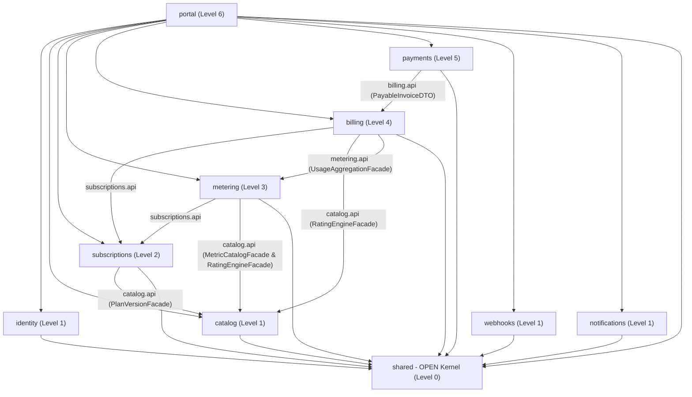
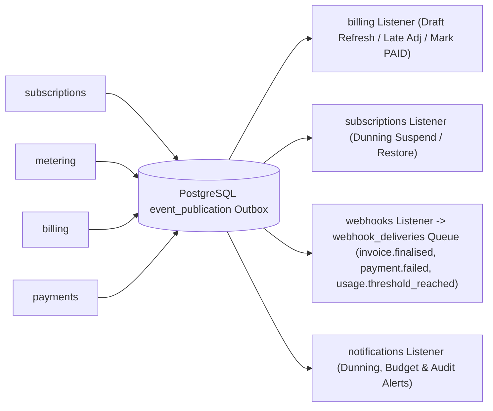

# MeterFlow Module Boundaries (`docs/architecture/MODULE_BOUNDARIES.md`)

## 1. Ten-Module Spring Modulith Decomposition

MeterFlow partitions `com.meterflow` into **ten acyclic Spring Modulith modules** (`C1`, `QA3`, [ADR-001](./ADRs/ADR-001-modular-monolith-spring-modulith.md)). Every domain module hides its JPA entities, Spring Data repositories, and internal services inside `internal`, exposing cross-module contracts exclusively via `@NamedInterface("api")` Java `record` DTOs and facades.

```text
com.meterflow
├── MeterFlowApplication.java
├── shared/          # @ApplicationModule(type = OPEN) — Money, BillingPeriod, ProrationCalculator, Clock
├── identity/        # Users, BCrypt, RBAC (ADMIN/OPERATOR/CUSTOMER), Dual Spring Security 7 Chains
├── catalog/         # Metrics (5 aggs + filters), Immutable PlanVersions, Strategy/Composite RatingEngine (6 charge types)
├── subscriptions/   # Customers, Trials, Seat Quantities, Mid-Cycle Switches & Proration Segments
├── metering/        # Idempotency Key + 72h Gate, 5 Aggregations, Sync Hourly Rollups, <=1m Live Estimates & Budgets
├── billing/         # Spring Batch Draft/Final Invoices, Tax, Line Traceability, Credits, Credit Notes, Late Adj, Simulation
├── payments/        # Simulated Collection, Day 1/3/7 Retries, Separate Suspension Timer, Dunning & Ledger
├── webhooks/        # invoice.finalised / payment.failed / usage.threshold_reached, Dual-Key HMAC, Backoff, Replay
├── notifications/   # Outbox Event Listeners for In-App Alerts & Immutable System Audit Logs
└── portal/          # Top Adapter: Spring MVC + Thymeleaf Views & /api/v1/events Ingestion Controller
```

---

## 2. Module Responsibilities, Exposed APIs & Domain Events

| Module | Type | Requirements Owned | Exposed `@NamedInterface("api")` Contracts | Published Outbox Events | Consumed Outbox Events |
| :--- | :--- | :--- | :--- | :--- | :--- |
| **`shared`** | `OPEN` | `Money` (`NUMERIC(19,8)` intermediate / `NUMERIC(19,4)` persisted), `BillingPeriod`, `ProrationCalculator`, injectable `Clock`, cache name constants. | All public types in `com.meterflow.shared` | None | None |
| **`identity`** | Closed | User authentication, `BCrypt`, `ROLE_ADMIN`/`ROLE_OPERATOR`/`ROLE_CUSTOMER`, customer-to-principal mapping, dual `SecurityFilterChain`s (`C6`, `QA4`). | `IdentityQueryFacade`, `UserAdminFacade`, `AuthenticatedActorDTO` | `UserCreatedEvent`, `UserRoleUpdatedEvent` | None |
| **`catalog`** | Closed | Metric schemas & filters (`FR2`), immutable `PUBLISHED` `plan_versions` (`FR10`), **all `6` mandatory charge strategies** (`FLAT_FEE`, `PER_UNIT`, `GRADUATED_TIERS`, `VOLUME_TIERS`, `PACKAGE`, `PER_SEAT`) + OCP `ChargeStrategyRegistry` + `PlanRatingComposite` (`FR3`). | `MetricCatalogFacade`, `PlanVersionFacade`, **`RatingEngineFacade`**, `ChargeCalculationStrategy` (extension SPI) | `MetricUpdatedEvent`, `PlanVersionPublishedEvent` | None |
| **`subscriptions`** | Closed | Customer billing accounts, tax profile, subscription transitions (`PENDING`..`EXPIRED`), trial windows, `seat_quantity` (`PER_SEAT`), mid-cycle switches & `subscription_segments` (`FR4`). | `CustomerAccountFacade`, `SubscriptionCommandFacade`, `SubscriptionSegmentQueryFacade` | `CustomerCreatedEvent`, `SubscriptionStartedEvent`, `SubscriptionPlanChangedEvent`, `SubscriptionSeatQuantityChangedEvent`, `SubscriptionCanceledEvent` | `DunningSuspensionTriggeredEvent`, `DunningRecoveredEvent` |
| **`metering`** | Closed | Single & batch (`<= 1,000`) ingestion, `(customer_id, idempotency_key)` + `payload_hash` (`200` duplicate / `409` conflict), `72h` late gate (`FR1`), `5` aggregations + `JSONB` filters (`FR2`), sync `bucket_hour` `usage_rollups`, `<= 1m` live estimates, budgets & alerts (`FR7`). | `UsageIngestionFacade`, `UsageAggregationFacade`, `LiveEstimateFacade`, `BudgetManagementFacade` | `PriorPeriodLateEventRecorded`, `BudgetThresholdExceededEvent` (`usage.threshold_reached`) | `SubscriptionPlanChangedEvent`, `SubscriptionSeatQuantityChangedEvent`, `MetricUpdatedEvent` (after-commit cache eviction) |
| **`billing`** | Closed | Two-step Spring Batch (`generateDraftInvoicesJob`, `finalizeInvoicesJob`), immutable `FINALIZED` invoices, tax, full line provenance (`FR5`), credit grants, credit notes, cumulative-delta late adjustments (`FR6`), and `@Transactional(readOnly = true)` invoice simulation (`FR10`). | `BillingJobFacade`, `InvoiceQueryFacade`, `CreditManagementFacade`, `InvoiceSimulationFacade`, `PayableInvoiceDTO` | `InvoiceDraftGeneratedEvent`, `InvoiceFinalizedEvent` (`invoice.finalised`), `CreditNoteIssuedEvent`, `LateAdjustmentRecordedEvent` | `PriorPeriodLateEventRecorded`, `PaymentCapturedEvent`, `InvoiceWrittenOffEvent` |
| **`payments`** | Closed | Deterministic `SimulatedPaymentService`, exact **Day 1 / Day 3 / Day 7 (`[24, 72, 168]`)** retry worker, separate `suspension_at` state-transition timer, dunning recovery (`FR8`), and balanced `ledger_entries`. | `SimulatedPaymentFacade`, `DunningManagementFacade`, `LedgerQueryFacade` | `PaymentCapturedEvent`, `InvoicePaymentFailedEvent` (`payment.failed`), `DunningFinalWarningEvent`, `DunningSuspensionTriggeredEvent`, `DunningRecoveredEvent`, `InvoiceWrittenOffEvent` | `InvoiceFinalizedEvent`, `CreditNoteIssuedEvent` |
| **`webhooks`** | Closed | Endpoint registry, dual-key encrypted `HMAC-SHA256` signer (`active` + `previous` rotation grace window), SSRF IP validator, PostgreSQL `SKIP LOCKED` exponential backoff dispatcher, attempt history, and RBAC-scoped manual replay (`FR9`). | `WebhookEndpointFacade`, `WebhookDeliveryQueryFacade`, `WebhookReplayFacade` | None | `InvoiceFinalizedEvent` (`invoice.finalised`), `InvoicePaymentFailedEvent` (`payment.failed`), `BudgetThresholdExceededEvent` (`usage.threshold_reached`), plus optional billing/dunning events |
| **`notifications`** | Closed | In-app customer/operator notifications for every dunning transition, budget alert, and billing event + immutable `audit_logs` (`FR7`, `FR8`, `QA5`). | `NotificationQueryFacade`, `AuditLogQueryFacade` | None | All billing, budget, dunning, security, and webhook-replay audit events |
| **`portal`** | Closed | **Spring MVC + Thymeleaf** UI controllers/templates and `/api/v1/events` REST ingestion controller. | None (top-most presentation adapter) | None | None |

---

## 3. Synchronous Dependency Graph (Verified Strict DAG)



---

## 4. Open/Closed Pricing Strategy & Cycle-Prevention Contracts

1. **Strategy + Composite Pricing Extension (`FR3`, `QA3`)**:
   - `catalog` registers all six mandatory strategies (`FLAT_FEE`, `PER_UNIT`, `GRADUATED_TIERS`, `VOLUME_TIERS`, `PACKAGE`, `PER_SEAT`) via Spring bean injection (`List<ChargeCalculationStrategy>` -> `ChargeStrategyRegistry`).
   - Supporting an additional instructor-defined charge type (e.g., an optional `PERCENTAGE` strategy) requires only adding a new `@Component` implementing `ChargeCalculationStrategy` with **zero edits** to existing strategy classes or `PlanRatingComposite`.
2. **Zero Duplicate Pricing Logic**: `billing` (draft/final invoicing, late-event cumulative re-rating, dry-run simulation) and `metering` (live `<= 1m` estimates & budget evaluation) all delegate exclusively to `catalog.api.RatingEngineFacade`.
3. **Cycle Elimination via Outbox**: `metering -> billing` (`PriorPeriodLateEventRecorded`) and `payments -> billing/subscriptions` (`PaymentCapturedEvent`, `DunningSuspensionTriggeredEvent`, `DunningRecoveredEvent`) propagate asynchronously via `event_publication` (`ApplicationModules.verify()` passes with `0` cycles).

---

## 5. Asynchronous Event & Webhook Topology


