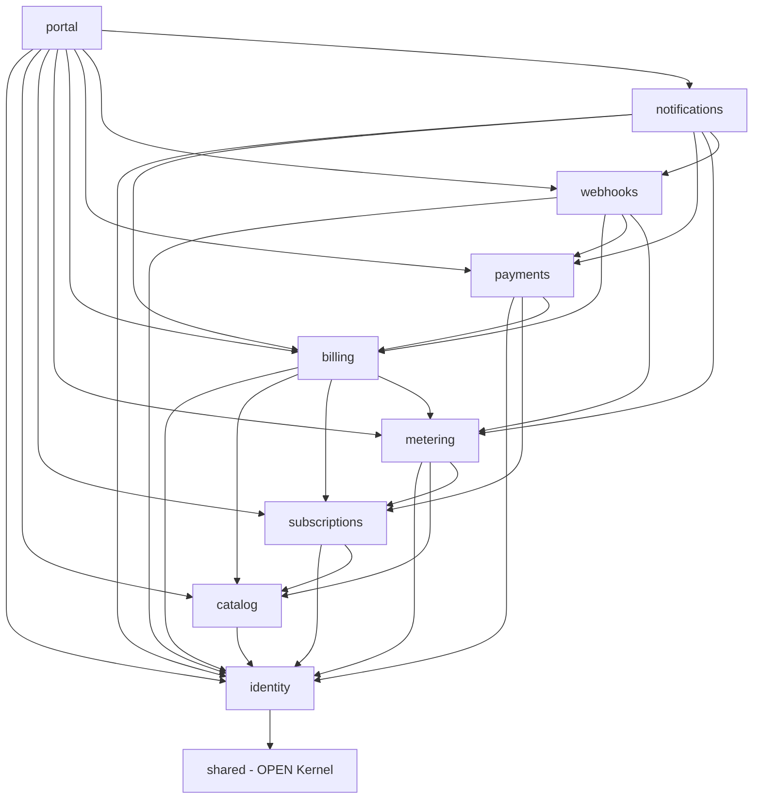
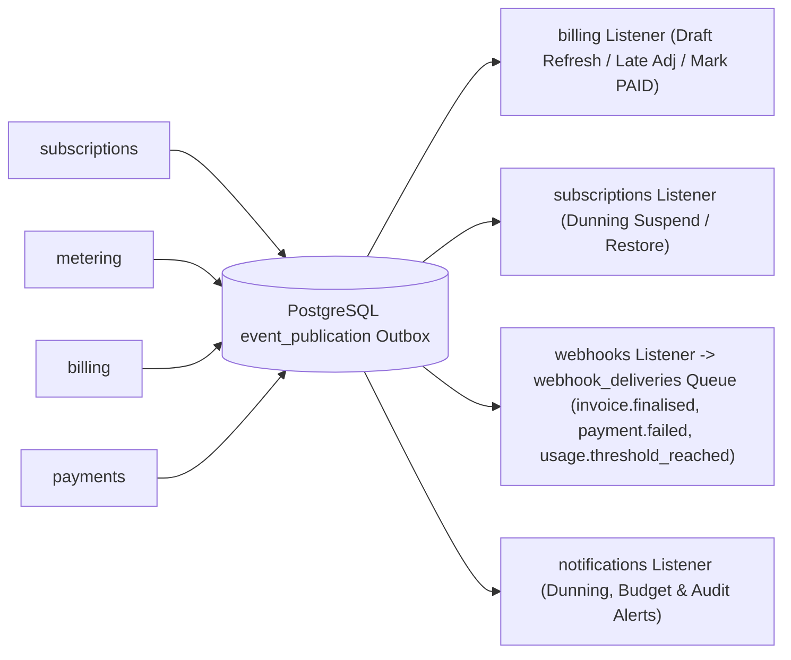

# MeterFlow Module Boundaries (`docs/architecture/MODULE_BOUNDARIES.md`)

## 1. Ten-Module Spring Modulith Decomposition

MeterFlow partitions `com.meterflow` into **ten acyclic Spring Modulith modules** (`C1`, `QA3`, [ADR-001](./ADRs/ADR-001-modular-monolith-spring-modulith.md)). Every domain module hides its JPA entities, Spring Data repositories, and internal services inside `internal`, exposing cross-module contracts exclusively via `@NamedInterface("api")` Java `record` DTOs and facades.

```text
com.meterflow
├── MeterFlowApplication.java
├── shared/          # @ApplicationModule(type = OPEN) — Money, BillingPeriod, ProrationCalculator, Clock
├── identity/        # Users, BCrypt, RBAC (ADMIN/OPERATOR/CUSTOMER), Dual Spring Security 7 Chains
├── catalog/         # Metrics (5 aggs + filters), Immutable PlanVersions, Strategy/Composite RatingEngine (6 charge types)
├── subscriptions/   # Customers, Trials, Seat Quantities, Mid-Cycle Switches & Proration Segments
├── metering/        # Idempotency Key + 72h Gate, 5 Aggregations, Sync Hourly Rollups, <=1m Live Estimates & Budgets
├── billing/         # Spring Batch Draft/Final Invoices, Tax, Line Traceability, Credits, Credit Notes, Late Adj, Simulation
├── payments/        # Simulated Collection, Day 1/3/7 Retries, Separate Suspension Timer, Dunning & Ledger
├── webhooks/        # invoice.finalised / payment.failed / usage.threshold_reached, Dual-Key HMAC, Backoff, Replay
├── notifications/   # Outbox Event Listeners for In-App Alerts & Immutable System Audit Logs
└── portal/          # Top Adapter: Spring MVC + Thymeleaf Views & /api/v1/events Ingestion Controller
```

---

## 2. Module Responsibilities, Exposed APIs & Domain Events

| Module | Type | Requirements Owned | Exposed `@NamedInterface("api")` Contracts | Published Outbox Events | Consumed Outbox Events |
| :--- | :--- | :--- | :--- | :--- | :--- |
| **`shared`** | `OPEN` | Canonical `Money` (`BDT`/`USD`, exact intermediate `BigDecimal`, explicit `scale=8`/`4`/`2` `HALF_UP` per [ADR-010](./ADRs/ADR-010-financial-precision-currency-and-rounding-policy.md)), `SupportedCurrency`, `BillingInterval`, `BillingPeriod` (`ZonedDateTime` calendar clamping & exact UTC seconds per [ADR-012](./ADRs/ADR-012-subscription-workflow-billing-periods-and-proration.md)), `FinancialException`s, `CorrelationIds`, injectable `Clock`, `CacheNames`, `OutboxRetryScheduler`, `SchedulingConfiguration`. | All public types in `com.meterflow.shared` | None | None |
| **`identity`** | Closed | Persistent `customers`, `users`, `customer_memberships` (`V2`), DB-backed `DatabaseUserDetailsService`, `BCrypt(12)`, `ADMIN`/`OPERATOR`/`CUSTOMER` roles, one-time `InitialAdminBootstrapRunner`, reusable `CustomerAccessGuard` tenant isolation, hardened dual `SecurityFilterChain`s (`C6`, `QA4`). | `IdentityManagementFacade`, `IdentityQueryFacade`, `CustomerAccessGuard`, `MeterFlowRoles`, `PlatformRole`, `UserStatus`, `CustomerStatus`, `MembershipRole`, `MembershipStatus`, `AuthenticatedActor`, `CustomerSummary`, `UserSummary`, `CustomerMembershipSummary`, typed `IdentityException`s | Planned `UserCreatedEvent`, `UserRoleUpdatedEvent` | None |
| **`catalog`** | Closed *(depends on `shared`, `identity :: api`)* | Verified `V3` metric definitions & `5` filters (`FR2`), immutable `PUBLISHED` `plan_versions` + DB triggers + cloning (`FR10`), **all `6` mandatory charge strategies** (`FLAT_FEE`, `PER_UNIT`, `GRADUATED_TIERS`, `VOLUME_TIERS`, `PACKAGE` ceiling, `PER_SEAT`) + OCP `ChargeStrategyRegistry` + `PlanRatingComposite` (`FR3`, incl. `rateRecurringCharges` for `FR4` proration), single-pass allowances, commitments, read-only `PricingSimulationFacade`, and Caffeine `planVersions`/`metricDefinitions`. | `MetricCatalogFacade`, `PlanCatalogFacade`, **`RatingEngineFacade`**, `PricingSimulationFacade`, `ChargeCalculationStrategy` (OCP SPI), `MetricEvaluationSupport`, `ChargeTypes`, `RecurringQuoteRequest`, `RecurringPlanQuote`, immutable DTOs & typed exceptions | Planned `MetricUpdatedEvent`, `PlanVersionPublishedEvent` | None |
| **`subscriptions`** | Closed *(depends on `shared`, `identity :: api`, `catalog :: api`)* | Verified `V4` subscriptions, single-open-subscription policy, authoritative transitions (`TRIALING`, `ACTIVE`, `PAUSED`, `PAST_DUE`, `CANCELLED`, `EXPIRED`), trials (`EXPIRE_ON_END` / `AUTO_CONVERT_TO_PAID`), immediate mid-cycle upgrades/downgrades with exact-seconds `EXACT_SECONDS_V1` proration (`ProrationCalculator`), scheduled period-end changes, pause/resume period shift, immutable `subscription_plan_assignments`, `subscription_proration_records`, `subscription_state_transitions`, and restart-safe `SubscriptionMaintenanceFacade` (`FR4`, [ADR-012](./ADRs/ADR-012-subscription-workflow-billing-periods-and-proration.md)). | `SubscriptionManagementFacade`, `SubscriptionQueryFacade`, `SubscriptionMaintenanceFacade`, `SubscriptionStatus`, `TrialConversionPolicy`, `PlanChangeDirection`, `ScheduledChangeStatus`, `SubscriptionSummary`, `SubscriptionHistory`, `ProrationRecord`, `ScheduledPlanChangeRecord`, `SubscriptionPlanAssignmentRecord`, `SubscriptionTransitionRecord`, command DTOs & typed exceptions | Planned `SubscriptionStartedEvent`, `SubscriptionPlanChangedEvent`, `SubscriptionCancelledEvent` | Planned `DunningSuspensionTriggeredEvent`, `DunningRecoveredEvent` |
| **`metering`** | Closed *(depends on `shared`, `identity :: api`, `catalog :: api`, `subscriptions :: api`)* | Verified `V5` single-round-trip `UNNEST` batch ingestion (`<= 1,000`, partial acceptance), `(customer_id, idempotency_key)` + `SHA-256` `payload_hash` (`200` duplicate / `409` conflict), `72h` late tracking (`FR1`), all `5` aggregations & `5` filters reusing `MetricEvaluationSupport` (`FR2`), transactional hourly `usage_rollups` + sub-hour edge queries + ACID reconciliation/recovery, `15s` after-commit Caffeine `liveEstimates`, deduplicated `50/80/100%` threshold evaluator, & low-cardinality Micrometer metrics (`FR7`, [ADR-013](./ADRs/ADR-013-metering-ingestion-idempotency-rollups-and-freshness.md)). | `UsageIngestionFacade`, `UsageQueryFacade`, `LateUsageQueryFacade`, `UsageReconciliationFacade`, `UsageThresholdFacade`, immutable DTOs, command records & typed `MeteringException`s | `LateUsageEventRecordedEvent`, `UsageThresholdReachedEvent` | Planned `SubscriptionPlanChangedEvent`, `MetricUpdatedEvent` (after-commit cache eviction) |
| **`billing`** | Closed *(depends on `shared`, `identity :: api`, `catalog :: api`, `subscriptions :: api`, `metering :: api`)* | Two-step Spring Batch (`generateDraftInvoicesJob`, `finalizeInvoicesJob`), immutable `FINALIZED` invoices, tax, full line provenance (`FR5`), prepaid credit grants, credit notes, cumulative-delta late & manual adjustments (`FR6`), and `@Transactional(readOnly = true)` historical invoice simulation (`FR10`). | `BillingRunFacade`, `InvoiceManagementFacade`, `TaxPolicyFacade`, `PrepaidCreditFacade`, `CreditNoteFacade`, `BillingAdjustmentFacade`, `HistoricalInvoiceSimulationFacade`, `TaxCalculationStrategy` | `InvoiceFinalizedEvent` (`invoice.finalised`), `CreditNoteIssuedEvent` (`credit_note.issued`) | `LateUsageEventRecordedEvent` |
| **`payments`** | Closed *(depends on `shared`, `identity :: api`, `subscriptions :: api`, `billing :: api`)* | Deterministic `MockPaymentGateway`, exact **Day 1 / Day 3 / Day 7 (`[24, 72, 168]`)** retry worker, separate `suspension_at` state-transition timer (`FOR UPDATE SKIP LOCKED`), ACID billing/subscription settlement & recovery (`FR8`). | `PaymentProcessingFacade`, `PaymentQueryFacade`, `DunningManagementFacade`, `DunningPolicyFacade` | `PaymentSucceededEvent`, `PaymentFailedEvent` (`payment.failed`), `PaymentRetryScheduledEvent`, `SubscriptionSuspendedForNonPaymentEvent`, `SubscriptionReactivatedAfterPaymentEvent` | None (called synchronously via facades/scheduled worker; publishes outbox events) |
| **`webhooks`** | Closed *(depends on `shared`, `identity :: api`, `billing :: api`, `payments :: api`, `metering :: api`)* | Endpoint registry, AES-256-GCM encrypted dual-key `HMAC-SHA256` signer (`24h` rotation grace window), `SsrfUrlValidator`, PostgreSQL `SKIP LOCKED` exponential backoff dispatcher (`+30s/+2m/+10m/+1h/+6h`), immutable attempt history, and RBAC-scoped auditable manual replay (`FR9`). | `WebhookEndpointFacade`, `WebhookDeliveryFacade`, `WebhookSignatureVerifier` | `WebhookReplayAuditEvent` | `InvoiceFinalizedEvent`, `CreditNoteIssuedEvent`, `PaymentSucceededEvent`, `PaymentFailedEvent`, `SubscriptionSuspendedForNonPaymentEvent`, `SubscriptionReactivatedAfterPaymentEvent`, `UsageThresholdReachedEvent` |
| **`notifications`** | Closed *(depends on `shared`, `identity :: api`, `billing :: api`, `payments :: api`, `metering :: api`, `webhooks :: api`)* | Idempotent customer notifications for billing, payment/dunning, and threshold alerts + immutable `audit_logs` (`FR7`, `FR8`, `FR9`, `QA5`). | `NotificationFacade`, `AuditLogFacade` | None | `InvoiceFinalizedEvent`, `CreditNoteIssuedEvent`, `PaymentSucceededEvent`, `PaymentFailedEvent`, `SubscriptionSuspendedForNonPaymentEvent`, `SubscriptionReactivatedAfterPaymentEvent`, `UsageThresholdReachedEvent`, `WebhookReplayAuditEvent` |
| **`portal`** | Closed *(depends on `shared` and all `8` domain `:: api` packages)* | **Spring MVC + Thymeleaf** Customer/Operator portals and `/api/v1/**` REST controllers + `GlobalApiExceptionHandler` + `PageResponse`. | None (top-most presentation adapter) | None | None |

---

## 3. Synchronous Dependency Graph (Verified Strict DAG Matching `package-info.java`)



---

## 4. Open/Closed Pricing Strategy & Cycle-Prevention Contracts

1. **Strategy + Composite Pricing Extension (`FR3`, `QA3`)**:
   - `catalog` registers all six mandatory strategies (`FLAT_FEE`, `PER_UNIT`, `GRADUATED_TIERS`, `VOLUME_TIERS`, `PACKAGE`, `PER_SEAT`) via Spring bean injection (`List<ChargeCalculationStrategy>` -> `ChargeStrategyRegistry`).
   - Supporting an additional instructor-defined charge type (e.g., an optional `PERCENTAGE` strategy) requires only adding a new `@Component` implementing `ChargeCalculationStrategy` with **zero edits** to existing strategy classes or `PlanRatingComposite`.
2. **Zero Duplicate Pricing Logic**: `billing` (draft/final invoicing, late-event cumulative re-rating, dry-run simulation) and `metering` (live `<= 1m` estimates & budget evaluation) all delegate exclusively to `catalog.api.RatingEngineFacade`.
3. **Cycle Elimination via Outbox**: `metering -> billing` (`PriorPeriodLateEventRecorded`) and `payments -> billing/subscriptions` (`PaymentCapturedEvent`, `DunningSuspensionTriggeredEvent`, `DunningRecoveredEvent`) propagate asynchronously via `event_publication` (`ApplicationModules.verify()` passes with `0` cycles).

---

## 5. Asynchronous Event & Webhook Topology


