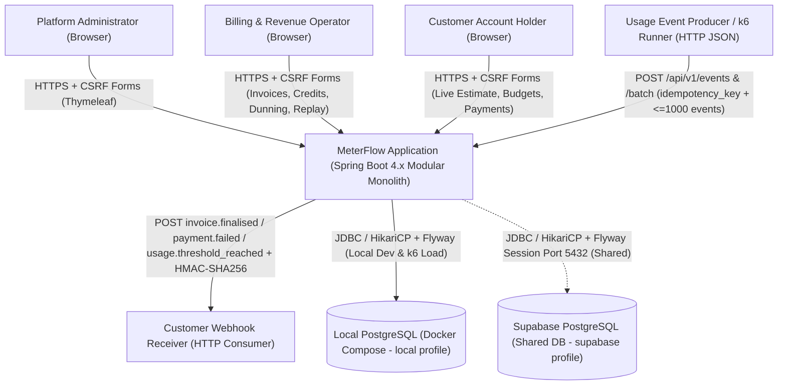
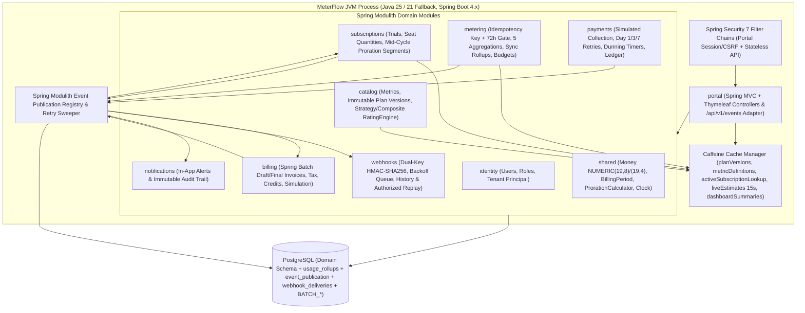

# MeterFlow System Design (`docs/architecture/SYSTEM_DESIGN.md`)

## 1. Architectural Overview

**MeterFlow** is a **Domain-Partitioned Modular Monolith** built on **Spring Boot 4.x**, **Spring Modulith 2.x**, and **Java 25** (with **Java 21 LTS** fallback compatibility) (`C1`, [ADR-001](./ADRs/ADR-001-modular-monolith-spring-modulith.md)). It provides idempotent `72-hour` late-event ingestion (`FR1`), five-mode filtered metric aggregation (`FR2`), six-model Open/Closed subscription pricing (`FR3`), mid-cycle proration and trials (`FR4`), draft/finalized batch invoicing with line-level provenance (`FR5`), credits/credit notes/late adjustments (`FR6`), proven `<= 1 minute` live estimates and budgets (`FR7`), exact Day 1/3/7 payment retries and dunning (`FR8`), `HMAC-SHA256` webhooks with secret rotation, backoff, and authorized replay (`FR9`), and immutable plan versions with dry-run simulation (`FR10`)—backed exclusively by **PostgreSQL** and **Caffeine** (`C5`, `C7`).

---

## 2. System Context



---

## 3. Internal Container & Module Topology



---

## 4. End-to-End Runtime Workflows

### 4.1 Idempotent Usage Ingestion, Conflict Detection, Synchronous Rollup & 72h Late Routing (`FR1`, `FR2`, `FR6`, `FR7`)

```mermaid
sequenceDiagram
    autonumber
    actor Client as Ingestion Producer
    participant API as portal (EventIngestionController)
    participant Met as metering (UsageIngestionService)
    participant Caf as Caffeine (metricDefinitions + liveEstimates)
    participant PG as PostgreSQL (usage_events + usage_rollups + event_publication)
    participant Bill as billing (LateEventAdjustmentListener)

    Client->>API: POST /api/v1/events (idempotency_key, customer_id, subscription_id, metric_code, event_timestamp, properties)
    API->>Met: ingest(event + SHA-256 payload_hash)
    Met->>PG: BEGIN TX - Check existing (customer_id, idempotency_key) FIRST (before 72h check)
    alt Existing key found
        alt payload_hash matches
            Met-->>API: 200 OK (DUPLICATE_IGNORED - 0 rows inserted, 0 rollup delta)
        else payload_hash differs
            Met->>PG: INSERT rejected_usage_events (IDEMPOTENCY_KEY_CONFLICT)
            Met-->>API: 409 Conflict (IDEMPOTENCY_KEY_CONFLICT)
        end
    else New idempotency_key
        Met->>Met: Verify timestamp <= ingested_at + 5m AND ingested_at - event_timestamp <= 72h
        alt Late > 72h or Future > 5m
            Met->>PG: INSERT rejected_usage_events (EXPIRED_LATE_EVENT / FUTURE_TIMESTAMP)
            Met-->>API: 422 Unprocessable Entity
        else Valid Event
            Met->>PG: INSERT usage_events ON CONFLICT (customer_id, idempotency_key) DO NOTHING RETURNING id
            alt Lost concurrent race (0 rows returned)
                Met->>PG: Re-read winning row & compare payload_hash (200 Duplicate or 409 Conflict)
            else Won insert
                Met->>PG: Synchronous UPSERT usage_rollups (subscription_id, metric_id, bucket_hour)
                opt Event falls into closed prior billing period
                    Met->>PG: INSERT event_publication (PriorPeriodLateEventRecorded)
                end
                Met->>PG: COMMIT TX -> after-commit evicts subscriptionId from liveEstimates
                Met-->>API: 202 Accepted
                opt PriorPeriodLateEventRecorded emitted
                    PG--)Bill: Async @ApplicationModuleListener
                    Bill->>PG: If DRAFT -> re-rate draft; If FINALIZED -> cumulative-delta late_usage_adjustments
                end
            end
        end
    end
```

### 4.2 Two-Step Batch Invoicing, Exact Day 1 / Day 3 / Day 7 Dunning Retries & Dual-Key HMAC Webhooks (`FR5`, `FR8`, `FR9`)

```mermaid
sequenceDiagram
    autonumber
    actor Sched as Admin / Batch Scheduler
    participant Batch as billing (generateDraftInvoicesJob / finalizeInvoicesJob)
    participant PG as PostgreSQL (Invoices, Credits, Outbox, Dunning, Webhooks)
    participant Pay as payments (SimulatedPaymentService & DunningWorker)
    participant Hook as webhooks (HmacWebhookDispatcher)
    actor Sink as Customer Webhook Receiver

    Sched->>Batch: generateDraftInvoicesJob -> finalizeInvoicesJob (after grace cutoff)
    Batch->>PG: Lock FINALIZED invoice + tax + FIFO credits + event_publication (InvoiceFinalizedEvent -> invoice.finalised)

    PG--)Pay: Initial collection attempt (T0)
    alt SIMULATE_SOFT_DECLINE / SIMULATE_TIMEOUT
        Pay->>PG: Invoice & Subscription -> PAST_DUE; open dunning_cases (Retry 1 at T0 + 24h)
        Pay->>PG: Emit payment.failed + customer notification
        loop Exactly 3 Payment Retries: Day 1 (+24h), Day 3 (+72h), Day 7 (+168h)
            Pay->>PG: Execute retry (dunning:{caseId}:retry:{1|2|3})
            alt Retry fails
                Pay->>PG: Notify customer + emit payment.failed; advance timer (after Retry 3 -> FINAL_WARNING + separate suspension_at timer)
            else Retry succeeds (or manual payment at any time)
                Pay->>PG: Capture payment + RECOVERED + invoice PAID + subscription ACTIVE + recovery notice
            end
        end
        opt suspension_at reached unpaid (NO 4th payment attempt)
            Pay->>PG: Transition dunning_cases -> SUSPENDED + emit suspension notice & DunningSuspensionTriggeredEvent
        end
    end

    PG--)Hook: Enqueue webhook_deliveries (invoice.finalised / payment.failed / usage.threshold_reached)
    Hook->>Hook: Sign with active_signing_secret (+ previous_signing_secret if in rotation grace window)
    Hook->>Sink: POST payload + X-MeterFlow-Signature: t=<epoch>,v1=<sig>[,v1=<prev_sig>]
```

---

## 5. Proven One-Minute (`<= 60s`) Live Spend Freshness Budget (`FR7`, `QA1`)

Naive designs that rely on a `60-second` background rollup job plus a `30-second` cache TTL produce `> 90 seconds` worst-case staleness and **fail `FR7`**. MeterFlow proves `<= 60 seconds` freshness mathematically using **synchronous in-transaction hourly rollups (`bucket_hour`) + after-commit Caffeine eviction + a hard `15-second` Caffeine TTL ceiling**:

| Latency Component | Normal Single-JVM Path | Worst-Case Bound (Missed Eviction / Burst) | Mechanism Eliminating Unbounded Lag |
| :--- | :---: | :---: | :--- |
| **1. Event Ingestion Commit (`T_ingest`)** | `0.10 s` | `0.40 s` (`QA1` `p99`) | Single ACID PostgreSQL TX inserts `usage_events` and synchronously upserts `usage_rollups (subscription_id, metric_id, bucket_hour)`. |
| **2. Event Publication Delay (`T_publish`)** | `0.00 s` | `0.00 s` | Live spend computation does **not** wait on `event_publication` outbox polling. |
| **3. Aggregation Delay (`T_aggregate`)** | `0.00 s` | `0.00 s` | Additive/monotonic metrics (`COUNT`, `SUM`, `MAX`, `LATEST`) fold synchronously at commit into `<= 744` hourly rows/month; `UNIQUE_COUNT` reads indexed `usage_events` directly with `0s` lag. |
| **4. Cache Invalidation Delay (`T_invalidate`)** | `0.05 s` | `15.00 s` | After-commit transactional callback evicts `liveEstimates.evict(subscriptionId)` immediately; `expireAfterWrite = 15s` acts as a hard ceiling if an eviction is missed. |
| **5. Cache Miss Recompute & Read (`T_read`)** | `0.08 s` | `0.25 s` (`QA1` `p95`) | Reads `<= 744` hourly rollup rows + cached immutable `planVersions` through `RatingEngineFacade`. |
| **Total End-to-End Live Estimate Freshness** | **`0.23 s`** | **`15.65 s`** | **Proven `<= 60.00 s` (`44.35 s` safety margin) using Caffeine + PostgreSQL only.** |

### Budget Alert Freshness (`usage.threshold_reached`) & Financial Safety Rule

- **Budget Evaluator Timing**: A lightweight `@Scheduled(fixedDelay = 10_000)` budget evaluator (or after-commit async check) compares updated `usage_rollups` against active `spend_budgets`, inserts `budget_alerts_fired` (`uq_budget_alert_once`), and publishes `BudgetThresholdExceededEvent` (`usage.threshold_reached`). Worst-case ingestion-to-alert time: `0.40 s` (ingest) + `10.00 s` (evaluator interval) + `0.25 s` (rate/insert) + `5.00 s` (initial webhook HTTP timeout) = **`15.65 s` (`<= 60.00 s`)**.
- **Strict Financial Isolation**: **`liveEstimates` in Caffeine is strictly read-only telemetry.** Draft/Final Invoices (`FR5`), Credit Notes (`FR6`), Late Adjustments (`FR6`), and Invoice Simulations (`FR10`) **never** read from Caffeine `liveEstimates`; they always query committed PostgreSQL state inside ACID transactions.

---

## 6. Financial Calculation & Strategy/Composite Architecture (`FR3`–`FR6`, `FR10`, `QA2`)

1. **Six Mandatory Charge Types via Strategy + Composite (`FR3`, [ADR-011](./ADRs/ADR-011-pricing-tiers-packages-allowances-and-commitments.md))**:
   - `catalog` implements `ChargeCalculationStrategy` (`String`-keyed SPI) with six Spring-managed beans registered in `ChargeStrategyRegistry`: `FlatFeeChargeStrategy` (`FLAT_FEE`), `PerUnitChargeStrategy` (`PER_UNIT`), `GraduatedTiersChargeStrategy` (`GRADUATED_TIERS`), `VolumeTiersChargeStrategy` (`VOLUME_TIERS`), `PackageChargeStrategy` (`PACKAGE` with explicit `CEILING` partial-package rounding), and `PerSeatChargeStrategy` (`PER_SEAT` using contracted `seatQuantity` or metered seat gauges).
   - `PlanRatingComposite` (`RatingEngineFacade`) orchestrates single-pass free-allowance deduction (preventing double consumption across charges sharing a metric), strategy execution, charge-level and plan-level minimum commitment true-ups, and `ADR-010` rounding—reused identically by read-only `PricingSimulationService` (`PricingSimulationFacade`).
   - Adding any future charge type requires one new `ChargeCalculationStrategy` bean with **zero edits** to existing strategy classes or `PlanRatingComposite` (`OCP`, proven by automated test-only 7th strategy verification).
2. **Rounding & Evaluation Order (`QA2`, [ADR-010](./ADRs/ADR-010-financial-precision-currency-and-rounding-policy.md))**:
   - All monetary math uses canonical immutable `com.meterflow.shared.Money` (`SupportedCurrency.BDT` and `SupportedCurrency.USD`, `0` `double`/`float`, no implicit intermediate rounding): `roundToIntermediate()` (`NUMERIC(19,8)` `HALF_UP`) for proration factors and unit rates, `roundToPersisted()` (`NUMERIC(19,4)` `HALF_UP`) per persisted `invoice_lines` / `credit_note_lines` / `ledger_entries` row, and `roundToPayable()` (`2` decimals — exact paisa for `BDT`, exact cents for `USD`, `HALF_UP`) for final customer settlement.
   - Exact order: `Segment Aggregation -> Prorated Free Allowance -> Charge Strategy -> Minimum Commitment True-Up -> Carry-Forward Late Adjustments -> Subtotal (SUM of rounded lines) -> Tax -> FIFO Credit Wallet Drawdown -> Net Amount Due`.
3. **Cumulative-Delta Re-Rating (`FR1`, `FR6`)**: Post-finalization `<= 72h` late events re-rate the entire period cumulatively via `RatingEngineFacade` and persist `delta = new_period_charge - prior_billed_charge` in `late_usage_adjustments` without touching the `FINALIZED` invoice.
4. **Subscription Proration & Period Management (`FR4`, [ADR-012](./ADRs/ADR-012-subscription-workflow-billing-periods-and-proration.md))**: `subscriptions` enforces single-open-subscription per customer (`uq_subscriptions_one_open_per_customer` + PostgreSQL advisory lock), `PUBLISHED`-only plan versions, calendar-clamped zoned `BillingPeriod` boundaries (`shared`), exact-seconds UTC `EXACT_SECONDS_V1` proration via `RatingEngineFacade.rateRecurringCharges` (rating only fixed recurring charges while listing non-proratable usage charges in `subscription_proration_records`), immutable `subscription_plan_assignments` segments, conflict-safe scheduled period-end changes, pause/resume period shifting, and restart-safe repeatable maintenance (`SubscriptionMaintenanceFacade`).
5. **High-Throughput Metering, Rollups & Freshness (`FR1`, `FR2`, `FR7`, [ADR-013](./ADRs/ADR-013-metering-ingestion-idempotency-rollups-and-freshness.md))**: `metering` ingests batches up to `1,000` events via single-round-trip PostgreSQL `UNNEST ... ON CONFLICT (customer_id, idempotency_key) DO NOTHING RETURNING`, resolves only conflicted keys for duplicate vs. `409` payload-hash discrimination, tracks `<= 72h` late events in `usage_late_event_records` + `LateUsageEventRecordedEvent`, pre-aggregates newly inserted rows into deadlock-free sorted hourly `usage_rollups` inside the same ACID transaction, combines `usage_rollups` with exact sub-hour edge queries (and indexed `UNIQUE_COUNT` / `MetricEvaluationSupport` filtered queries), reconciles/recovers deterministically from immutable `usage_events`, evicts `15s` Caffeine `liveEstimates` after commit, and emits deduplicated `50%`/`80%`/`100%` `UsageThresholdReachedEvent` outbox records.

---

## 7. Caffeine Cache Regions & Security Summary (`ADR-003`, `ADR-006`, `ADR-009`)

| Cache Region | Module | Key -> Immutable `record` DTO | Max Size | Write TTL | Eviction Rule |
| :--- | :--- | :--- | :---: | :---: | :--- |
| `planVersions` | `catalog` | `planVersionId -> PlanVersionBundleDTO` | `1,000` | `60m` | Zero staleness (`PUBLISHED` versions are immutable, `FR10`). |
| `metricDefinitions` | `catalog` | `metricCode -> MetricDefDTO` | `1,000` | `15m` | After-commit eviction on filter/metric mutation (`FR2`). |
| `activeSubscriptionLookup` | `subscriptions` | `customerId -> ActiveSubscriptionsDTO` | `5,000` | `5m` | After-commit eviction on trial/plan/seat/dunning change (`FR4`, `FR8`). |
| `liveEstimates` | `metering` | `subscriptionId -> LiveEstimateDTO` | `5,000` | **`15s`** | After-commit key eviction on ingestion/plan change (`<= 15.65s` worst-case freshness, `FR7`). |
| `dashboardSummaries` | `portal` | `(role, scopeId) -> DashboardKpiDTO` | `200` | `30s` | Short bounded TTL for portal KPIs (`QA1`). |

- **Dual PostgreSQL Profiles (`ADR-002`)**: `local` targets Docker Compose PostgreSQL (`HikariCP 20`, mandatory for all `k6` load runs); `supabase` reads `SUPABASE_DB_*` env vars (`HikariCP 6`, Flyway over Session Mode port `5432`).
- **Identity, Database Authentication & Tenant Isolation (`ADR-006`)**: `DatabaseUserDetailsService` authenticates normalized emails against PostgreSQL `users` (`BCrypt(12)`), rejecting `DISABLED`/`SUSPENDED` accounts; `CustomerAccessGuard` verifies live user status and active `customer_memberships` for every customer-scoped request (never trusting request-supplied `customerId`); `InitialAdminBootstrapRunner` provides opt-in one-time environment-driven admin provisioning with zero hardcoded defaults; dual `SecurityFilterChain`s enforce defensive headers (`X-Frame-Options: DENY`, CSP, `Referrer-Policy`), session fixation migration, CSRF logout, and RFC 9457 `ProblemDetail` API errors.
- **Dual-Key Webhook Verification (`FR9`, `ADR-009`)**: Signing secrets are encrypted at rest; during rotation (`previous_secret_expires_at > now`), headers include both active and previous signatures (`t=<epoch>,v1=<active>,v1=<previous>`) verified in constant time within a `300s` timestamp skew window.
