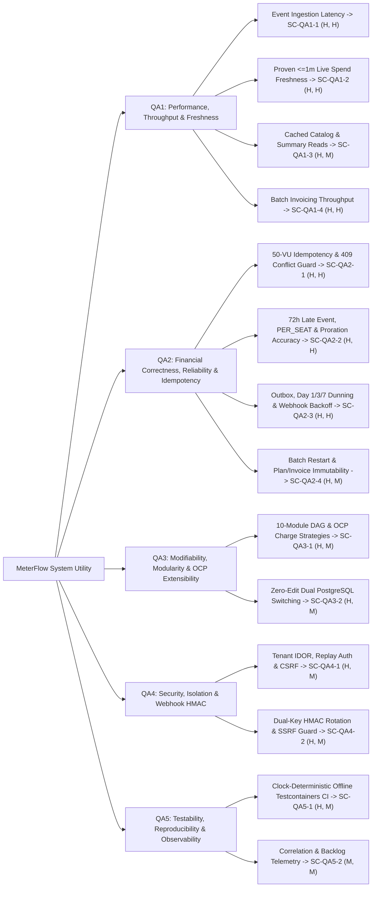

# MeterFlow ATAM Quality Attribute Utility Tree (`docs/architecture/UTILITY_TREE.md`)

## 1. Purpose & Ranking Model

Following the SEI **Architecture Tradeoff Analysis Method (ATAM)** (`C3`), this Utility Tree refines MeterFlow's system **Utility** across `QA1`–`QA5` into concrete 6-part scenarios prioritized by **`(Business Importance, Architectural Difficulty / Risk)`** (`H`, `M`, `L`). All target metrics retain exact alignment with [`QUALITY_ATTRIBUTE_PLAN.md`](./QUALITY_ATTRIBUTE_PLAN.md) and [`REQUIREMENTS_TRACEABILITY.md`](../REQUIREMENTS_TRACEABILITY.md).

---

## 2. Utility Tree Diagram

---

## 3. Prioritized 6-Part Quality Attribute Scenarios

| ID | `(Imp, Diff)` | Attribute | Source | Stimulus | Artifact | Environment | Response | Measurable Target |
| :--- | :--- | :--- | :--- | :--- | :--- | :--- | :--- | :--- |
| **SC-QA1-1** | **`(H, H)`** | `QA1` | `100` concurrent producers (`k6`) | Sustain single & `1,000`-event batch `POST /api/v1/events` traffic for `60 s` | `portal`, `metering`, Caffeine, PostgreSQL `usage_events` & `usage_rollups` | Local Docker Compose stack (`500` subscriptions) | Validates metric/subscription via Caffeine, deduplicates `idempotency_key`, writes event & `bucket_hour` rollup atomically | `p95 <= 200 ms`, `p99 <= 400 ms`, error `< 0.5%`, `>= 500` events/s |
| **SC-QA1-2** | **`(H, H)`** | `QA1` | Customer or operator viewing live spend (`FR7`) | Ingest new usage event and query current-period live invoice estimate | `metering`, `catalog` (`RatingEngineFacade`), `usage_rollups`, Caffeine `liveEstimates` (`15s` TTL) | Active billing period | Synchronous in-TX rollup (`0s` aggregation lag) + after-commit key eviction (`0.05s`) bounded by `15s` TTL cap; never relies on stale cache for real invoices | **`0.70s` typical / `15.65s` worst-case freshness (`<= 60s` proven)**; query `p95 <= 250 ms` |
| **SC-QA1-3** | **`(H, M)`** | `QA1` | `100` concurrent users / rating calls | Read immutable `PUBLISHED` `plan_versions`, metrics, and dashboard KPIs | `catalog`, `portal`, `CaffeineCacheManager` | Post-warmup steady state | Served from Caffeine with zero Redis dependency | `p95 <= 150 ms`; hit ratio `>= 90%` |
| **SC-QA1-4** | **`(H, H)`** | `QA1` | Scheduler / Admin (`FR5`) | Run `generateDraftInvoicesJob` + `finalizeInvoicesJob` across `1,000` subscriptions (`>= 100,000` events) | `billing` (`Spring Batch`), `catalog`, PostgreSQL | Local Docker Compose PostgreSQL | Chunks of `100` subscriptions rate all `6` mandatory charge types and persist traceable lines | Total duration `<= 60 seconds`; heap `< 512 MB` |
| **SC-QA2-1** | **`(H, H)`** | `QA2` | Retrying or misconfigured producer (`50` VUs) | Send `50` simultaneous identical `idempotency_key` events (same `payload_hash` and conflicting `payload_hash`) + duplicate payment keys | `metering`, `payments`, PostgreSQL unique indexes | High-contention concurrency | Winning insert commits once; identical duplicates return `200 DUPLICATE_IGNORED` (`0` rollup delta); differing `payload_hash` returns `409 IDEMPOTENCY_KEY_CONFLICT` | `0` duplicate events/rollups/captures; `100%` `409` on payload conflict; `0` HTTP `500`s |
| **SC-QA2-2** | **`(H, H)`** | `QA2` | Mid-cycle seat/plan change (`FR3`, `FR4`) + `48h`-late event post-finalization (`FR1`, `FR6`) | Customer upgrades `PER_SEAT` quantity mid-period, finalizes invoice, then receives a valid `48h`-late event crossing a `GRADUATED_TIERS` boundary | `subscriptions`, `catalog` (`RatingEngineFacade`), `billing` (`late_usage_adjustments`) | Production financial rules | Proration uses `NUMERIC(19,8)` -> `NUMERIC(19,4)` `HALF_UP`; late event triggers cumulative period re-rating delta without mutating `FINALIZED` invoice | `0.0000` rounding drift; `FINALIZED` invoice unchanged; exact delta persisted |
| **SC-QA2-3** | **`(H, H)`** | `QA2` | Soft-declining payer (`FR8`) + failing customer webhook receiver (`FR9`, `503` for `2h`) | Invoice fails initial collection; webhook endpoint rejects `invoice.finalised`/`payment.failed` | `payments` (`dunning_cases`), `event_publication`, `webhooks` (`webhook_deliveries`) | Degraded payment/receiver state | Exactly **3** retries run at Day 1 (`+24h`), Day 3 (`+72h`), Day 7 (`+168h`), separate `suspension_at` timer suspends without a 4th charge; webhooks back off (`30s`..`6h`) and log every attempt without blocking internal outbox | `3` exact retries; `0` lost outbox events; `100%` webhook attempt history & replayability |
| **SC-QA2-4** | **`(H, M)`** | `QA2` | Batch crash at chunk `5` of `10` (`FR5`) or attempted edit to `PUBLISHED` `plan_version` (`FR10`) | Restart batch job; send `PUT` to edit published plan charge | `billing` (`BATCH_*`), `catalog` (`plan_versions`) | Recovery & admin mutation | Batch resumes from chunk `5` with zero duplicates; published plan edit rejected (`409` + DB trigger) | `1,000 / 1,000` subscriptions billed once; `100%` published plan immutability |
| **SC-QA3-1** | **`(H, M)`** | `QA3` | Contributor or instructor extension test | Add a new custom `ChargeCalculationStrategy` (e.g., `PERCENTAGE`) or attempt an illegal cross-module internal import | `catalog` Strategy registry, `ModularityTests` | `mvn test` / CI | New strategy plugs in with `0` edits to existing 6 strategies; illegal import fails `ApplicationModules.verify()` | `0` module violations; `0` edits to existing strategies for new charge type |
| **SC-QA3-2** | **`(H, M)`** | `QA3` | Operator switching environment | Change `SPRING_PROFILES_ACTIVE` between `local` and `supabase` | HikariCP, Flyway (`5432` session mode), JPA | Local Docker Compose vs. Shared Supabase | Validates identical Flyway schema with profile pool limits (`20` vs. `6`) | `0` code or Flyway SQL edits |
| **SC-QA4-1** | **`(H, M)`** | `QA4` | Authenticated `ROLE_CUSTOMER` (`Customer A`) or untokenized form POST | Request/replay `Customer B`'s invoice, simulation (`DRAFT` plan), or webhook delivery; submit HTML form without `_csrf` | `portal`, `identity`, `webhooks`, `billing` | Active browser/API session | Principal-scoped authorization blocks cross-tenant access and unpublished `DRAFT` simulation; CSRF filter blocks forged POST | `100%` rejection (`403`/`404`) on IDOR, unauthorized replay, and missing CSRF |
| **SC-QA4-2** | **`(H, M)`** | `QA4` | Webhook receiver during active secret rotation + malicious endpoint (`http://169.254.169.254`) | Rotate webhook secret (24h grace window) and dispatch `invoice.finalised`; attempt registering cloud-metadata URL | `webhooks` (`HmacSigner`, `SsrfUrlValidator`) | Rotation & registration | Header contains both active and previous `v1=` signatures verified in constant time within `300s`; metadata URL rejected (`422`) | `100%` zero-downtime rotation verification; `0` SSRF bypasses |
| **SC-QA5-1** | **`(H, M)`** | `QA5` | Clean GitHub Actions runner | Run `./mvnw -B verify` exercising `72h` late cutoffs, Day 1/3/7 retries + suspension timer, and `6h` webhook backoff | JUnit 5, Testcontainers PostgreSQL, `MutableClock` | Isolated CI runner | Deterministic `Clock` stepping completes full suite offline against ephemeral PostgreSQL | `100%` deterministic pass in `< 3 min` with `0` cloud secrets |
| **SC-QA5-2** | **`(M, M)`** | `QA5` | Operator diagnosing backlog | Query `/actuator/health`, `/actuator/metrics`, and MDC logs | Actuator, Micrometer, SLF4J MDC | Runtime operation | Exposes Caffeine hit rate, HikariCP usage, and pending `event_publication` / `webhook_deliveries` / `dunning_cases` counts | Telemetry queryable in `< 100 ms` |

---

## 4. Sensitivity Points & Trade-Off Analysis

1. **Synchronous Hourly Rollup vs. Write Contention (`FR7`, `QA1`)**: Updating `usage_rollups (subscription_id, metric_id, bucket_hour)` inside the ingestion transaction eliminates `60s` background aggregation lag (`15.65s` worst-case freshness `<< 60s`), trading a lightweight indexed upsert per accepted event (zero rollup writes on duplicates/conflicts!).
2. **Payment Retry Timer vs. Suspension Timer (`FR8`)**: Decoupling `retry_offsets_hours = [24, 72, 168]` from `suspension_offset_hours` guarantees exact instructor compliance (3 retries on Days 1, 3, 7) while supporting configurable post-retry final-warning grace periods without ever firing a 4th charge.
3. **Exact `UNIQUE_COUNT` vs. Approximate Sketches (`FR2`, `QA2`)**: `UNIQUE_COUNT` runs exact `COUNT(DISTINCT)` on indexed `usage_events` rather than `HyperLogLog`, trading modest indexed scan cost for `100%` financial precision.
